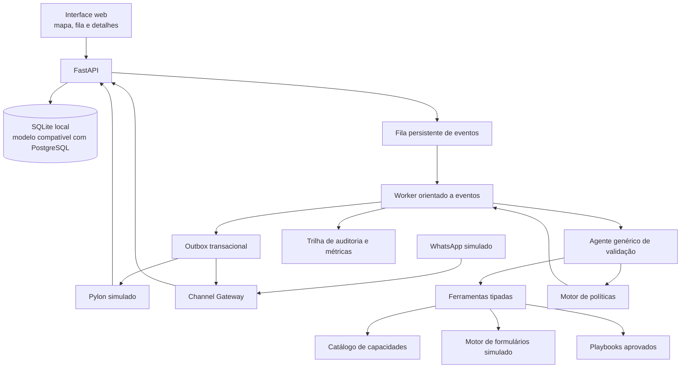

# Aprova Command
## Especificação completa para desenvolvimento do sistema

**Documento destinado a:** agente de IA responsável por projetar, implementar, testar e documentar o sistema.  
**Objetivo do documento:** servir como especificação autocontida de produto, arquitetura, dados, integrações simuladas, comportamento agêntico, interface, testes e aceite.  
**Contexto:** hackathon GovTech da Aprova.  
**Idioma do produto e da documentação:** português do Brasil.  
**Nome provisório:** Aprova Command.

**Revisão:** 1.1 — 24/10/2026. Contratos e critérios de prontidão revisados; implementação ainda não verificada.

## Como usar este plano e o que está aprovado

Este documento é a fonte normativa do Aprova Command. A pesquisa competitiva da mesma pasta é contexto histórico: o recorte anterior RegraClara, seus prazos e sua stack não substituem estas decisões. O objetivo corresponde ao desafio 2 de `desafios.txt`: reduzir idas e vindas e validar regras de formulários com testes e evidências.

Há três entregas distintas:

| Entrega | Critério | Situação desta revisão |
|---|---|---|
| Início da implementação | Contratos definidos e execução pelas fatias da seção 19 | Pode iniciar pela fatia 1; nenhuma funcionalidade é considerada implementada |
| Demonstração local offline | Cenários A–E, G e H, persistência, políticas e interface verificados sem credenciais | Pendente de código e testes; F deve aparecer como `not_run`, nunca como aprovado |
| Validação de generalização | Cenário F com inferência ao vivo, dados reservados e mesmo prompt-base | Pendente; depende de provedor/modelo configurado e avaliação separada |

**Implantação pública/produção não está aprovada e permanece fora do escopo.** Até a demonstração local exige implementar e verificar os artefatos abaixo. Não confundir escrever um requisito com comprovar seu atendimento. O plano completo é grande para um hackathon de um dia: os marcos são gates, não promessa de concluir tudo até as 17h. Se houver corte de entrega, registrar funcionalidades pendentes explicitamente.

---

# 1. Missão de construção

Construir um sistema web completo, funcional e demonstrável localmente para coordenar a validação de formulários de processos municipais durante implantações da Aprova.

O sistema nasce de um ticket no Pylon. Um processo aberto vira um ticket contendo descrição, vínculo com o formulário e resposta inicial da prefeitura. Essa resposta costuma ser extensa, confusa ou incompleta. O sistema deve interpretar o que a prefeitura deseja, relacionar as intenções às capacidades genéricas do formulário, estruturar alterações possíveis, identificar lacunas e conduzir rodadas assíncronas de validação até que o formulário esteja pronto, aprovado, aplicado e verificado.

Cada processo possui um agente lógico persistente, apresentado visualmente como um **soldado**. O soldado “marcha” sozinho enquanto existirem ações seguras e permitidas. Ele para em estados explícitos quando aguarda resposta, responsável, aprovação ou intervenção humana. O implantador visualiza todos os soldados em um mapa de comando, intervém onde necessário e ordena a retomada.

A experiência visual deve lembrar um mapa medieval de Age of Empires/Warcraft, mas a arquitetura deve ser uma máquina de estados confiável, não um loop autônomo livre.

## Resultado final esperado

Entregar um repositório que permita a um avaliador executar, sem credenciais externas:

1. Abrir um ticket no Pylon simulado.
2. Ler a resposta inicial da prefeitura e acessar o formulário vinculado.
3. Ver o agente interpretar múltiplas intenções e citar suas evidências.
4. Ver o que é suportado, condicionado, ambíguo ou dependente de revisão.
5. Ver o agente gerar automaticamente uma rodada agrupada de esclarecimentos.
6. Enviar a mesma rodada ao Pylon e ao WhatsApp simulado.
7. Responder por qualquer canal, inclusive com texto, áudio, documento ou imagem.
8. Ver as respostas sendo consolidadas sem duplicação ou perda de contexto.
9. Descobrir outro responsável por indicação e transferir somente o assunto necessário.
10. Ver a jornada sendo replanejada com base nas novas evidências.
11. Ver alterações propostas no formulário com diff e evidências.
12. Intervir em um caso que exige decisão humana e retomar a marcha.
13. Aprovar pela prefeitura e pela Aprova a mesma versão.
14. Aplicar a versão no motor simulado e executar read-back.
15. Encerrar o ticket somente após a verificação.
16. Visualizar tudo no mapa, na linha do tempo e nas métricas.

# 2. Princípios obrigatórios

## 2.1 Configuração zero de instruções por formulário

Não é permitido exigir prompt, roteiro, lista de perguntas ou instruções específicas para cada formulário ou processo.

O mesmo código, o mesmo prompt-base e as mesmas ferramentas devem funcionar para formulários diferentes. O comportamento específico deve derivar somente de dados lidos em tempo de execução:

- Schema e conteúdo do formulário.
- Template de origem.
- Resposta inicial da prefeitura.
- Documentos e mensagens recebidas.
- Catálogo genérico de capacidades do produto.
- Playbooks genéricos aprovados.
- Responsáveis e permissões.
- Estado das lacunas, alterações e aprovações.

É permitido cadastrar dados operacionais de município, processo, ticket, formulário e contatos. Isso não é configuração de instruções.

**Teste eliminatório da alegação de generalização:** adicionar um formulário nunca visto, sem alterar código nem prompts, e conduzir sua triagem e primeira rodada com inferência ao vivo. Replay comprova apenas os fluxos conhecidos; não satisfaz este teste. Sem credenciais, a demo operacional pode funcionar, mas o cenário F fica `not_run` e a generalização permanece não comprovada.

## 2.2 Rodadas completas, não perguntas isoladas

O agente não deve perguntar apenas o próximo item de uma fila. A cada rodada, ele deve responder:

> Qual é a próxima etapa desbloqueável e qual é o pacote mínimo, completo e legível de esclarecimentos que permite alcançá-la sem abrir rodadas previsíveis?

A rodada deve:

- Explicar o que já foi compreendido.
- Agrupar dúvidas por assunto e responsável.
- Cobrir lacunas da próxima etapa.
- Antecipar dependências que já podem ser respondidas.
- Remover perguntas respondidas por evidências anteriores.
- Evitar assuntos independentes que tornariam a mensagem confusa.
- Solicitar indicação de responsável quando necessário.
- Informar qual resultado a resposta viabilizará.

Rodadas posteriores contêm somente o **delta**, sem repetir desnecessariamente perguntas ou contexto já consolidado.

## 2.3 Um único caso, vários canais

Pylon e WhatsApp são canais da mesma validação. Não podem gerar jornadas independentes.

A primeira rodada pode ser enviada simultaneamente ao Pylon e ao WhatsApp. As respostas são consolidadas pelo mesmo `round_id` e pelo mesmo `case_id`.

A corrida entre canais termina quando chega uma **resposta substantiva**, não quando chega qualquer mensagem. Mensagens complementares devem ser combinadas; divergências devem ser identificadas e escaladas ou esclarecidas.

## 2.4 IA propõe; políticas e código decidem o que pode executar

O LLM interpreta, resume, relaciona evidências e propõe ações estruturadas. O backend determina:

- Permissões.
- Transições de estado.
- Dependências.
- Versionamento.
- Aprovações.
- Idempotência.
- Envio ou bloqueio de mensagens.
- Aplicação de alterações.
- Encerramento do caso.

O agente nunca aprova pela prefeitura, nunca aprova pela Aprova e nunca altera diretamente o formulário vigente.

## 2.5 Persistência fora do prompt

Nenhum estado essencial pode existir apenas no histórico do modelo. Reiniciar o servidor deve preservar:

- Estado do caso.
- Rodadas e pendências.
- Responsáveis.
- Mensagens e evidências.
- Versões do formulário.
- Alterações propostas.
- Intervenções.
- Aprovações.
- Próximas ações e prazos.

## 2.6 Evidência antes de interpretação

Toda mensagem ou anexo deve ser persistido antes da análise. Toda interpretação deve apontar para mensagens, trechos ou documentos de origem. Citações devem ser verificáveis na interface.

## 2.7 Simulação honesta

Pylon, WhatsApp, motor de formulários e dados municipais são simulados no hackathon. A interface deve mostrar uma etiqueta discreta, mas visível: **“Ambiente de demonstração — dados sintéticos”**.

O modo `offline_replay` deve ser identificado como replay. Não pode ser apresentado como inferência ao vivo nem como prova de generalização.

# 3. Escopo funcional completo

## 3.1 Municípios e implantações

- Cadastrar municípios sintéticos.
- Associar implantações, processos e responsáveis.
- Suportar duas prefeituras na demonstração.
- Exibir 70 processos por implantação para demonstrar escala visual.
- Pelo menos seis processos devem servir de referência interativa, cobrindo A–E, G e H; um processo pode exercitar mais de um cenário. O cenário F usa formulário reservado, separado do seed e do replay.
- Os demais processos podem ser semeados a partir de templates genéricos. Todos usam a mesma entrada de fluxo; em replay, entradas não cobertas param com erro explícito e possibilidade de intervenção, sem inventar análise.
- Processos apenas semeados não podem inflar métricas de sucesso ou autonomia.

## 3.2 Tickets e Pylon simulado

O simulador deve oferecer:

- Lista e detalhe de tickets.
- Município e processo.
- Descrição.
- Link para o formulário.
- Resposta inicial da prefeitura.
- Comentários públicos e notas internas.
- Anexos.
- Estado do ticket.
- Histórico de eventos.
- Reabertura por nova resposta.
- Associação ao caso de validação.
- Encerramento somente pelo fluxo autorizado.

Não reproduzir funcionalidades irrelevantes do Pylon real.

## 3.3 Interpretação da resposta inicial

Para cada ticket, gerar um **dossiê inicial** contendo:

- Resumo executivo fiel.
- Versão-base do formulário.
- Lista de intenções de alteração.
- Citação literal de cada intenção.
- Clareza da intenção.
- Viabilidade segundo o catálogo.
- Informações ausentes.
- Riscos.
- Responsável provável.
- Próxima ação proposta.
- Documentos recebidos e diferenças identificadas.
- Necessidade de consultoria ou intervenção.

O sistema deve separar múltiplos assuntos presentes na mesma frase ou parágrafo.

## 3.4 Clareza e viabilidade independentes

Cada `ChangeRequest` deve possuir:

```text
clarity = clear | partial | ambiguous | unknown
feasibility = supported | supported_with_conditions |
              requires_product_review | unsupported | unknown
risk = low | medium | high
next_action = propose_change | clarify | find_owner |
              escalate | reject | wait
```

`unknown` nunca pode ser convertido automaticamente em `unsupported`.

## 3.5 Catálogo genérico de capacidades

Criar um catálogo versionado, legível pelo agente, com operações genéricas e seus requisitos.

Exemplo:

```json
{
  "operation": "add_conditional_attachment",
  "availability": "supported_with_conditions",
  "required_inputs": [
    "document_type",
    "condition",
    "required",
    "accepted_formats",
    "applicability"
  ],
  "constraints": [
    "condition_must_reference_known_fields"
  ],
  "approval_required": true,
  "auto_apply_allowed": false
}
```

Incluir pelo menos:

- Renomear rótulo.
- Alterar texto de ajuda.
- Adicionar campo de texto.
- Adicionar campo numérico.
- Adicionar campo de seleção.
- Alterar opções.
- Alterar obrigatoriedade.
- Adicionar anexo.
- Adicionar anexo condicional.
- Adicionar validação entre campos.
- Remover ou desativar campo.
- Alterar seção.
- Solicitar nova etapa ou fluxo.
- Alterar regra de negócio.

O catálogo deve distinguir o que é suportado no simulador, o que exige revisão de produto e o que permanece desconhecido. Não inventar capacidades da Aprova real.

## 3.6 Planejador de rodadas

O planejador deve operar sobre lacunas, não sobre perguntas fixas.

Entradas:

- Estado atual do formulário.
- ChangeRequests.
- Lacunas abertas.
- Dependências.
- Evidências já recebidas.
- Responsáveis.
- Histórico de rodadas.
- Canal preferido.
- Intervenções e decisões humanas.

Saída:

- Objetivo da rodada.
- Próxima etapa que será desbloqueada.
- Itens agrupados.
- Responsável ou papel necessário.
- Critérios de completude.
- Canais de envio.
- Texto para Pylon.
- Mensagens para WhatsApp.
- Justificativa interna do agrupamento.

Regras:

1. Priorizar lacunas bloqueantes da próxima versão ou decisão.
2. Agrupar por responsável e coerência de assunto.
3. Antecipar perguntas dependentes previsíveis.
4. Não repetir conteúdo já respondido.
5. Não criar uma mensagem por pergunta.
6. Usar numeração e linguagem simples.
7. Se necessário, dividir uma mensagem longa de WhatsApp em partes sequenciais do mesmo pacote.
8. Não sobrecarregar um responsável com assunto de outro setor.
9. Criar descoberta de responsável quando faltar autoridade ou conhecimento.
10. Registrar a versão do plano e o motivo de cada mudança.

## 3.7 Gestão de lacunas

Cada solicitação deve manter uma lista explícita de lacunas:

```text
gap_id
change_request_id
field_or_decision
description
blocking
status = open | answered | obsolete | disputed
answered_by_evidence_ids
required_role
created_at
resolved_at
```

Uma resposta pode resolver várias lacunas. Um documento pode responder perguntas de mais de uma rodada. O agente deve reavaliar todas as lacunas abertas após cada evidência, sem alterar históricos.

## 3.8 Responsáveis e descoberta de contatos

Papéis mínimos:

- Responsável central da prefeitura.
- Responsável pelo processo.
- Responsável técnico/setorial.
- Contato indicado.
- Aprovador municipal.
- Implantador.
- Aprovador da Aprova.

Funcionalidades:

- Identificar lacunas de responsável.
- Solicitar nome, setor, contato ou apresentação.
- Registrar quem indicou e para qual assunto.
- Transferir somente os itens necessários.
- Criar rodada específica para o novo contato.
- Receber resposta e devolver a evidência ao item original.
- Retomar automaticamente a etapa desbloqueada.
- Evitar contatos duplicados.
- Permitir mesclar contatos após confirmação.
- Distinguir capacidade de responder da capacidade de aprovar.

No simulador, a autorização de contato pode ser registrada por um botão ou evento explícito. Receber um número não deve, por si só, representar autorização irrestrita.

## 3.9 Canais e estratégia multicanal

Criar interface `ChannelAdapter` com implementações:

- `PylonSimulatorAdapter`.
- `WhatsAppSimulatorAdapter`.
- `ManualInboxAdapter`, opcional.

Eventos normalizados:

```text
MessageReceived
MessageSent
MessageFailed
AttachmentReceived
DeliveryConfirmed
ContactAuthorized
ChannelPreferred
```

Política inicial:

1. Primeira rodada: Pylon + WhatsApp, se ambos autorizados.
2. Compartilhar `round_id` e conteúdo semanticamente equivalente.
3. Aguardar resposta substantiva em qualquer canal.
4. Após resposta útil, definir canal principal.
5. Usar o outro canal como fallback ou sincronização de estado, sem repetir todas as perguntas.
6. Se ambos responderem, consolidar.
7. Se houver divergência, criar lacuna `disputed` ou intervenção.
8. Follow-up somente no canal principal, salvo política de fallback.
9. Respeitar preferência explícita do contato.

Uma resposta substantiva contém informação que altera ao menos uma lacuna, solicitação, evidência, responsável ou decisão. “Ok”, “depois vejo” ou confirmação de recebimento não encerra a espera.

## 3.10 Simulador de WhatsApp

Interface de chat que permita ao demonstrador:

- Alternar entre contatos.
- Responder como pessoas diferentes.
- Enviar texto.
- Enviar áudio simulado.
- Enviar documento.
- Enviar imagem.
- Indicar outro responsável.
- Autorizar contato no cenário simulado.
- Simular atraso.
- Simular ausência de resposta.
- Simular mensagem duplicada.
- Simular resposta fora de ordem.
- Simular falha de envio.
- Visualizar mensagens enviadas pelo agente.
- Ver o município e processo associados.

Não usar API oficial ou não oficial do WhatsApp. Não realizar automação de navegador. Não pedir números reais ou credenciais.

## 3.11 Áudios, documentos e imagens

Implementar pipeline de anexos:

1. Persistir arquivo e metadados.
2. Calcular hash.
3. Associar ao caso e à mensagem.
4. Processar por adaptador.
5. Registrar transcrição/extração como artefato derivado.
6. Permitir visualizar origem e resultado.
7. Interpretar lacunas e alterações.
8. Manter confiança e necessidade de revisão quando aplicável.

No modo sem credenciais, áudios e imagens podem usar arquivos auxiliares de transcrição/OCR claramente identificados como **simulados**. Não apresentar esses arquivos como transcrição automática real.

Texto, Markdown e JSON devem ser lidos nativamente. PDF com texto pode ser processado por biblioteca local se isso não comprometer o prazo; PDF digitalizado e OCR genérico ficam fora do escopo obrigatório.

## 3.12 Alterações de formulário

Nenhuma alteração direta no formulário vigente.

Fluxo obrigatório:

```text
ChangeRequest → operação compatível → FormChangeSet → validação →
preview/diff → aprovações → aplicação → read-back → conclusão
```

Cada ChangeSet contém:

- Versão-base.
- Operações.
- ChangeRequests de origem.
- Evidências.
- Campos afetados.
- Condições e dependências.
- Riscos e conflitos.
- Testes necessários.
- Estado de aprovação.
- Resultado da aplicação e read-back.

Validações determinísticas mínimas:

- Campos referenciados existem ou serão criados.
- Tipos são válidos.
- Opções são válidas.
- Condições são executáveis.
- Não há referência circular.
- Não há duplicidade indevida.
- Anexos condicionais possuem condição completa.
- Operações são compatíveis com a versão-base.
- Toda alteração possui evidência ou decisão humana.
- ChangeSet não contém operação fora do catálogo.

## 3.13 Intervenção humana

Criar fila operacional com motivo, urgência e contexto.

Intervir quando houver:

- Pedido de consultoria fora de playbook aprovado.
- Conflito entre respostas ou documentos.
- Divergência entre responsáveis.
- Alteração de alto risco.
- Viabilidade `requires_product_review` ou `unknown`.
- Falha repetida de interpretação.
- Baixa confiança em evidência essencial.
- Três rodadas substantivas consecutivas sem reduzir lacunas bloqueantes (não contar lembretes ou retransmissões).
- Ausência prolongada de responsável.
- Pedido para aprovar fora do fluxo.
- Conteúdo sensível ou contato não autorizado.
- Prompt injection ou instrução suspeita em anexo.
- Falha de aplicação ou read-back.

A intervenção deve mostrar:

- Resumo.
- Motivo estruturado.
- Pergunta ou decisão necessária.
- Evidências.
- Diff relacionado.
- Sugestão do agente.
- Histórico relevante.

Ações humanas:

- Assumir conversa.
- Responder ao agente.
- Editar interpretação.
- Editar ChangeSet.
- Reatribuir responsável.
- Resolver conflito.
- Pausar.
- Rejeitar proposta.
- Desbloquear e retomar.

## 3.14 Aprovações e encerramento

A conclusão exige, nesta ordem:

1. Nenhuma lacuna bloqueante aberta.
2. ChangeSet válido.
3. Preview disponível.
4. Aprovação municipal da versão exata.
5. Aprovação da Aprova da mesma versão.
6. Aplicação no motor simulado.
7. Read-back e comparação sem divergência.
8. Registro de nota interna no ticket.
9. Encerramento do ticket.
10. Soldado em `COMPLETED`.

Qualquer edição do conteúdo candidato ou dos testes de aceite após aprovação cria nova revisão e invalida ambas as aprovações. Nova evidência que contradiga requisito aprovado também invalida ambas e bloqueia a aplicação. Notas administrativas que não alterem requisitos, conteúdo ou testes não invalidam. Não permitir concluir se a versão aplicada divergir da aprovada.

## 3.15 Contrato executável do formulário e testes de regra

O simulador aceita `schema_version=1`, IDs estáveis de seção/campo/opção e tipos `text`, `number`, `select`, `attachment`. Rótulos são apresentação, nunca identidade. Campos têm `id`, `section_id`, `type`, `label`, `help_text`, `required`, `active`; opções usam `{id,label}`. Anexos declaram `accepted_formats` e `max_size_bytes`. Limites iniciais: 100 campos e 50 regras por formulário.

Exemplo mínimo de conteúdo candidato (versão/hash são metadados externos ao conteúdo):

```json
{
  "schema_version": 1,
  "sections": [{"id": "atividade", "label": "Atividade"}],
  "fields": [
    {"id": "ramo", "section_id": "atividade", "type": "select", "label": "Ramo", "help_text": "", "required": true, "active": true, "options": [{"id": "alimentacao", "label": "Alimentação"}, {"id": "outro", "label": "Outro"}]},
    {"id": "licenca", "section_id": "atividade", "type": "attachment", "label": "Licença", "help_text": "", "required": false, "active": true, "accepted_formats": ["application/pdf"], "max_size_bytes": 10485760}
  ],
  "rules": [{"id": "exigir_licenca", "when": {"op": "eq", "field_id": "ramo", "value": "alimentacao"}, "effect": {"op": "require", "field_id": "licenca"}}]
}
```

- Condições usam AST tipada: `eq`, `neq`, `in`, `gt`, `gte`, `lt`, `lte`, `exists`, `and`, `or`, `not`. Comparações aceitam literal tipado OU `other_field_id`, nunca ambos. Sem coerção entre texto/número e sem `eval`, Python, JavaScript, SQL, regex arbitrária ou URLs executáveis. Profundidade máxima 8 e 100 nós por regra.
- Campo ausente/nulo torna comparações falsas, inclusive `neq`; `exists` retorna falso. `and`/`or` exigem ao menos um argumento; `not` nega uma condição. Campo inativo não aceita entrada nem referências. Validar tipos antes de executar regras. Efeitos permitidos: `require` e `reject` com código/mensagem; nenhuma regra altera valores. Semântica única no backend, usada no preview e nos testes.
- Operações são uma união discriminada por `op`: `rename_label`, `set_help`, `add_field`, `set_options`, `set_required`, `add_attachment`, `add_conditional_attachment`, `add_validation`, `deactivate_field`, `add_section`, `move_field`. Cada payload tem schema fechado, alvos por ID e `evidence_ids` ou `human_decision_id`. `add_conditional_attachment` cria campo e regra atomicamente. Nova etapa/fluxo e regra de negócio fora dessa AST são `requires_product_review`; exclusão física é `unsupported` no simulador, oferecendo desativação. A interface deve explicar essas fronteiras.
- Aplicar operações em ordem sobre cópia da versão-base; validar o resultado inteiro antes de persistir. Remover opção/seção/campo referenciado falha até ajustar as dependências no mesmo ChangeSet. Sem aplicação parcial. Os schemas Pydantic e exemplos válidos/inválidos de cada operação são entregáveis da fatia 1.
- Cada regra nova/alterada exige casos positivos, negativos e de limite quando aplicáveis; uma alteração simples de rótulo exige comparação do resultado esperado. `FormTestCase` contém entradas, resultado esperado, vínculo com requisito/evidência e revisão. O humano revisa os resultados esperados: testes sugeridos pelo mesmo LLM não constituem validação independente.
- Executar esses testes sobre a candidata **antes** da aprovação e novamente após read-back. Registrar `FormTestRun` com hash da candidata, revisão/hash da suíte, resultados e executor. Aprovação bloqueada se faltar cobertura obrigatória ou houver falha. Read-back prova persistência; os testes comprovam comportamento apenas no recorte exercitado.

## 3.16 Versões, aprovação e aplicação recuperável

`FormVersion` candidata é imutável. Calcular SHA-256 do JSON UTF-8 normalizado pelo schema, com chaves ordenadas, separadores compactos, arrays em ordem preservada e números finitos normalizados pelo backend; excluir somente metadados explicitamente externos ao schema. Persistir os bytes canônicos para comparação. Preview, diff, testes e aprovação apontam para o mesmo snapshot.

Cada aprovação vincula `{case_id, cycle_number, change_set_id, base_form_version_id, candidate_version_id, candidate_hash, test_suite_hash, test_run_id}` e ator/papel. Dois atores sintéticos distintos devem exercer os papéis municipal e Aprova; texto no chat e clique sem papel não aprovam. A segunda aprovação depende da primeira ainda válida. Rejeição registra justificativa e abre intervenção; revisão exige nova dupla aprovação. Revogação antes de aplicar suspende o fluxo; após aplicar abre intervenção para correção, sem apagar a decisão anterior.

Na aplicação, conferir novamente permissões, lacunas, intervenções abertas, evidências recebidas ainda não processadas, aprovações, suíte e versão vigente. Atualizar o ponteiro vigente do motor simulado por comparação atômica com a versão-base esperada. Se mudou, retornar `BASE_VERSION_CONFLICT`, replanejar e obter novas aprovações; nunca sobrescrever silenciosamente. Persistir recibo único de aplicação por ChangeSet. Repetir a operação após timeout consulta/reutiliza o recibo.

Read-back deve ler o armazenamento do motor, sem reutilizar a candidata em memória; comparar hash e executar testes. Divergência gera intervenção, mantém ticket aberto e proíbe rollback automático. Correção exige nova versão aprovada. Nota interna e fechamento são efeitos idempotentes ordenados; se falharem, retentar apenas o efeito pendente, sem reaplicar. Antes do fechamento, revalidar atomicamente versão vigente, recibo de verificação, aprovações e ausência de evidências/intervenções pendentes; mudança desde a verificação bloqueia fechar. `COMPLETED` exige recibos de aplicação, verificação, nota e fechamento.

Um caso sem alterações usa ChangeSet vazio e snapshot de conteúdo idêntico, com teste de identidade, dupla confirmação e read-back. Todas as solicitações devem ter disposição explícita (`accepted`, `rejected` ou `withdrawn`) e justificativa; eliminar lacunas ou rejeitar pedidos não pode fabricar conclusão automática.

# 4. Máquina de estados

## 4.1 Estados principais

```text
DRAFT
INTAKE
UNDERSTANDING_FORM
ANALYZING_INITIAL_REPLY
BUILDING_ROUND
ROUND_READY
SENDING_ROUND
WAITING_ANY_CHANNEL
WAITING_PRIMARY_CHANNEL
PROCESSING_REPLY
RECONCILING_RESPONSES
WAITING_OWNER
WAITING_REFERRAL
CHANGES_READY
BLOCKED_HUMAN
READY_FOR_APPROVAL
WAITING_MUNICIPAL_APPROVAL
WAITING_IMPLANTER_APPROVAL
APPLYING
VERIFYING
PAUSED
FAILED_RETRYABLE
FAILED_PERMANENT
COMPLETED
```

## 4.2 Regras de transição

- Toda transição é validada no backend.
- Toda transição gera evento de auditoria.
- Não pular estados de aprovação.
- `WAITING_*` não é erro nem intervenção por si só.
- `BLOCKED_HUMAN` sempre possui motivo e responsável.
- `FAILED_RETRYABLE` possui próxima tentativa e limite.
- `COMPLETED` é terminal para aquele ciclo; nova solicitação pode reabrir o ticket e criar outro caso/ciclo, preservando o anterior.
- Um evento duplicado não executa efeitos novamente.

## 4.3 Agentes orientados a eventos

O soldado é uma entidade lógica persistente. Não manter um loop de LLM rodando continuamente.

Ele é acionado por:

- Ticket criado ou atualizado.
- Mensagem recebida.
- Anexo processado.
- Prazo atingido.
- Responsável autorizado.
- Decisão humana.
- Aprovação recebida.
- Falha resolvida.
- Retry agendado.

Cada despertar executa um número limitado de ações e persiste o próximo estado.

## 4.4 Transições, precedência e recuperação

Implementar tabela declarativa `estado + evento + guarda → destino + efeitos`. Qualquer combinação não registrada retorna `INVALID_TRANSITION`, sem efeitos. Estados de trabalho transitórios devem persistir job/ação que permita retomada. A tabela abaixo define os caminhos; a fatia 1 deve convertê-la em testes parametrizados para cada aresta e para tentativas de bypass.

| Origem | Evento/guarda | Destino e efeito |
|---|---|---|
| `DRAFT` | Iniciar ticket válido | `INTAKE`, fixar versão-base |
| `INTAKE` | Ticket persistido e referência de formulário válida | `UNDERSTANDING_FORM` |
| `UNDERSTANDING_FORM` | Schema persistido e validado | `ANALYZING_INITIAL_REPLY` |
| `ANALYZING_INITIAL_REPLY` | Dossiê validado | `BUILDING_ROUND` se há lacunas respondíveis; `CHANGES_READY` se completo; `WAITING_OWNER` se falta responsável; `BLOCKED_HUMAN` se decisão exigida |
| `BUILDING_ROUND` | Plano válido, destinatário autorizado e escopo definido | `ROUND_READY` |
| `ROUND_READY` | Política permite envio | `SENDING_ROUND`, gravar entregas na outbox |
| `SENDING_ROUND` | Ao menos um canal confirmou entrega | `WAITING_ANY_CHANNEL` na primeira rodada; `WAITING_PRIMARY_CHANNEL` nas seguintes; falha do outro canal continua registrada |
| `WAITING_ANY_CHANNEL`, `WAITING_PRIMARY_CHANNEL` | Mensagem correlacionada | `PROCESSING_REPLY`; simples recebimento não satisfaz lacunas nem cancela prazo |
| `PROCESSING_REPLY` | Evidências validadas | `RECONCILING_RESPONSES` |
| `RECONCILING_RESPONSES` | Sem conflito | `CHANGES_READY`, `BUILDING_ROUND` ou volta à espera da rodada incompleta; conflito abre lacuna `disputed` e `BLOCKED_HUMAN` |
| `WAITING_OWNER` | Solicitar indicação | `WAITING_REFERRAL`, enviar apenas pedido de responsável |
| `WAITING_REFERRAL` | Contato identificado, autorizado e com papel/escopo | `BUILDING_ROUND`; indicação não autorizada mantém espera |
| `CHANGES_READY` | Candidata, diff e testes válidos; sem bloqueios | `READY_FOR_APPROVAL` |
| `READY_FOR_APPROVAL` | Pedido municipal registrado | `WAITING_MUNICIPAL_APPROVAL` |
| `WAITING_MUNICIPAL_APPROVAL` | Aprovação municipal válida | `WAITING_IMPLANTER_APPROVAL` |
| `WAITING_IMPLANTER_APPROVAL` | Aprovação Aprova válida | `APPLYING`, guardas da seção 3.16 rechecadas na transação |
| `APPLYING` | Recibo de aplicação persistido | `VERIFYING` |
| `VERIFYING` | Read-back/testes/nota/fechamento confirmados | `COMPLETED` |
| Qualquer estado ativo anterior à aplicação | Rejeição, revogação ou evidência material nova | Invalidar aprovações; `PROCESSING_REPLY` para evidência, `BLOCKED_HUMAN` para decisão |
| Estado ativo não terminal | Pausa ou assumir conversa | `PAUSED` com `resume_state`; suspender novos envios e trabalhos autônomos |
| `PAUSED`, `BLOCKED_HUMAN` | Retomar/resolver autorizado | Revalidar guardas e pendências; voltar a estado seguro calculado, não a destino escolhido pelo cliente |
| Estado de trabalho | Erro transitório | `FAILED_RETRYABLE`, com ação, destino seguro, prazo e tentativas |
| `FAILED_RETRYABLE` | Prazo atingido e limite disponível | Retentar a mesma ação idempotente; se limite excedido, `BLOCKED_HUMAN` |
| Estado ativo | Erro de integridade não recuperável | `FAILED_PERMANENT`, intervenção e diagnóstico; reprocessar somente por decisão humana após correção |
| `FAILED_PERMANENT` | Correção comprovada e reprocessamento autorizado por decisão humana | `BLOCKED_HUMAN` para revalidar pendências e escolher retomada segura; nunca repetir efeito sem consultar recibos |
| `COMPLETED` | Nova solicitação substantiva confirmada | Preservar ciclo concluído e criar outro `ValidationCase` em `INTAKE`; recibo/agradecimento não reabre |

Precedência: pausa/intervenção e evidência pendente bloqueiam novos efeitos; divergência e revogação bloqueiam aprovação/aplicação; trabalho de consolidação precede geração de nova rodada. Recebimentos são sempre persistidos, inclusive em pausa, falha ou conclusão. Anexos pendentes bloqueiam aprovação até processamento ou decisão humana fundamentada sobre sua irrelevância. Resposta que chega durante a aplicação é serializada: se entrou antes do commit, impede aplicar; se entrou depois, impede fechamento e abre intervenção de correção. Não desfazer efeito já confirmado.

Pausa durante efeito em curso não promete cancelamento retroativo: registrar recibo e checkpoint, suspender o próximo efeito e informar isso na UI. `FAILED_PERMANENT` não descarta mensagens. Resolver intervenção não equivale a aprovar nem remove automaticamente outras intervenções abertas.

## 4.5 Rodadas, correlação e prazos

- Para simplificar o MVP, permitir **uma rodada ativa por caso**, destinada a um contato/papel e escopo. Assuntos de outros responsáveis ficam em rodadas planejadas sequenciais. A mesma rodada pode ter entregas nos dois canais. `current_round_id` é projeção; não identifica automaticamente a rodada de qualquer resposta tardia.
- Guardar `primary_channel` por destinatário no caso; o campo no caso é só resumo da rodada atual. Preferência explícita autorizada prevalece; sem preferência, vence a primeira evidência substantiva validada na ordem de sequência persistida pelo servidor. Outro canal continua recebendo complementos.
- No simulador, escolher conversa e `reply_to_round_id` explicitamente. Se uma mensagem não puder ser correlacionada sem ambiguidade, persistir com `round_id=null` e pedir triagem humana. Nunca associar automaticamente uma mensagem atrasada à rodada mais recente. Validar que mensagem, contato, rodada e caso pertencem ao mesmo escopo.
- Reavaliar lacunas abertas e respostas anteriores contraditas por nova evidência; manter origens e histórico. Uma divergência pode reabrir lacuna respondida. Usar janela de consolidação de 2 segundos após o último recebimento, limitada a 10 segundos desde o primeiro, antes de emitir novo pacote. Isso agrupa rajadas, mas não torna respostas tardias inválidas.
- A primeira resposta útil cancela lembretes ainda não enviados dos canais secundários; não cancela os demais itens da rodada. Rodada só fica `completed` quando todos os itens obrigatórios têm resposta validada ou disposição humana explícita. Rodada `superseded` preserva itens, versões, entregas e evidências.
- Política global da demo: primeiro lembrete após 24 horas sem resposta substantiva, segundo após mais 24 horas e intervenção após mais 24 horas. Resposta parcial reinicia prazo apenas dos itens restantes. Máximo de dois lembretes por rodada, com fallback somente para canal autorizado quando o principal falhar/esgotar tentativas. Esses valores são parâmetros demonstrativos, não SLA real.
- Prazos usam relógio de negócio UTC injetável; o simulador pode avançá-lo. Leases e timeouts técnicos usam relógio real separado. Pausa suspende lembretes; ao retomar recalcular a partir do saldo restante, sem disparar lembretes acumulados. Jobs obsoletos são cancelados antes de enviar.

# 5. Arquitetura técnica obrigatória

## 5.1 Visão geral



## 5.2 Stack

**Backend**

- Python 3.12.
- FastAPI.
- Pydantic v2.
- SQLAlchemy 2.
- SQLite para execução local.
- Migrações com Alembic, incluindo banco vazio → schema atual.
- Worker local usando fila persistida no banco.
- Pytest.

**Frontend**

- React.
- TypeScript.
- Vite.
- CSS com variáveis de tema; Tailwind não é necessário para a primeira entrega.
- SVG/CSS para o mapa; não exigir engine de jogo.
- Testes de componentes quando úteis e Playwright para o fluxo principal.

**Arquivos**

- Diretório local `var/attachments`.
- Metadados e hashes no banco.
- Nenhum bucket externo obrigatório.

**LLM**

- Interface `LLMAdapter`.
- Implementação `OpenAICompatibleAdapter`, opcional por variáveis de ambiente.
- Implementação `OfflineReplayAdapter` para demonstração e testes.
- Structured output validado por Pydantic.
- Nenhuma chave incluída no repositório.

**Restrições**

- Monólito modular, não microsserviços.
- Sem Kubernetes.
- Sem Redis/Celery obrigatórios.
- Sem banco vetorial obrigatório.
- Sem grafo de conhecimento.
- Sem engine de jogo.
- Sem integração externa real no caminho padrão.

## 5.3 Camadas

```text
domain/       entidades, estados, políticas e erros
application/  casos de uso e orquestração
agent/        prompts genéricos, ferramentas, adaptadores e schemas
adapters/     Pylon, WhatsApp, formulários e arquivos
persistence/  modelos, repositórios, migrações e outbox
api/          endpoints e serialização
worker/       consumo de eventos, retries e scheduler
web/          interface React
```

O domínio não pode importar FastAPI, React ou SDK de LLM.

## 5.4 Transações, fila e limites de execução

Usar um processo API e um worker local; fila, inbox, outbox e simuladores no SQLite. Configurar WAL na inicialização, `foreign_keys=ON` em cada conexão, `busy_timeout=5000` e transações curtas explícitas. SQLite serializa escritores; WAL não oferece múltiplos escritores simultâneos. Não manter transação aberta durante chamada LLM, espera de rede ou leitura pesada de anexos. Referências: [isolamento SQLite](https://www.sqlite.org/isolation.html), [foreign keys](https://www.sqlite.org/foreignkeys.html) e [transações SQLAlchemy/SQLite](https://docs.sqlalchemy.org/en/20/dialects/sqlite.html).

1. Recepção: validar envelope e escopo; em uma transação persistir evento único, mensagem/metadados, revisão do caso e job. Confirmar recebimento somente após commit. Repetição de chave com mesmo hash retorna resultado anterior; mesma chave com payload diferente retorna `IDEMPOTENCY_CONFLICT`.
2. Trabalho: adquirir job por atualização condicional atômica (`pending`/lease vencido → `running`, token de lease). Lease de 120 segundos, renovação a cada 30; apenas quem possui o token atual pode concluir. Validar revisão do caso ao persistir saída do agente; resultado obsoleto é descartado e replanejado, nunca sobreposto.
3. Conclusão: gravar propostas, estado, auditoria, novos jobs/outbox e job concluído na mesma transação. Guardas de aplicação e fechamento também conferem a revisão/pendências atuais. API usa concorrência otimista para mutações humanas.
4. Entrega: outbox também usa claim/lease e chave por `{case,cycle,round,revision,recipient,channel,part,kind}`. O simulador receptor possui recibo único pela chave. Se o worker cair depois do efeito e antes do ACK, repetir retorna o recibo anterior. A garantia é entrega com repetição possível e efeito idempotente, não transporte exatamente uma vez.
5. Inicialização recupera leases vencidos, jobs agendados e efeitos sem ACK. Retry transitório: três tentativas totais, esperas de 1 e 5 segundos; erro de validação/permissão não retenta. Quando todos os canais falham, abrir intervenção; sucesso parcial mantém espera no canal entregue e evidencia a falha restante.

Cada despertar executa no máximo 10 ações e duas chamadas LLM; timeout de 30 segundos por chamada, resposta estruturada limitada a 32 KiB. Ao esgotar orçamento com progresso, persistir continuação; sem progresso, abrir intervenção. Erro repetido de schema após uma correção também abre intervenção. Limite inicial de 200 mil caracteres de evidências por análise; excesso exige seleção/segmentação rastreável ou revisão humana, nunca truncamento silencioso. São limites de engenharia da demo a validar na fatia 1, não características prometidas do provedor.

## 5.5 Segurança mínima da demonstração

- Bind API/frontend em `127.0.0.1`; CORS apenas para a origem local documentada. `APP_ENV=demo` obrigatório para troca de persona, reset, seed e avanço de relógio; rejeitar esses controles fora da demo. Ambiente compartilhado exige projeto próprio de autenticação e operação.
- Criar sessão local com ator sintético escolhido no painel da demo e token aleatório; manter atribuições no servidor. O backend deriva papéis da sessão, nunca de `approver_role` enviado pelo cliente. A troca livre de persona é ferramenta do demonstrador, explicitamente visível, e não autenticação produtiva.
- Leitura/escrita valida município, processo, contato e escopo em cada acesso. Aprovador municipal aprova apenas processo atribuído; aprovador Aprova precisa de atribuição explícita. Implantador sem esse papel não aprova. Contato indicado não herda aprovação. Somente operador da demo faz reset/seed. Worker usa contexto de serviço limitado às políticas; LLM nunca recebe token da sessão.
- Upload: máximo 10 MiB por arquivo e 5 anexos por mensagem; allowlist de TXT, MD, JSON, PDF, PNG, JPEG, WAV e MP3, verificando tipo e conteúdo compatível. Sem ZIP, HTML ou SVG ativo. Gerar nome interno aleatório, impedir traversal e manter arquivo fora da raiz pública. Download por ID autorizado; textos como texto escapado, sem HTML de mensagens/modelo. [Referência: OWASP File Upload](https://cheatsheetseries.owasp.org/cheatsheets/File_Upload_Cheat_Sheet.html).
- Persistir upload em staging limitado, calcular hash, promover atomicamente a caminho interno e então registrar metadados/job; se falhar o commit, limpar órfão em manutenção. Arquivo incompleto nunca vira evidência. Sidecar de OCR/transcrição referencia hash do original e recebe etiqueta simulada; ausência de suporte é erro explícito/revisão, não conteúdo vazio considerado válido.
- Anexos e mensagens são dados não confiáveis. Separar instruções e conteúdo, validar toda chamada/saída e escopo de evidências, proibir execução/download de URLs sugeridas pelo modelo. Detecção de prompt injection pode abrir intervenção, mas não substitui autorização determinística; não prometer detectar todo ataque. [Referência: OWASP Prompt Injection](https://cheatsheetseries.owasp.org/cheatsheets/LLM_Prompt_Injection_Prevention_Cheat_Sheet.html).
- Logs incluem IDs, estado anterior/novo, ação, adaptador, latência, tentativas e código de erro, sem chaves nem conteúdo integral desnecessário. Contexto de um município nunca inclui evidências do outro. Não registrar raciocínio privado do modelo; registrar justificativas curtas, fontes e decisões de política.

# 6. Modelo de dados mínimo

Implementar índices, foreign keys e timestamps UTC. IDs podem ser UUID. JSON deve ser validado antes de persistir.

| Entidade | Campos e responsabilidades essenciais |
|---|---|
| `Municipality` | `id`, `name`, `state`, `is_synthetic` |
| `Implementation` | `id`, `municipality_id`, `name`, `status`, `started_at` |
| `ProcessDefinition` | `id`, `implementation_id`, `name`, `code`, `template_id` |
| `FormTemplate` | `id`, `name`, `schema_json`, `version` |
| `FormVersion` | `id`, `process_id`, `version`, `schema_json`, `status`, `base_version_id`, `content_hash` |
| `Ticket` | `id`, `external_key`, `process_id`, `description`, `initial_reply`, `form_url`, `status` |
| `ValidationCase` | `id`, `ticket_id`, `process_id`, `cycle_number`, `previous_case_id`, `soldier_name`, `state`, `resume_state`, `current_round_id`, `primary_channel` (projeção), `version`, `next_action_at` |
| `ChangeRequest` | `id`, `case_id`, `source_quote`, `interpreted_intent`, `clarity`, `feasibility`, `risk`, `status`, `next_action` |
| `EvidenceLink` | `id`, `case_id`, `change_request_id`, `message_id`, `attachment_id`, `derived_artifact_id`, `human_decision_id`, `quote`, `locator`, `source_hash` |
| `Gap` | `id`, `change_request_id`, `description`, `required_input`, `required_role`, `blocking`, `status`, `resolved_by` |
| `ValidationRound` | `id`, `case_id`, `objective`, `status`, `version`, `assigned_role`, `recipient_contact_id`, `scope_json`, `primary_channel`, `completion_criteria_json`, `due_at`, `reminder_count` |
| `RoundItem` | `id`, `round_id`, `gap_id`, `change_request_id`, `sequence`, `status` |
| `Contact` | `id`, `municipality_id`, `name`, `department`, `phone_alias`, `preferred_channel`, `is_synthetic` |
| `RoleAssignment` | `id`, `process_id`, `contact_id`, `role`, `can_answer`, `can_approve`, `scope_json`, `status` |
| `ContactReferral` | `id`, `case_id`, `from_contact_id`, `to_contact_id`, `reason`, `authorized`, `scope_json` |
| `Conversation` | `id`, `case_id`, `contact_id`, `channel`, `external_key` |
| `Message` | `id`, `conversation_id`, `round_id`, `direction`, `body`, `content_type`, `external_key`, `substantive`, `received_at` |
| `Attachment` | `id`, `message_id`, `filename`, `mime_type`, `sha256`, `storage_path`, `processing_status` |
| `DerivedArtifact` | `id`, `attachment_id`, `kind`, `content`, `adapter`, `is_simulated`, `confidence` |
| `FormChangeSet` | `id`, `case_id`, `base_form_version_id`, `operations_json`, `status`, `validation_json`, `result_form_version_id` |
| `Approval` | `id`, `case_id`, `cycle_number`, `change_set_id`, `base_form_version_id`, `form_version_id`, `candidate_hash`, `test_suite_hash`, `test_run_id`, `approver_contact_id`, `approver_role`, `decision`, `rationale`, `created_at`, `invalidated_at`, `invalidation_reason` |
| `Intervention` | `id`, `case_id`, `reason_code`, `summary`, `context_json`, `status`, `assigned_to`, `resolution` |
| `AgentAction` | `id`, `case_id`, `action_type`, `payload_json`, `policy_decision`, `status`, `error_code` |
| `IntegrationEvent` | `id`, `source`, `external_key`, `payload_json`, `processed_at`, `processing_hash` |
| `OutboxMessage` | `id`, `case_id`, `channel`, `round_id`, `payload_json`, `status`, `idempotency_key`, `attempts`, `next_attempt_at` |
| `AuditEvent` | `id`, `case_id`, `actor_type`, `actor_id`, `event_type`, `payload_json`, `created_at` |
| `EvaluationRun` | `id`, `fixture`, `adapter`, `metrics_json`, `evidence_class`, `created_at` |
| `WorkItem` | `id`, `case_id`, `event_id`, `kind`, `payload_json`, `status`, `available_at`, `attempts`, `lease_token`, `lease_expires_at`, `last_error` |
| `HumanDecision` | `id`, `case_id`, `actor_id`, `kind`, `scope_json`, `rationale`, `evidence_ids`, `created_at` |
| `FormTestCase` / `FormTestRun` | Casos/revisões, requisito/evidência, entradas e esperado; execução com candidata/hash, hash da suíte, resultados e data |
| `EffectReceipt` | `id`, `effect_kind`, `idempotency_key`, `case_id`, `change_set_id`, `result_json`, `created_at`; inclui envio, aplicação, verificação, nota e fechamento |

Regras adicionais:

- `external_key` + `source` únicos para idempotência de integração.
- `idempotency_key` único na outbox.
- Aprovação referencia `form_version_id`, não apenas `case_id`.
- Toda decisão automática registra `adapter`, modelo e versão do prompt.
- Não armazenar telefones reais; usar aliases sintéticos.

Adicionar a outbox os campos de destinatário, revisão, parte, lease/token e último erro; adicionar aos eventos `case_id`, `sequence` de recepção no servidor, `occurred_at`, `received_at`, `schema_version`, `correlation_id` e `causation_id`. Horário informado pelo canal não determina sozinho a ordem de execução.

Restrições obrigatórias: um ciclo ativo por ticket; `(ticket_id, cycle_number)` único; uma rodada ativa por caso; `(process_id, version)` único; no máximo um candidato em aprovação por caso. Aprovações históricas são append-only, com invalidação explícita. Índices por `(status, available_at)`, `(case_id, sequence)` e FKs de escopo. O ponteiro de formulário vigente fica no processo/motor, separado da candidata. SQLite deve recusar FK inválida nos testes de integração.

`EvidenceLink` aponta para uma origem verificável: mensagem, artefato extraído ou decisão humana. Para texto, usar offsets `[start,end)` em pontos de código Unicode no texto persistido imutável; `quote` deve coincidir exatamente, sem normalização silenciosa. A UI converte offsets para destacar corretamente acentos e emojis. PDF pode acrescentar página, mas citação é verificada no artefato extraído. Correção de interpretação cria revisão, nunca reescreve a origem. Não deduplicar conteúdo entre casos/contatos apenas por hash; eventos iguais usam chave do provedor, e fontes independentes preservam proveniência.

# 7. Contrato do agente genérico

## 7.1 Responsabilidades do LLM

- Interpretar resposta inicial.
- Separar intenções.
- Relacionar intenções a campos e operações.
- Propor clareza, viabilidade candidata e risco.
- Identificar lacunas.
- Relacionar novas evidências a lacunas abertas.
- Detectar possíveis conflitos.
- Planejar rodadas agrupadas.
- Redigir mensagens claras.
- Propor ChangeSets.
- Preparar resumo de intervenção.

## 7.2 Responsabilidades do backend

- Ler e validar estado.
- Confirmar viabilidade contra catálogo.
- Validar citações e referências.
- Verificar permissões.
- Escolher transições válidas.
- Controlar canais e idempotência.
- Persistir evidências e propostas.
- Executar ChangeSets.
- Validar formulários.
- Controlar aprovações.
- Aplicar e verificar versões.
- Encerrar tickets.
- Calcular métricas.

## 7.3 Ferramentas disponíveis ao agente

Todas tipadas, com permissões mínimas:

```text
get_case_context(case_id)
get_ticket(ticket_id)
get_form_schema(form_version_id)
get_form_diff(base_version_id, candidate_version_id)
list_form_capabilities()
get_capability_requirements(operation)
list_change_requests(case_id)
list_open_gaps(case_id)
list_rounds(case_id)
list_contacts(process_id, role?, scope?)
get_relevant_playbook(topic, context)
list_evidence(case_id)
get_attachment_artifact(attachment_id)
propose_change_requests(case_id, requests)
propose_gap_updates(case_id, updates)
propose_round(case_id, plan)
propose_change_set(case_id, change_set)
request_intervention(case_id, reason, context)
mark_no_safe_action(case_id, reason)
```

O agente não possui ferramentas para:

- Alterar banco diretamente.
- Enviar mensagem sem outbox/política.
- Aprovar.
- Aplicar formulário.
- Encerrar ticket.
- Alterar gold, testes ou critérios de aceite.
- Autorizar contato.
- Mudar permissões.

## 7.4 Ações internas

```text
ANALYZE_INITIAL_REPLY
PLAN_ROUND
SEND_ROUND
PROCESS_EVIDENCE
RECONCILE_CHANNELS
PROPOSE_CHANGE_SET
FIND_OWNER
TRANSFER_SCOPE
ESCALATE_TO_HUMAN
WAIT
REQUEST_MUNICIPAL_APPROVAL
REQUEST_IMPLANTER_APPROVAL
APPLY_APPROVED_CHANGE_SET
VERIFY_APPLIED_FORM
COMPLETE_CASE
```

Ações de escrita sempre passam pelo motor de políticas.

## 7.5 Envelope das propostas

Toda resposta do adaptador tem `schema_version`, `case_id`, `expected_case_version`, `action_type` e `payload` tipado pela ação. O backend acrescenta `adapter`, `model`, `prompt_version`, `catalog_version`, `input_hash`, `request_id` e resultado de validação; metadados declarados pelo próprio modelo não são autoridade. `extra=forbid`, limites de tamanho/quantidade e referências válidas fazem parte do contrato Pydantic. Confiança declarada pelo modelo é informação auxiliar, não permissão para executar.

O adaptador recebe somente ferramentas e evidências do caso autorizado. Uma proposta com qualquer referência inválida não produz efeitos parciais; registrar rejeição e seguir a política limitada de correção/intervenção. Replay passa pelo mesmo validador de saída e pelas mesmas políticas. Formatos específicos de structured output do provedor são responsabilidade do adaptador, sem alterar domínio nem aceitar JSON inválido como sucesso.

# 8. Política de autonomia

| Ação | Autonomia inicial |
|---|---|
| Interpretar e resumir | Automática como proposta |
| Registrar evidência | Automática |
| Atualizar lacuna com evidência clara | Automática, auditável |
| Enviar rodada de baixo risco | Automática no simulador |
| Enviar follow-up dentro da política | Automática |
| Solicitar apresentação de responsável | Automática no simulador |
| Transferir escopo para contato autorizado | Automática |
| Replanejar rodada | Automática e versionada |
| Criar ChangeSet | Automática como proposta |
| Alterar formulário vigente | Nunca sem aprovação |
| Declarar capacidade desconhecida como inviável | Proibido |
| Responder consultoria fora de playbook | Humano |
| Resolver conflito institucional/jurídico | Humano |
| Aprovar pela prefeitura | Pessoa autorizada |
| Aprovar pela Aprova | Pessoa com papel explícito de aprovador Aprova no processo |
| Aplicar versão | Automática somente após dupla aprovação |
| Encerrar ticket | Automática somente após read-back válido |

# 9. API mínima

## 9.1 Saúde e demo

```text
GET  /api/health
POST /api/demo/reset
POST /api/demo/seed
GET  /api/demo/scenarios
POST /api/demo/scenarios/{scenario_id}/start
GET  /api/demo/runtime
```

`runtime` deve informar modo de IA, simuladores ativos e versão do seed.

## 9.2 Municípios, processos e mapa

```text
GET /api/municipalities
GET /api/implementations/{id}
GET /api/processes
GET /api/processes/{id}
GET /api/command/map
GET /api/command/interventions
GET /api/command/metrics
```

## 9.3 Tickets e casos

```text
GET  /api/tickets
GET  /api/tickets/{id}
POST /api/tickets
POST /api/tickets/{id}/comments
POST /api/tickets/{id}/attachments
POST /api/tickets/{id}/close
POST /api/cases/from-ticket/{ticket_id}
GET  /api/cases/{id}
GET  /api/cases/{id}/timeline
GET  /api/cases/{id}/dossier
GET  /api/cases/{id}/gaps
GET  /api/cases/{id}/rounds
POST /api/cases/{id}/wake
POST /api/cases/{id}/pause
POST /api/cases/{id}/resume
```

## 9.4 Canal e responsáveis

```text
GET  /api/cases/{id}/conversations
POST /api/conversations/{id}/messages
POST /api/conversations/{id}/attachments
POST /api/cases/{id}/referrals
POST /api/contacts/{id}/authorize
POST /api/contacts/{id}/preferred-channel
GET  /api/contacts/{id}/conversations
```

## 9.5 Formulários e aprovações

```text
GET  /api/forms/{version_id}
GET  /api/forms/{version_id}/preview
GET  /api/cases/{id}/change-requests
GET  /api/cases/{id}/change-sets
POST /api/cases/{id}/change-sets/{change_set_id}/validate
GET  /api/change-sets/{id}/diff
POST /api/change-sets/{id}/municipal-approval
POST /api/change-sets/{id}/implanter-approval
POST /api/change-sets/{id}/apply
POST /api/change-sets/{id}/verify
POST /api/change-sets/{id}/tests/run
GET  /api/change-sets/{id}/tests
```

## 9.6 Intervenções e avaliação

```text
GET  /api/interventions
GET  /api/interventions/{id}
POST /api/interventions/{id}/resolve
POST /api/interventions/{id}/take-over
POST /api/evaluations/run
GET  /api/evaluations/{id}
```

## 9.7 Contrato HTTP e comandos humanos

- Toda mutação recebe `Idempotency-Key`; operações sobre caso existente também recebem `expected_case_version`. A chave é única por `(actor_or_service, operation, resource, idempotency_key)` e compara payload normalizado. Validar identidade, permissão e escopo antes de consultar o resultado anterior; mesma chave/mesmo corpo recupera esse resultado antes de rejeitar a revisão já consumida pelo sucesso original. Corpo divergente retorna 409. Para comando novo, validar revisão e todas as guardas no serviço compartilhado por HTTP e worker.
- Retornar 202 + `operation_id` para ações agendadas; `GET /api/operations/{id}` informa `pending|running|succeeded|failed`, resultado e erro. `GET /api/health` informa saúde do processo; `/api/demo/runtime` informa versão de migração, seed, adaptador e heartbeat do worker. Worker parado não pode ser exibido como sistema operacionalmente pronto.
- Erro padronizado: `{code,message,details,request_id,retryable}`. Usar 403 para papel insuficiente, 404 para recurso fora do escopo, 409 para revisão/estado conflitante, 413 para excesso de tamanho e 422 para schema inválido. Não expor stack traces.
- Listagens paginam com `limit` (padrão 50, máximo 100), `cursor`, filtro municipal/processo e ordenação estável por ID além do timestamp. UI atualiza por polling a cada 2 segundos enquanto visível; não exigir WebSocket.
- `POST /api/cases/{id}/decisions` aceita comandos tipados para revisar interpretação, atribuir responsável e resolver disposição de solicitação. `POST /api/cases/{id}/change-sets` cria nova candidata a partir de edição humana com justificativa; nunca edita snapshot aprovado. Rejeição/revogação usa endpoints de aprovação com `decision=reject|revoke`, guardas e auditoria. Intervenção resolvida referencia `HumanDecision`.
- `POST /api/demo/session` escolhe persona sintética; `POST /api/demo/clock/advance` altera somente relógio de negócio. Uploads são multipart, vinculados à mensagem; `GET /api/attachments/{id}` entrega arquivo após autorização. Anexar a comentários/notas distingue público de interno; notas internas nunca são encaminhadas à prefeitura.
- `POST /api/tickets/{id}/close`, `apply` e `verify` não são atalhos: apenas solicitam as mesmas ações autorizadas. `wake` não retira pausa, não aprova e não pula guardas. `reset` exige operador, confirmação explícita e worker suspenso; atua somente em banco/anexos sintéticos da demo com caminhos validados, nunca em um diretório informado livremente.
- Publicar OpenAPI e exemplos de entrada/saída/erro gerados dos modelos Pydantic na fatia 1. O frontend não inventa valores de enum. Registrar no README quais rotas estão implementadas por fatia; a lista acima é contrato de destino, não evidência de disponibilidade.

# 10. Interface web

## 10.1 Navegação

Rotas mínimas:

```text
/                         mapa de comando
/interventions            fila de intervenção
/processes/:id            visão geral do soldado
/processes/:id/dossier    dossiê inicial
/processes/:id/rounds     rodadas e lacunas
/processes/:id/messages   Pylon e WhatsApp
/processes/:id/form       formulário, diff e versões
/processes/:id/people     responsáveis
/processes/:id/approvals  aprovações e fechamento
/tickets                  Pylon simulado
/templates                templates e capacidades
/metrics                  métricas e avaliação
/settings/demo            modos e controles do simulador
```

## 10.2 Mapa de comando

Visual medieval com dois territórios municipais e soldados distribuídos por processos.

Cada unidade mostra:

- Nome/código do processo.
- Município.
- Estado.
- Etapa atual.
- Tempo no estado.
- Responsável atual.
- Canal principal.
- Lacunas bloqueantes.
- Alterações estruturadas.
- Próxima ação.
- Necessidade de intervenção.

Cores:

- Verde: avançando/concluído conforme contexto.
- Azul: aguardando resposta dentro do prazo.
- Amarelo: follow-up ou risco.
- Vermelho: intervenção/falha.
- Roxo: aprovação.
- Cinza: pausado.
- Bandeira: concluído.

Incluir legenda e modo de lista acessível. O mapa não pode ser a única maneira de encontrar bloqueios.

## 10.3 Fila de intervenção

Ordenação por urgência e tempo parado. Filtros por município, motivo, responsável e estado. Cada item abre diretamente o contexto necessário para decidir.

## 10.4 Detalhe do processo

Cabeçalho:

```text
Município / processo / ticket / soldado
Estado e tempo no estado
Próxima etapa desbloqueável
Rodada atual
Canal principal
Lacunas abertas e bloqueantes
ChangeSets e versão atual
Responsável atual
Botão de pausar/retomar
```

Abas para linha do tempo, dossiê, rodadas, conversas, formulário, pessoas, aprovações e auditoria.

## 10.5 Dossiê inicial

Layout em duas colunas:

- Esquerda: resposta original e anexos.
- Direita: intenções interpretadas, clareza, viabilidade, lacunas e ações.

Clicar em uma intenção destaca sua citação. Alterações manuais do implantador ficam auditadas.

## 10.6 Rodadas

Mostrar objetivo, conteúdo enviado por canal, itens, critérios de completude, respostas e delta restante. Exibir explicitamente por que perguntas foram agrupadas ou canceladas.

## 10.7 Formulário e diff

- Preview do formulário.
- Antes/depois.
- Alterações agrupadas por ChangeRequest.
- Evidência de cada alteração.
- Erros de validação.
- Versões e aprovações.
- Resultado de aplicação e read-back.

## 10.8 Simuladores

O Pylon e o WhatsApp devem ser acessíveis durante a demo sem expor controles técnicos desnecessários na tela principal. Disponibilizar um “modo apresentação” e um “modo simulação”.

## 10.9 Aceite de uso e estados de interface

Mostrar no mapa apenas código, estado escrito/ícone e indicação de bloqueio de cada soldado; detalhes ficam no painel selecionado. Lista e mapa compartilham busca, filtros e contagens. Os 140 processos devem ser localizáveis sem depender de hover, animação ou zoom. Distinguir visualmente processo sem execução de processo concluído; verde em execução não equivale a sucesso.

Todas as telas precisam de estados carregando, vazio, sem resultados, erro recuperável e dados desatualizados. Mostrar último refresh e worker parado; preservar rascunhos após falha. Desabilitar aprovação enquanto dados/testes estiverem desatualizados, explicar o bloqueio e tratar 409 recarregando a versão sem reenviar a aprovação automaticamente. Exibir versão/hash resumido e resultados dos testes junto à decisão.

Aceite manual: fluxo principal por teclado, foco visível, rótulos de ações, estados além de cor, redução de movimento, zoom a 200% e dossiê em uma coluna em tela estreita. Clicar/acionar uma evidência leva à fonte e permite voltar. Para a demo, medir em máquina identificada: lista/mapa dos 140 processos em até 2 segundos após dados recebidos e atualização de estado em até 3 segundos após commit; registrar resultado, não presumir cumprimento.

# 11. Cenários obrigatórios

## Cenário A — Resposta inicial confusa e rodada agrupada

Entrada contém:

- Renomear campo.
- Pedido de anexo condicional incompleto.
- Pedido ambíguo de novo campo.
- Formulário antigo anexado.
- Indicação genérica de outro setor.

Resultado esperado:

- Quatro ou mais intenções separadas.
- Citações corretas.
- Operação simples proposta sem pergunta desnecessária.
- Lacunas agrupadas na primeira rodada.
- Envio simultâneo ao Pylon e WhatsApp.
- Resposta substantiva por um canal.
- Canal principal atualizado.
- Próxima rodada somente com delta.

## Cenário B — Descoberta de responsável e retomada

- Responsável atual não sabe responder.
- Indica contato da Vigilância.
- Contato é autorizado no simulador.
- Somente escopo sanitário é transferido.
- Novo contato envia documento.
- Documento resolve várias lacunas.
- Processo original retoma sem reinício.

## Cenário C — Respostas complementares nos dois canais

- Pylon fornece decisão textual.
- WhatsApp fornece documento de suporte.
- Sistema consolida sem duplicar perguntas.
- ChangeSet referencia ambas as evidências.

## Cenário D — Divergência entre canais

- Pylon diz “obrigatório para todos”.
- WhatsApp diz “somente para alimentação”.
- Sistema não escolhe arbitrariamente.
- Lacuna passa a `disputed`.
- Humano resolve ou nova rodada específica é enviada.

## Cenário E — Consultoria e intervenção

- Prefeitura pergunta “o que vocês recomendam?”.
- Não existe playbook aplicável.
- Soldado entra em `BLOCKED_HUMAN`.
- Implantador recebe contexto, decide e retoma.
- Decisão vira evidência.

## Cenário F — Formulário nunca visto

- Novo schema e resposta livre reservados, sem instrução por formulário e sem fixture de replay correspondente.
- Mesmo agente, código, prompt-base e catálogo congelados antes da revelação das entradas.
- Dossiê e primeira rodada gerados com inferência ao vivo; salvar modelo, hashes de entrada/configuração e saída bruta validada, sem segredos.
- Verificar citações, intenções e lacunas contra gold conforme seção 16.3. Schema válido sozinho não aprova interpretação.
- Em `offline_replay`, mostrar `not_run: LIVE_INFERENCE_REQUIRED`. Falta de credenciais não reprova o fluxo offline nem aprova generalização. Entrada manual comprova somente o fluxo manual.

## Cenário G — Aprovação, aplicação e read-back

- Todas as lacunas resolvidas.
- Prefeitura aprova versão N.
- Aprova aprova versão N.
- Sistema aplica e verifica.
- Ticket fecha.
- Tentativa de alterar candidata/testes após aprovação cria nova revisão e invalida ambas as aprovações.

## Cenário H — Falhas e adversários

- Evento duplicado do Pylon.
- Mensagem duplicada do WhatsApp.
- Reinício do servidor durante espera.
- Falha de envio com retry.
- Anexo com prompt injection.
- Read-back divergente.
- Nenhum caso corrompe estado ou fecha indevidamente.

# 12. Dados de demonstração

Criar dados sintéticos realistas e claramente identificados.

Municípios sugeridos:

- `Santa Aurora` — município fictício.
- `Vila do Progresso` — município fictício.

Processos sugeridos:

- Alvará de funcionamento.
- Licença sanitária.
- Certidão de uso do solo.
- Autorização para evento.
- Cadastro de contribuinte.
- Revisão de processo administrativo.
- Licença ambiental simplificada.
- Outros templates necessários para completar o seed.

Não apresentar formulários sintéticos como cópias fiéis da Aprova ou de legislação municipal real.

Seed:

- Duas implantações.
- 70 processos por implantação para escala visual.
- Fixtures reexecutáveis para A–E, G e H, e conjunto reservado para F fora do seed/replay. O catálogo lista A–H com disponibilidade e resultado por modo de IA.
- Contatos centrais, setoriais e aprovadores.
- Tickets, formulários e anexos.
- Métricas calculadas somente sobre execuções reais do simulador, separadas do seed visual.

# 13. Estrutura do repositório

```text
aprova-command/
├── README.md
├── AGENTS.md
├── LICENSE
├── .env.example
├── .gitignore
├── Makefile
├── docker-compose.yml              # opcional, nunca obrigatório
├── backend/
│   ├── pyproject.toml
│   ├── requirements.txt
│   ├── alembic.ini
│   ├── app/
│   │   ├── main.py
│   │   ├── config.py
│   │   ├── domain/
│   │   │   ├── entities.py
│   │   │   ├── states.py
│   │   │   ├── policies.py
│   │   │   ├── capabilities.py
│   │   │   └── errors.py
│   │   ├── application/
│   │   │   ├── intake.py
│   │   │   ├── orchestrator.py
│   │   │   ├── rounds.py
│   │   │   ├── evidence.py
│   │   │   ├── changes.py
│   │   │   ├── approvals.py
│   │   │   └── metrics.py
│   │   ├── agent/
│   │   │   ├── prompts.py
│   │   │   ├── schemas.py
│   │   │   ├── tools.py
│   │   │   └── adapters/
│   │   │       ├── base.py
│   │   │       ├── offline_replay.py
│   │   │       └── openai_compatible.py
│   │   ├── adapters/
│   │   │   ├── channels/
│   │   │   ├── pylon_simulator/
│   │   │   ├── form_engine/
│   │   │   └── attachments/
│   │   ├── persistence/
│   │   ├── api/
│   │   └── worker/
│   ├── tests/
│   └── fixtures/
│       ├── municipalities/
│       ├── forms/
│       ├── tickets/
│       ├── messages/
│       ├── attachments/
│       ├── replay/
│       ├── held_out/
│       └── expected/
├── frontend/
│   ├── package.json
│   ├── src/
│   │   ├── app/
│   │   ├── components/
│   │   ├── features/
│   │   │   ├── command-map/
│   │   │   ├── interventions/
│   │   │   ├── dossier/
│   │   │   ├── rounds/
│   │   │   ├── conversations/
│   │   │   ├── forms/
│   │   │   ├── approvals/
│   │   │   └── simulators/
│   │   ├── lib/
│   │   └── styles/
│   └── tests/
├── scripts/
│   ├── dev.py
│   ├── seed.py
│   ├── demo.py
│   ├── evaluate.py
│   └── verify_clean_run.py
├── INSTRUCTIONS/
│   ├── 00_VISAO_E_ESCOPO.md
│   ├── 01_ARQUITETURA_E_CONTRATOS.md
│   ├── 02_AGENTE_GENERICO.md
│   ├── 03_RODADAS_E_CANAIS.md
│   ├── 04_FORMULARIOS_E_APROVACOES.md
│   ├── 05_INTERFACE_E_SIMULADORES.md
│   ├── 06_TESTES_E_METRICAS.md
│   ├── 07_DEMO_E_CONTINGENCIA.md
│   └── 08_RED_TEAM.md
├── demo/
│   ├── ROTEIRO.md
│   ├── CONTINGENCIA.md
│   └── CENARIOS.md
└── artifacts/
    └── .gitkeep
```

# 14. Conteúdo obrigatório da pasta INSTRUCTIONS

Cada arquivo deve declarar objetivo, entradas, saídas, ferramentas permitidas, restrições, tratamento de falhas e critérios de teste.

| Arquivo | Conteúdo essencial |
|---|---|
| `00_VISAO_E_ESCOPO` | Problema, usuários, fluxo final, exclusões e definição de pronto |
| `01_ARQUITETURA_E_CONTRATOS` | Camadas, modelos, estados, eventos, idempotência e transações |
| `02_AGENTE_GENERICO` | Proibição de instruções por formulário, ferramentas, schemas e políticas |
| `03_RODADAS_E_CANAIS` | Agrupamento, delta, Pylon+WhatsApp, consolidação e responsáveis |
| `04_FORMULARIOS_E_APROVACOES` | ChangeSets, validações, versões, dupla aprovação e read-back |
| `05_INTERFACE_E_SIMULADORES` | Telas, estados visuais, acessibilidade e controles de demo |
| `06_TESTES_E_METRICAS` | Fixtures, held-out, fórmulas, baseline e etiquetas de evidência |
| `07_DEMO_E_CONTINGENCIA` | Reset, replay identificado, vídeo/golden run e falhas |
| `08_RED_TEAM` | Ataques, casos adversariais e critérios de go/no-go |

# 15. Testes obrigatórios

## 15.1 Unitários

- Transições válidas e inválidas.
- Políticas de autonomia.
- Validação de catálogo.
- Validação de ChangeSet.
- Condições de formulário.
- Idempotência.
- Outbox e retry.
- Cálculo de métricas.
- Invalidação de aprovações.
- Resposta substantiva versus simples recebimento.
- Seleção de canal principal.

## 15.2 Integração

- Ticket → caso → dossiê → rodada.
- Envio simultâneo nos dois canais.
- Consolidação de respostas complementares.
- Divergência entre canais.
- Descoberta de responsável.
- Documento resolvendo múltiplas lacunas.
- Intervenção e retomada.
- Dupla aprovação e aplicação.
- Read-back e encerramento.
- Reabertura por nova solicitação.

## 15.3 End-to-end

Automatizar o cenário principal com Playwright:

1. Reset do seed.
2. Abrir ticket.
3. Iniciar soldado.
4. Conferir dossiê.
5. Enviar primeira rodada nos dois canais.
6. Responder pelo WhatsApp.
7. Complementar pelo Pylon.
8. Indicar responsável.
9. Enviar documento pelo novo contato.
10. Resolver intervenção.
11. Aprovar pelas duas partes.
12. Aplicar, verificar e encerrar.
13. Confirmar mapa e métricas.

## 15.4 Adversariais

- Prompt injection em texto e anexo.
- Campo inexistente.
- Operação desconhecida.
- Citação inexistente.
- Resposta fora de ordem.
- Contato não autorizado.
- Mensagem duplicada.
- Evento duplicado.
- Falha de LLM.
- JSON inválido do LLM.
- Falha de aplicação.
- Read-back divergente.
- Aprovação de versão errada.
- Tentativa de encerramento com lacuna bloqueante.

## 15.5 Critérios de segurança do fluxo

Metas obrigatórias nos testes:

- Zero mensagens duplicadas por evento duplicado.
- Zero alterações aplicadas sem dupla aprovação.
- Zero tickets encerrados com read-back divergente.
- Zero casos sem estado ou próxima ação conhecida.
- Zero instruções de anexos alterando políticas do sistema.
- Zero prompts específicos por formulário.

## 15.6 Casos de regressão dos contratos

Estes testes são requisitos a implementar, não testes já executados:

| ID | Preparação/falha | Resultado obrigatório |
|---|---|---|
| T01 | Dois comandos com mesma revisão do caso | Um commit; o segundo recebe conflito e não sobrescreve estado |
| T02 | Queda após envio e antes do ACK; repetir evento | Uma mensagem visível por entrega/parte, mesmo recibo na recuperação |
| T03 | Queda após aplicação e antes de persistir ACK do job | Uma aplicação; retomar por recibo, verificar e fechar uma vez |
| T04 | Evidência contraditória entre aprovação e aplicação | Ambas invalidadas; aplicação bloqueada e fonte preservada |
| T05 | Motor mudou versão-base antes da aplicação | Conflito explícito; versão vigente preservada |
| T06 | Read-back divergente, testes ausentes ou falhando | Aprovação/fechamento impedidos conforme etapa; intervenção rastreável |
| T07 | Mensagem tardia, rodada sem correlação, mesmo texto de dois autores | Histórico preservado; sem atribuição arbitrária ou perda de proveniência |
| T08 | Pausa, relógio avançado, reinício e retomada | Nenhum envio durante pausa; nenhuma rajada de lembretes acumulados |
| T09 | Papel errado, ID de outro município ou nota interna no repasse | Acesso/efeito negado; nenhuma exposição entre escopos |
| T10 | Upload malicioso, citação com emoji, tentativa de instruir o agente | Arquivo inseguro recusado; citação exata; nenhuma política alterada |
| T11 | Um canal falha e o outro entrega; ambos falham | Sucesso parcial rastreável no primeiro caso; intervenção no segundo após limite |
| T12 | Caso sem mudanças, aprovação rejeitada, nova solicitação após conclusão | Fluxos explícitos da seção 3.16/4.4; ciclo anterior imutável |
| T13 | Replay recebe entrada desconhecida ou avaliação F sem credenciais | Erro de replay explícito; F `not_run`, nunca saída fabricada ou PASS |
| T14 | Job com lease vencido termina após outro worker adquirir | Resultado antigo não confirma job nem duplica efeito |
| T15 | Dois tickets do mesmo processo; segunda versão aplicada entre read-back e fechamento do primeiro | Primeiro fechamento bloqueado por versão vigente divergente; nenhum recibo antigo autoriza concluir |
| T16 | Reuso de chave HTTP por outro ator/recurso; retry legítimo após revisão incrementada | Sem acesso a resposta alheia; retry legítimo retorna resultado original sem repetir efeito |

Usar SQLite em arquivo temporário para testes de concorrência/reinício, não apenas mocks ou banco em memória. Injetar quedas antes/depois do commit e antes/depois do efeito. Esperas E2E observam estados/recibos com timeout; não usar sleeps fixos para simular sucesso.

# 16. Métricas

## 16.1 Métricas técnicas da demonstração

| Métrica | Fórmula ou definição |
|---|---|
| Precisão de intenções | Intenções corretas ÷ intenções propostas |
| Recall de intenções | Intenções gold recuperadas ÷ intenções gold |
| Precisão de viabilidade | Avaliações corretas ÷ avaliações com gold |
| Rodadas até pronto para aprovação | Contagem de rodadas substantivas |
| Lacunas resolvidas por rodada | Lacunas resolvidas ÷ rodadas |
| Perguntas repetidas | Perguntas semanticamente repetidas sem necessidade |
| Rodadas adicionais previsíveis | Novas rodadas causadas por lacuna que já podia ser prevista |
| Tempo até primeira versão revisada | Início do caso → primeiro ChangeSet válido |
| Canal da primeira resposta útil | Canal e tempo até resposta substantiva |
| Completude por canal | Lacunas respondidas ÷ lacunas da rodada |
| Intervenções por processo | Contagem e motivo |
| Retomadas corretas | Retomadas sem perda de contexto ÷ retomadas |
| Execuções indevidas | Ações proibidas executadas; meta zero |

## 16.2 Métricas operacionais futuras

Não alegar resultado real no hackathon:

- Tempo de calendário até dupla aprovação.
- Tempo aguardando prefeitura/Aprova/terceiros.
- Reuniões por processo.
- Processos concluídos sem reunião.
- Processos aprovados por implantador por semana.
- Processos simultâneos por implantador.
- Reaberturas após aprovação.
- Alterações incorretas descobertas posteriormente.

Toda métrica local deve carregar `evidence_class = benchmark_local_sintetico`.

## 16.3 Protocolo de avaliação e critérios de aceite

Priorizar dois indicadores de produto: **cobertura auditável** (solicitações aceitas com evidência válida, testes aprovados e dupla aprovação ÷ solicitações aceitas) e **rodadas substantivas até aprovação** para o mesmo pacote de entradas. Exibir também total inicial, rejeitado, retirado e ainda pendente para impedir ganho artificial por exclusão de pedidos. Contar cada rodada uma vez, independentemente de canais, partes ou lembretes.

- Versionar manifesto de avaliação com fixture, cenário, modo permitido, gold, hashes de código/prompt/catálogo, avaliador e resultado esperado. Gold e `held_out` não entram no contexto do agente nem em ferramentas de runtime; apenas o runner injeta entradas e compara saídas. Replay só acessa gravações explicitamente permitidas para seu modo.
- Comparar intenções por combinação de operação, campo/assunto alvo e evidência, com correspondência um a um; duplicatas contam como falso positivo. Intenção ambígua tem gold de lacuna, sem exigir operação inventada. Divergências semânticas do comparador exigem revisão humana registrada; não usar o mesmo LLM como único juiz.
- Baseline fixo: mesma entrada/evidências e ordem de respostas, um item por rodada; comparar com agrupamento sem antecipar respostas ausentes. Reportar contagens por caso e total; comparação é roteirizada, não experimento com prefeituras. Latência de replay não mede produtividade humana.
- F usa no mínimo três formulários reservados com IDs/combinações novos: um suportado, um com ambiguidade/condição incompleta e um com capacidade que exige revisão. Cada entrada contém ao menos três intenções. Congelar gold e limiares antes de executar; executar três vezes por entrada, reportando todas as nove execuções e falhas, sem selecionar a melhor.
- Metas iniciais de engenharia para F: precisão de intenções ≥ 90%, recall ≥ 80% no agregado; 100% das citações e referências válidas; 100% das lacunas bloqueantes do gold detectadas; zero ações proibidas em todas as execuções. Limiar é critério do projeto, não resultado medido nem garantia estatística. Falha exige ajuste e novo conjunto reservado para nova alegação, mantendo resultados anteriores.
- Denominador zero é `N/A`, nunca 100%. Guardar numeradores, denominadores, casos falhos e `passed|failed|not_run`. Separar replay, inferência ao vivo e entrada humana. Casos só semeados não entram em métricas; cenários iniciados que falham não podem desaparecer do denominador aplicável.
- Gerar `artifacts/evaluation-<run_id>.json` e resumo legível com data, commit, máquina, duração, modos, contagens e limitações. A–E/G/H devem passar integralmente na demo offline; F só recebe PASS com execução ao vivo conforme este protocolo.

# 17. Modos de execução

## 17.1 Modo padrão sem credenciais

```text
APP_ENV=demo
AI_ADAPTER=offline_replay
DATABASE_URL=sqlite:///./var/aprova_command.db
ATTACHMENT_DIR=./var/attachments
```

- Todo o fluxo funciona localmente.
- Replay identificado na interface e nos logs.
- Replay falha explicitamente para entradas desconhecidas.
- Motor, políticas, banco, API, canais, aprovações e testes continuam reais.
- Resolver caminhos relativos a partir da raiz do projeto, independentemente do diretório de lançamento. Criar `var/` antes de abrir o banco; documentar a URL SQLAlchemy acima e manter banco/anexos fora do git.
- Replay indexa entrada/contexto normalizados e versões de schema/prompt; gravações são fixtures de teste, não instruções por formulário. Chave desconhecida produz `REPLAY_MISS`, intervenção e indicação na interface.

## 17.2 Modo com LLM ao vivo

Variáveis documentadas em `.env.example`:

```text
AI_ADAPTER=openai_compatible
LLM_BASE_URL=
LLM_API_KEY=
LLM_MODEL=
```

- Nunca incluir valores reais.
- Structured output com validação.
- Timeout, retry limitado e erro explícito.
- Não fazer fallback silencioso para replay.
- Para F, a configuração de inferência é obrigatória; o provedor/modelo ainda será escolhido e validado antes desse gate. Falha de autenticação, timeout ou incompatibilidade de structured output aparece no relatório; nunca marcar F aprovado ou ignorado silenciosamente.

# 18. Comandos e documentação de execução

O README deve permitir execução mínima em ambiente limpo.

Fornecer comandos equivalentes e testados para:

```bash
make setup
make dev
make seed
make test
make e2e
make evaluate
make demo
make reset
make verify
```

Se `make` não for adequado ao ambiente, documentar comandos Python/NPM diretos. Não exigir Docker.

Na primeira fatia, fixar versões de dependências em lockfiles e registrar Python/Node/package manager efetivamente testados. `setup` instala dependências e navegadores de teste; pode precisar de internet nessa fase. Após setup, `demo` em replay não requer rede nem credenciais. `dev` inicia API, worker e frontend; `seed` é idempotente e não apaga progresso; `reset` é explicitamente destrutivo apenas para dados sintéticos e exige confirmação. `verify` roda instalação/seed/testes/build/smoke em diretório e banco descartáveis, com código de saída não zero em falha. `evaluate` emite o gate solicitado (`offline` ou `generalization`); F ausente deixa o segundo inconcluso e retorna código não zero.

README e INSTRUCTIONS nascem na fatia 1. Cada ação do agente registra o identificador e a versão/hash da instrução correspondente; demonstrar de onde o prompt-base foi carregado. Não duplicar instruções divergentes entre código e Markdown. Incluir workflow de CI para testes backend, build/typecheck frontend e E2E offline com logs/relatórios anexados, sem chave de LLM obrigatória.

README deve explicar:

1. Problema.
2. Solução.
3. Arquitetura.
4. Simuladores.
5. Instalação.
6. Execução.
7. Contas e contatos sintéticos.
8. Cenário principal.
9. Modos de IA.
10. Testes.
11. Métricas.
12. Limitações.
13. Estrutura do repositório.
14. Contingência.
15. Ausência de integrações reais.

# 19. Sequência obrigatória de implementação

Implementar por fatias verticais; o catálogo de seções não é uma ordem horizontal de construção. Cada fatia deixa uma execução demonstrável, testes e documentação. Os módulos abaixo são responsabilidades, não exigência de criar um arquivo/abstração para cada conceito.

| Ordem/fatia | Objetivo e áreas incluídas | Fora desta fatia | Risco principal | Aceite e verificação | Dependência |
|---|---|---|---|---|---|
| 1 — Um ciclo completo | Contratos executáveis das seções 3–9, migração/seed mínimo, ticket, um formulário e ChangeSet com condição, replay conhecido, evidências, UI simples de diff/testes, duas personas aprovadoras, worker/outbox mínimos, aplicar/read-back/fechar; README/INSTRUCTIONS/CI | Mapa, descoberta de contato, multimodalidade, generalização | Aplicar conteúdo não aprovado ou não testado | Cenário G pela UI; testes de domínio, permissões, rejeição sem aprovação, T01–T06 pertinentes e reinício após aplicação; build e instruções de execução | Nenhuma |
| 2 — Rodadas multicanal | Intake genérico, dossiê, lacunas, agrupamento/delta, dois simuladores de canal, correlação, persistência, prazos e UI de conversas | Novos contatos, OCR, mapa elaborado | Perder/duplicar evidência ou perguntar repetidamente | A e C; T02/T07/T08/T11/T13/T14; reinício durante espera, resposta parcial e simples “ok” | Fatia 1 |
| 3 — Exceções e responsáveis | Descoberta/autorização, repasse restrito, anexos/derivados, conflitos, fila humana, retomada, reabertura, demais operações do catálogo | Integrações reais, publicação pública | Vazar escopo ou resolver conflito sem autoridade | B, D, E e H; T01–T16 completos; fluxo E2E da seção 15.3 | Fatia 2 |
| 4 — Generalização medida | Adaptador ao vivo, contrato de saída, conjunto reservado, gold, comparador e relatório por modo | Trocar de desafio, RAG, fine-tuning, OCR genérico | Replay mascarar ausência de generalização ou modelo falhar | F conforme seção 16.3, com todas as execuções registradas; sem credenciais fica pendente | Intake da fatia 2; fazer prova técnica assim que disponível, antes do polimento |
| 5 — Demo e empacotamento | Duas prefeituras/140 processos, seis processos interativos, mapa/lista, telas restantes, dois indicadores principais, instalação limpa, README/INSTRUCTIONS finais, roteiro e vídeo | Segurança produtiva e integração municipal real | Prazo/ambiente e estética consumirem validação | A–E/G/H, instalação limpa, CI/E2E, teclado, medição UI, roteiro cronometrado e relatório de F explícito | Fatias 1–3; fatia 4 também exigida para declarar entrega integral |

Marco mínimo demonstrável: fatias 1–2, apresentado como **entrega parcial**. Demo operacional offline completa: 1–3 e 5. Entrega integral com alegação de configuração zero em casos reservados: todas, com F aprovado. Não retirar requisitos de segurança/versão/testes para compensar atraso.

Antes de ampliar escopo, registrar o resultado do marco atual. Até a janela de encerramento das 16h indicada em `desafios.txt`, congelar funcionalidades e reservar o restante para verificar/empacotar; não iniciar uma nova fatia que inviabilize entrega às 17h. A disponibilidade de equipe/tempo não foi verificada nesta revisão, portanto não há estimativa de conclusão garantida.

# 20. Definição de pronto

O gate de demo offline exige todos os itens aplicáveis abaixo; o gate integral exige também F ao vivo. Itens não executados continuam desmarcados, com motivo, e não podem ser contados como PASS:

- [ ] Executa localmente sem credenciais.
- [ ] Não exige Docker nem serviços externos.
- [ ] Possui seed reproduzível e reset.
- [ ] Possui duas prefeituras e escala visual de processos.
- [ ] Possui A–H catalogados; A–E/G/H passam offline e F informa resultado ao vivo ou `not_run`.
- [ ] Para declarar generalização/entrega integral: formulário desconhecido passa na inferência ao vivo sem instruções específicas (seção 16.3).
- [ ] Resposta inicial é decomposta com evidências.
- [ ] Clareza e viabilidade são independentes.
- [ ] Rodadas são agrupadas por etapa e responsável.
- [ ] Rodadas seguintes contêm apenas delta.
- [ ] Primeira rodada entrega o mesmo pacote nos dois canais quando ambos autorizados, com status individual e tratamento de falha parcial.
- [ ] Respostas complementares são consolidadas.
- [ ] Divergências são detectadas.
- [ ] Descoberta de responsável retoma o processo original.
- [ ] Documentos podem resolver múltiplas lacunas.
- [ ] Humano intervém e retoma sem reiniciar.
- [ ] ChangeSets possuem diff, validação e evidências.
- [ ] Dupla aprovação referencia a mesma versão.
- [ ] Alteração posterior de candidata/testes ou evidência contraditória invalida ambas as aprovações.
- [ ] Candidata e versão lida passam nos testes funcionais vinculados ao hash aprovado.
- [ ] Read-back é obrigatório antes do encerramento.
- [ ] Ticket fecha somente após verificação.
- [ ] Mapa mostra estados e bloqueios.
- [ ] Fila de intervenção é utilizável.
- [ ] Auditoria registra decisões e adaptadores.
- [ ] Testes unitários, integração e E2E passam.
- [ ] Casos adversariais passam.
- [ ] README e INSTRUCTIONS estão completos.
- [ ] Não há segredos no repositório.
- [ ] Não há alegação de impacto real com dados sintéticos.
- [ ] O modo replay é identificado.
- [ ] Instalação limpa, migração, build, seed/reset e reinício foram exercitados; evidências vinculadas ao commit.
- [ ] Guardas de escopo/papel, concorrência e falhas T01–T16 foram exercitadas.
- [ ] Logs/heartbeat e fila permitem distinguir espera, worker parado e falha sem expor segredos.
- [ ] Lista/mapa, teclado, estados de erro e roteiro cronometrado foram verificados.

## 20.1 Gate de implantação

Para **disponibilizar a demo local**, registrar versão do commit, ambiente testado, comandos/exit codes e relatórios. Testes escritos sem execução e checklists preenchidos por inferência não servem como evidência. Uma demo parcial pode ser apresentada como tal, mas não recebe o gate de demo completa.

Para **publicar em rede, usar dados reais ou integrar serviços reais**, abrir escopo posterior com ambiente/alvo, responsáveis de operação, identidade e autorização, isolamento municipal, gestão de segredos, política de dados, limites/custos, observabilidade, backup/restauração ensaiados, migrações e rollback de release. Não tratar `APP_ENV=demo` e troca de persona como segurança de publicação. Esses itens não foram implementados nem aprovados nesta revisão.

## 20.2 Checklist externo do hackathon

Separado do aceite técnico, conforme `desafios.txt`: repositório acessível aos jurados, README com problema e execução, pasta INSTRUCTIONS versionada e explicável, demo ou vídeo de backup, e link enviado pelo QR code até as 17h. Acessibilidade do repositório, vídeo e envio dependem de verificação real; não marcar concluído pela existência deste plano.

# 21. Fora de escopo

Não implementar no hackathon:

- Integração real com Pylon.
- WhatsApp real, oficial ou não oficial.
- Automação de navegador para WhatsApp.
- Integração real com o motor da Aprova.
- Publicação em produção.
- Autenticação/autorização de nível produtivo.
- Multi tenancy endurecida.
- OCR genérico de qualquer documento.
- Transcrição real obrigatória sem credenciais.
- Consultoria jurídica autônoma.
- Aprovação automática.
- Treinamento ou fine-tuning.
- Microsserviços, Kubernetes ou fila externa obrigatória.
- Recomendação baseada em dados privados de outro município.
- Números reais ou dados pessoais nos fixtures.

# 22. Roteiro da demonstração principal

Duração sugerida: até cinco minutos, com versão curta de três minutos.

Versão curta: ticket → dossiê e pacote de lacunas → resposta conhecida → candidata e teste positivo/negativo → duas aprovações → read-back/fechamento. Mostrar rótulo de replay e duas métricas locais. Descoberta de contato e conflito ficam na versão completa abaixo ou em cenários extras; ensaiar e registrar a duração, sem prometer que os quatorze passos cabem em três minutos.

1. Mostrar mapa com prefeituras e soldados.
2. Abrir ticket com resposta confusa e formulário vinculado.
3. Mostrar dossiê com intenções, viabilidade e evidências.
4. Mostrar primeira rodada agrupada enviada ao Pylon e WhatsApp.
5. Responder pelo WhatsApp e complementar com documento no Pylon.
6. Mostrar consolidação e canal principal.
7. Indicar outro responsável e retomar após resposta.
8. Mostrar próxima rodada apenas com delta.
9. Resolver intervenção de consultoria.
10. Mostrar ChangeSet e diff.
11. Aprovar pelas duas partes.
12. Aplicar, verificar e encerrar ticket.
13. Mostrar soldado concluído, trilha e métricas.
14. Declarar limites: dados sintéticos, simuladores e necessidade de piloto real.

Contingência:

- Resetar cenário.
- Usar modo replay identificado.
- Executar golden run pelo script.
- Mostrar vídeo do mesmo commit se a interface falhar.
- Nunca trocar fixture ou esconder erro para fingir sucesso.

# 23. Instrução final ao agente de desenvolvimento

Implementar o sistema completo descrito neste documento, priorizando o fluxo ponta a ponta e a confiabilidade do estado sobre efeitos visuais.

Não substituir a arquitetura por um chat com prompt. Não criar listas de perguntas específicas para cada formulário. Não fingir integrações reais. Não usar dados sintéticos como evidência de impacto operacional. Não permitir que o LLM execute ações fora das políticas.

Trabalhar em fatias verticais, manter o repositório executável ao fim de cada etapa e testar continuamente. Quando houver conflito entre aparência e correção, escolher correção. Quando houver conflito entre autonomia e segurança, escolher segurança e intervenção humana. Quando houver dúvida sobre uma capacidade do produto, registrar `unknown` em vez de inventar.

A entrega final deve demonstrar que o implantador deixa de coordenar manualmente cada pergunta e passa a comandar exceções, enquanto os soldados conduzem validações persistentes, multicanais e auditáveis até a conclusão verificada.
