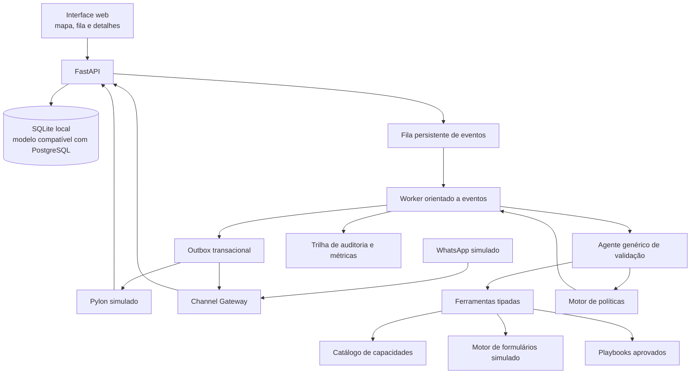

# Aprova Command
## Especificação completa para desenvolvimento do sistema

**Documento destinado a:** agente de IA responsável por projetar, implementar, testar e documentar o sistema.  
**Objetivo do documento:** servir como especificação autocontida de produto, arquitetura, dados, integrações simuladas, comportamento agêntico, interface, testes e aceite.  
**Contexto:** hackathon GovTech da Aprova.  
**Idioma do produto e da documentação:** português do Brasil.  
**Nome provisório:** Aprova Command.

---

# 1. Missão de construção

Construir um sistema web completo, funcional e demonstrável localmente para coordenar a validação de formulários de processos municipais durante implantações da Aprova.

O sistema nasce de um ticket no Pylon. Um processo aberto vira um ticket contendo descrição, vínculo com o formulário e resposta inicial da prefeitura. Essa resposta costuma ser extensa, confusa ou incompleta. O sistema deve interpretar o que a prefeitura deseja, relacionar as intenções às capacidades genéricas do formulário, estruturar alterações possíveis, identificar lacunas e conduzir rodadas assíncronas de validação até que o formulário esteja pronto, aprovado, aplicado e verificado.

Cada processo possui um agente lógico persistente, apresentado visualmente como um **soldado**. O soldado “marcha” sozinho enquanto existirem ações seguras e permitidas. Ele para em estados explícitos quando aguarda resposta, responsável, aprovação ou intervenção humana. O implantador visualiza todos os soldados em um mapa de comando, intervém onde necessário e ordena a retomada.

A experiência visual deve lembrar um mapa medieval de Age of Empires/Warcraft, mas a arquitetura deve ser uma máquina de estados confiável, não um loop autônomo livre.

## Resultado final esperado

Entregar um repositório que permita a um avaliador executar, sem credenciais externas:

1. Abrir um ticket no Pylon simulado.
2. Ler a resposta inicial da prefeitura e acessar o formulário vinculado.
3. Ver o agente interpretar múltiplas intenções e citar suas evidências.
4. Ver o que é suportado, condicionado, ambíguo ou dependente de revisão.
5. Ver o agente gerar automaticamente uma rodada agrupada de esclarecimentos.
6. Enviar a mesma rodada ao Pylon e ao WhatsApp simulado.
7. Responder por qualquer canal, inclusive com texto, áudio, documento ou imagem.
8. Ver as respostas sendo consolidadas sem duplicação ou perda de contexto.
9. Descobrir outro responsável por indicação e transferir somente o assunto necessário.
10. Ver a jornada sendo replanejada com base nas novas evidências.
11. Ver alterações propostas no formulário com diff e evidências.
12. Intervir em um caso que exige decisão humana e retomar a marcha.
13. Aprovar pela prefeitura e pela Aprova a mesma versão.
14. Aplicar a versão no motor simulado e executar read-back.
15. Encerrar o ticket somente após a verificação.
16. Visualizar tudo no mapa, na linha do tempo e nas métricas.

# 2. Princípios obrigatórios

## 2.1 Configuração zero de instruções por formulário

Não é permitido exigir prompt, roteiro, lista de perguntas ou instruções específicas para cada formulário ou processo.

O mesmo código, o mesmo prompt-base e as mesmas ferramentas devem funcionar para formulários diferentes. O comportamento específico deve derivar somente de dados lidos em tempo de execução:

- Schema e conteúdo do formulário.
- Template de origem.
- Resposta inicial da prefeitura.
- Documentos e mensagens recebidas.
- Catálogo genérico de capacidades do produto.
- Playbooks genéricos aprovados.
- Responsáveis e permissões.
- Estado das lacunas, alterações e aprovações.

É permitido cadastrar dados operacionais de município, processo, ticket, formulário e contatos. Isso não é configuração de instruções.

**Teste eliminatório:** adicionar um formulário nunca visto, sem alterar código nem prompts, e conduzir sua triagem e primeira rodada.

## 2.2 Rodadas completas, não perguntas isoladas

O agente não deve perguntar apenas o próximo item de uma fila. A cada rodada, ele deve responder:

> Qual é a próxima etapa desbloqueável e qual é o pacote mínimo, completo e legível de esclarecimentos que permite alcançá-la sem abrir rodadas previsíveis?

A rodada deve:

- Explicar o que já foi compreendido.
- Agrupar dúvidas por assunto e responsável.
- Cobrir lacunas da próxima etapa.
- Antecipar dependências que já podem ser respondidas.
- Remover perguntas respondidas por evidências anteriores.
- Evitar assuntos independentes que tornariam a mensagem confusa.
- Solicitar indicação de responsável quando necessário.
- Informar qual resultado a resposta viabilizará.

Rodadas posteriores contêm somente o **delta**, sem repetir desnecessariamente perguntas ou contexto já consolidado.

## 2.3 Um único caso, vários canais

Pylon e WhatsApp são canais da mesma validação. Não podem gerar jornadas independentes.

A primeira rodada pode ser enviada simultaneamente ao Pylon e ao WhatsApp. As respostas são consolidadas pelo mesmo `round_id` e pelo mesmo `case_id`.

A corrida entre canais termina quando chega uma **resposta substantiva**, não quando chega qualquer mensagem. Mensagens complementares devem ser combinadas; divergências devem ser identificadas e escaladas ou esclarecidas.

## 2.4 IA propõe; políticas e código decidem o que pode executar

O LLM interpreta, resume, relaciona evidências e propõe ações estruturadas. O backend determina:

- Permissões.
- Transições de estado.
- Dependências.
- Versionamento.
- Aprovações.
- Idempotência.
- Envio ou bloqueio de mensagens.
- Aplicação de alterações.
- Encerramento do caso.

O agente nunca aprova pela prefeitura, nunca aprova pela Aprova e nunca altera diretamente o formulário vigente.

## 2.5 Persistência fora do prompt

Nenhum estado essencial pode existir apenas no histórico do modelo. Reiniciar o servidor deve preservar:

- Estado do caso.
- Rodadas e pendências.
- Responsáveis.
- Mensagens e evidências.
- Versões do formulário.
- Alterações propostas.
- Intervenções.
- Aprovações.
- Próximas ações e prazos.

## 2.6 Evidência antes de interpretação

Toda mensagem ou anexo deve ser persistido antes da análise. Toda interpretação deve apontar para mensagens, trechos ou documentos de origem. Citações devem ser verificáveis na interface.

## 2.7 Simulação honesta

Pylon, WhatsApp, motor de formulários e dados municipais são simulados no hackathon. A interface deve mostrar uma etiqueta discreta, mas visível: **“Ambiente de demonstração — dados sintéticos”**.

O modo `offline_replay` deve ser identificado como replay. Não pode ser apresentado como inferência ao vivo nem como prova de generalização.

# 3. Escopo funcional completo

## 3.1 Municípios e implantações

- Cadastrar municípios sintéticos.
- Associar implantações, processos e responsáveis.
- Suportar duas prefeituras na demonstração.
- Exibir 70 processos por implantação para demonstrar escala visual.
- Pelo menos seis processos devem possuir cenários completos e interativos de referência.
- Os demais processos podem ser semeados a partir de templates genéricos e devem poder iniciar o mesmo fluxo, sem prompts específicos.
- Processos apenas semeados não podem inflar métricas de sucesso ou autonomia.

## 3.2 Tickets e Pylon simulado

O simulador deve oferecer:

- Lista e detalhe de tickets.
- Município e processo.
- Descrição.
- Link para o formulário.
- Resposta inicial da prefeitura.
- Comentários públicos e notas internas.
- Anexos.
- Estado do ticket.
- Histórico de eventos.
- Reabertura por nova resposta.
- Associação ao caso de validação.
- Encerramento somente pelo fluxo autorizado.

Não reproduzir funcionalidades irrelevantes do Pylon real.

## 3.3 Interpretação da resposta inicial

Para cada ticket, gerar um **dossiê inicial** contendo:

- Resumo executivo fiel.
- Versão-base do formulário.
- Lista de intenções de alteração.
- Citação literal de cada intenção.
- Clareza da intenção.
- Viabilidade segundo o catálogo.
- Informações ausentes.
- Riscos.
- Responsável provável.
- Próxima ação proposta.
- Documentos recebidos e diferenças identificadas.
- Necessidade de consultoria ou intervenção.

O sistema deve separar múltiplos assuntos presentes na mesma frase ou parágrafo.

## 3.4 Clareza e viabilidade independentes

Cada `ChangeRequest` deve possuir:

```text
clarity = clear | partial | ambiguous | unknown
feasibility = supported | supported_with_conditions |
              requires_product_review | unsupported | unknown
risk = low | medium | high
next_action = propose_change | clarify | find_owner |
              escalate | reject | wait
```

`unknown` nunca pode ser convertido automaticamente em `unsupported`.

## 3.5 Catálogo genérico de capacidades

Criar um catálogo versionado, legível pelo agente, com operações genéricas e seus requisitos.

Exemplo:

```json
{
  "operation": "add_conditional_attachment",
  "availability": "supported_with_conditions",
  "required_inputs": [
    "document_type",
    "condition",
    "required",
    "accepted_formats",
    "applicability"
  ],
  "constraints": [
    "condition_must_reference_known_fields"
  ],
  "approval_required": true,
  "auto_apply_allowed": false
}
```

Incluir pelo menos:

- Renomear rótulo.
- Alterar texto de ajuda.
- Adicionar campo de texto.
- Adicionar campo numérico.
- Adicionar campo de seleção.
- Alterar opções.
- Alterar obrigatoriedade.
- Adicionar anexo.
- Adicionar anexo condicional.
- Adicionar validação entre campos.
- Remover ou desativar campo.
- Alterar seção.
- Solicitar nova etapa ou fluxo.
- Alterar regra de negócio.

O catálogo deve distinguir o que é suportado no simulador, o que exige revisão de produto e o que permanece desconhecido. Não inventar capacidades da Aprova real.

## 3.6 Planejador de rodadas

O planejador deve operar sobre lacunas, não sobre perguntas fixas.

Entradas:

- Estado atual do formulário.
- ChangeRequests.
- Lacunas abertas.
- Dependências.
- Evidências já recebidas.
- Responsáveis.
- Histórico de rodadas.
- Canal preferido.
- Intervenções e decisões humanas.

Saída:

- Objetivo da rodada.
- Próxima etapa que será desbloqueada.
- Itens agrupados.
- Responsável ou papel necessário.
- Critérios de completude.
- Canais de envio.
- Texto para Pylon.
- Mensagens para WhatsApp.
- Justificativa interna do agrupamento.

Regras:

1. Priorizar lacunas bloqueantes da próxima versão ou decisão.
2. Agrupar por responsável e coerência de assunto.
3. Antecipar perguntas dependentes previsíveis.
4. Não repetir conteúdo já respondido.
5. Não criar uma mensagem por pergunta.
6. Usar numeração e linguagem simples.
7. Se necessário, dividir uma mensagem longa de WhatsApp em partes sequenciais do mesmo pacote.
8. Não sobrecarregar um responsável com assunto de outro setor.
9. Criar descoberta de responsável quando faltar autoridade ou conhecimento.
10. Registrar a versão do plano e o motivo de cada mudança.

## 3.7 Gestão de lacunas

Cada solicitação deve manter uma lista explícita de lacunas:

```text
gap_id
change_request_id
field_or_decision
description
blocking
status = open | answered | obsolete | disputed
answered_by_evidence_ids
required_role
created_at
resolved_at
```

Uma resposta pode resolver várias lacunas. Um documento pode responder perguntas de mais de uma rodada. O agente deve reavaliar todas as lacunas abertas após cada evidência, sem alterar históricos.

## 3.8 Responsáveis e descoberta de contatos

Papéis mínimos:

- Responsável central da prefeitura.
- Responsável pelo processo.
- Responsável técnico/setorial.
- Contato indicado.
- Aprovador municipal.
- Implantador.
- Aprovador da Aprova.

Funcionalidades:

- Identificar lacunas de responsável.
- Solicitar nome, setor, contato ou apresentação.
- Registrar quem indicou e para qual assunto.
- Transferir somente os itens necessários.
- Criar rodada específica para o novo contato.
- Receber resposta e devolver a evidência ao item original.
- Retomar automaticamente a etapa desbloqueada.
- Evitar contatos duplicados.
- Permitir mesclar contatos após confirmação.
- Distinguir capacidade de responder da capacidade de aprovar.

No simulador, a autorização de contato pode ser registrada por um botão ou evento explícito. Receber um número não deve, por si só, representar autorização irrestrita.

## 3.9 Canais e estratégia multicanal

Criar interface `ChannelAdapter` com implementações:

- `PylonSimulatorAdapter`.
- `WhatsAppSimulatorAdapter`.
- `ManualInboxAdapter`, opcional.

Eventos normalizados:

```text
MessageReceived
MessageSent
MessageFailed
AttachmentReceived
DeliveryConfirmed
ContactAuthorized
ChannelPreferred
```

Política inicial:

1. Primeira rodada: Pylon + WhatsApp, se ambos autorizados.
2. Compartilhar `round_id` e conteúdo semanticamente equivalente.
3. Aguardar resposta substantiva em qualquer canal.
4. Após resposta útil, definir canal principal.
5. Usar o outro canal como fallback ou sincronização de estado, sem repetir todas as perguntas.
6. Se ambos responderem, consolidar.
7. Se houver divergência, criar lacuna `disputed` ou intervenção.
8. Follow-up somente no canal principal, salvo política de fallback.
9. Respeitar preferência explícita do contato.

Uma resposta substantiva contém informação que altera ao menos uma lacuna, solicitação, evidência, responsável ou decisão. “Ok”, “depois vejo” ou confirmação de recebimento não encerra a espera.

## 3.10 Simulador de WhatsApp

Interface de chat que permita ao demonstrador:

- Alternar entre contatos.
- Responder como pessoas diferentes.
- Enviar texto.
- Enviar áudio simulado.
- Enviar documento.
- Enviar imagem.
- Indicar outro responsável.
- Autorizar contato no cenário simulado.
- Simular atraso.
- Simular ausência de resposta.
- Simular mensagem duplicada.
- Simular resposta fora de ordem.
- Simular falha de envio.
- Visualizar mensagens enviadas pelo agente.
- Ver o município e processo associados.

Não usar API oficial ou não oficial do WhatsApp. Não realizar automação de navegador. Não pedir números reais ou credenciais.

## 3.11 Áudios, documentos e imagens

Implementar pipeline de anexos:

1. Persistir arquivo e metadados.
2. Calcular hash.
3. Associar ao caso e à mensagem.
4. Processar por adaptador.
5. Registrar transcrição/extração como artefato derivado.
6. Permitir visualizar origem e resultado.
7. Interpretar lacunas e alterações.
8. Manter confiança e necessidade de revisão quando aplicável.

No modo sem credenciais, áudios e imagens podem usar arquivos auxiliares de transcrição/OCR claramente identificados como **simulados**. Não apresentar esses arquivos como transcrição automática real.

Texto, Markdown e JSON devem ser lidos nativamente. PDF com texto pode ser processado por biblioteca local se isso não comprometer o prazo; PDF digitalizado e OCR genérico ficam fora do escopo obrigatório.

## 3.12 Alterações de formulário

Nenhuma alteração direta no formulário vigente.

Fluxo obrigatório:

```text
ChangeRequest → operação compatível → FormChangeSet → validação →
preview/diff → aprovações → aplicação → read-back → conclusão
```

Cada ChangeSet contém:

- Versão-base.
- Operações.
- ChangeRequests de origem.
- Evidências.
- Campos afetados.
- Condições e dependências.
- Riscos e conflitos.
- Testes necessários.
- Estado de aprovação.
- Resultado da aplicação e read-back.

Validações determinísticas mínimas:

- Campos referenciados existem ou serão criados.
- Tipos são válidos.
- Opções são válidas.
- Condições são executáveis.
- Não há referência circular.
- Não há duplicidade indevida.
- Anexos condicionais possuem condição completa.
- Operações são compatíveis com a versão-base.
- Toda alteração possui evidência ou decisão humana.
- ChangeSet não contém operação fora do catálogo.

## 3.13 Intervenção humana

Criar fila operacional com motivo, urgência e contexto.

Intervir quando houver:

- Pedido de consultoria fora de playbook aprovado.
- Conflito entre respostas ou documentos.
- Divergência entre responsáveis.
- Alteração de alto risco.
- Viabilidade `requires_product_review` ou `unknown`.
- Falha repetida de interpretação.
- Baixa confiança em evidência essencial.
- Mais de três rodadas sem reduzir lacunas bloqueantes.
- Ausência prolongada de responsável.
- Pedido para aprovar fora do fluxo.
- Conteúdo sensível ou contato não autorizado.
- Prompt injection ou instrução suspeita em anexo.
- Falha de aplicação ou read-back.

A intervenção deve mostrar:

- Resumo.
- Motivo estruturado.
- Pergunta ou decisão necessária.
- Evidências.
- Diff relacionado.
- Sugestão do agente.
- Histórico relevante.

Ações humanas:

- Assumir conversa.
- Responder ao agente.
- Editar interpretação.
- Editar ChangeSet.
- Reatribuir responsável.
- Resolver conflito.
- Pausar.
- Rejeitar proposta.
- Desbloquear e retomar.

## 3.14 Aprovações e encerramento

A conclusão exige, nesta ordem:

1. Nenhuma lacuna bloqueante aberta.
2. ChangeSet válido.
3. Preview disponível.
4. Aprovação municipal da versão exata.
5. Aprovação da Aprova da mesma versão.
6. Aplicação no motor simulado.
7. Read-back e comparação sem divergência.
8. Registro de nota interna no ticket.
9. Encerramento do ticket.
10. Soldado em `COMPLETED`.

Alteração material após aprovação invalida as aprovações afetadas e cria nova versão. Não permitir concluir se a versão aplicada divergir da aprovada.

# 4. Máquina de estados

## 4.1 Estados principais

```text
DRAFT
INTAKE
UNDERSTANDING_FORM
ANALYZING_INITIAL_REPLY
BUILDING_ROUND
ROUND_READY
SENDING_ROUND
WAITING_ANY_CHANNEL
WAITING_PRIMARY_CHANNEL
PROCESSING_REPLY
RECONCILING_RESPONSES
WAITING_OWNER
WAITING_REFERRAL
CHANGES_READY
BLOCKED_HUMAN
READY_FOR_APPROVAL
WAITING_MUNICIPAL_APPROVAL
WAITING_IMPLANTER_APPROVAL
APPLYING
VERIFYING
PAUSED
FAILED_RETRYABLE
FAILED_PERMANENT
COMPLETED
```

## 4.2 Regras de transição

- Toda transição é validada no backend.
- Toda transição gera evento de auditoria.
- Não pular estados de aprovação.
- `WAITING_*` não é erro nem intervenção por si só.
- `BLOCKED_HUMAN` sempre possui motivo e responsável.
- `FAILED_RETRYABLE` possui próxima tentativa e limite.
- `COMPLETED` é terminal, mas pode ser reaberto por nova solicitação, criando nova versão/ciclo.
- Um evento duplicado não executa efeitos novamente.

## 4.3 Agentes orientados a eventos

O soldado é uma entidade lógica persistente. Não manter um loop de LLM rodando continuamente.

Ele é acionado por:

- Ticket criado ou atualizado.
- Mensagem recebida.
- Anexo processado.
- Prazo atingido.
- Responsável autorizado.
- Decisão humana.
- Aprovação recebida.
- Falha resolvida.
- Retry agendado.

Cada despertar executa um número limitado de ações e persiste o próximo estado.

# 5. Arquitetura técnica obrigatória

## 5.1 Visão geral



## 5.2 Stack

**Backend**

- Python 3.12.
- FastAPI.
- Pydantic v2.
- SQLAlchemy 2.
- SQLite para execução local.
- Migrações com Alembic ou SQL inicial versionado.
- Worker local usando fila persistida no banco.
- Pytest.

**Frontend**

- React.
- TypeScript.
- Vite.
- CSS/Tailwind, conforme setup escolhido e documentado.
- SVG/CSS para o mapa; não exigir engine de jogo.
- Testes de componentes quando úteis e Playwright para o fluxo principal.

**Arquivos**

- Diretório local `var/attachments`.
- Metadados e hashes no banco.
- Nenhum bucket externo obrigatório.

**LLM**

- Interface `LLMAdapter`.
- Implementação `OpenAICompatibleAdapter`, opcional por variáveis de ambiente.
- Implementação `OfflineReplayAdapter` para demonstração e testes.
- Structured output validado por Pydantic.
- Nenhuma chave incluída no repositório.

**Restrições**

- Monólito modular, não microsserviços.
- Sem Kubernetes.
- Sem Redis/Celery obrigatórios.
- Sem banco vetorial obrigatório.
- Sem grafo de conhecimento.
- Sem engine de jogo.
- Sem integração externa real no caminho padrão.

## 5.3 Camadas

```text
domain/       entidades, estados, políticas e erros
application/  casos de uso e orquestração
agent/        prompts genéricos, ferramentas, adaptadores e schemas
adapters/     Pylon, WhatsApp, formulários e arquivos
persistence/  modelos, repositórios, migrações e outbox
api/          endpoints e serialização
worker/       consumo de eventos, retries e scheduler
web/          interface React
```

O domínio não pode importar FastAPI, React ou SDK de LLM.

# 6. Modelo de dados mínimo

Implementar índices, foreign keys e timestamps UTC. IDs podem ser UUID. JSON deve ser validado antes de persistir.

| Entidade | Campos e responsabilidades essenciais |
|---|---|
| `Municipality` | `id`, `name`, `state`, `is_synthetic` |
| `Implementation` | `id`, `municipality_id`, `name`, `status`, `started_at` |
| `ProcessDefinition` | `id`, `implementation_id`, `name`, `code`, `template_id` |
| `FormTemplate` | `id`, `name`, `schema_json`, `version` |
| `FormVersion` | `id`, `process_id`, `version`, `schema_json`, `status`, `base_version_id`, `content_hash` |
| `Ticket` | `id`, `external_key`, `process_id`, `description`, `initial_reply`, `form_url`, `status` |
| `ValidationCase` | `id`, `ticket_id`, `process_id`, `soldier_name`, `state`, `current_round_id`, `primary_channel`, `version` |
| `ChangeRequest` | `id`, `case_id`, `source_quote`, `interpreted_intent`, `clarity`, `feasibility`, `risk`, `status`, `next_action` |
| `EvidenceLink` | `id`, `change_request_id`, `message_id`, `attachment_id`, `quote`, `locator` |
| `Gap` | `id`, `change_request_id`, `description`, `required_input`, `required_role`, `blocking`, `status`, `resolved_by` |
| `ValidationRound` | `id`, `case_id`, `objective`, `status`, `version`, `assigned_role`, `completion_criteria_json` |
| `RoundItem` | `id`, `round_id`, `gap_id`, `change_request_id`, `sequence`, `status` |
| `Contact` | `id`, `municipality_id`, `name`, `department`, `phone_alias`, `preferred_channel`, `is_synthetic` |
| `RoleAssignment` | `id`, `process_id`, `contact_id`, `role`, `can_answer`, `can_approve`, `scope_json`, `status` |
| `ContactReferral` | `id`, `case_id`, `from_contact_id`, `to_contact_id`, `reason`, `authorized`, `scope_json` |
| `Conversation` | `id`, `case_id`, `contact_id`, `channel`, `external_key` |
| `Message` | `id`, `conversation_id`, `round_id`, `direction`, `body`, `content_type`, `external_key`, `substantive`, `received_at` |
| `Attachment` | `id`, `message_id`, `filename`, `mime_type`, `sha256`, `storage_path`, `processing_status` |
| `DerivedArtifact` | `id`, `attachment_id`, `kind`, `content`, `adapter`, `is_simulated`, `confidence` |
| `FormChangeSet` | `id`, `case_id`, `base_form_version_id`, `operations_json`, `status`, `validation_json`, `result_form_version_id` |
| `Approval` | `id`, `change_set_id`, `form_version_id`, `approver_contact_id`, `approver_role`, `decision`, `rationale`, `created_at` |
| `Intervention` | `id`, `case_id`, `reason_code`, `summary`, `context_json`, `status`, `assigned_to`, `resolution` |
| `AgentAction` | `id`, `case_id`, `action_type`, `payload_json`, `policy_decision`, `status`, `error_code` |
| `IntegrationEvent` | `id`, `source`, `external_key`, `payload_json`, `processed_at`, `processing_hash` |
| `OutboxMessage` | `id`, `case_id`, `channel`, `round_id`, `payload_json`, `status`, `idempotency_key`, `attempts`, `next_attempt_at` |
| `AuditEvent` | `id`, `case_id`, `actor_type`, `actor_id`, `event_type`, `payload_json`, `created_at` |
| `EvaluationRun` | `id`, `fixture`, `adapter`, `metrics_json`, `evidence_class`, `created_at` |

Regras adicionais:

- `external_key` + `source` únicos para idempotência de integração.
- `idempotency_key` único na outbox.
- Aprovação referencia `form_version_id`, não apenas `case_id`.
- Toda decisão automática registra `adapter`, modelo e versão do prompt.
- Não armazenar telefones reais; usar aliases sintéticos.

# 7. Contrato do agente genérico

## 7.1 Responsabilidades do LLM

- Interpretar resposta inicial.
- Separar intenções.
- Relacionar intenções a campos e operações.
- Propor clareza, viabilidade candidata e risco.
- Identificar lacunas.
- Relacionar novas evidências a lacunas abertas.
- Detectar possíveis conflitos.
- Planejar rodadas agrupadas.
- Redigir mensagens claras.
- Propor ChangeSets.
- Preparar resumo de intervenção.

## 7.2 Responsabilidades do backend

- Ler e validar estado.
- Confirmar viabilidade contra catálogo.
- Validar citações e referências.
- Verificar permissões.
- Escolher transições válidas.
- Controlar canais e idempotência.
- Persistir evidências e propostas.
- Executar ChangeSets.
- Validar formulários.
- Controlar aprovações.
- Aplicar e verificar versões.
- Encerrar tickets.
- Calcular métricas.

## 7.3 Ferramentas disponíveis ao agente

Todas tipadas, com permissões mínimas:

```text
get_case_context(case_id)
get_ticket(ticket_id)
get_form_schema(form_version_id)
get_form_diff(base_version_id, candidate_version_id)
list_form_capabilities()
get_capability_requirements(operation)
list_change_requests(case_id)
list_open_gaps(case_id)
list_rounds(case_id)
list_contacts(process_id, role?, scope?)
get_relevant_playbook(topic, context)
list_evidence(case_id)
get_attachment_artifact(attachment_id)
propose_change_requests(case_id, requests)
propose_gap_updates(case_id, updates)
propose_round(case_id, plan)
propose_change_set(case_id, change_set)
request_intervention(case_id, reason, context)
mark_no_safe_action(case_id, reason)
```

O agente não possui ferramentas para:

- Alterar banco diretamente.
- Enviar mensagem sem outbox/política.
- Aprovar.
- Aplicar formulário.
- Encerrar ticket.
- Alterar gold, testes ou critérios de aceite.
- Autorizar contato.
- Mudar permissões.

## 7.4 Ações internas

```text
ANALYZE_INITIAL_REPLY
PLAN_ROUND
SEND_ROUND
PROCESS_EVIDENCE
RECONCILE_CHANNELS
PROPOSE_CHANGE_SET
FIND_OWNER
TRANSFER_SCOPE
ESCALATE_TO_HUMAN
WAIT
REQUEST_MUNICIPAL_APPROVAL
REQUEST_IMPLANTER_APPROVAL
APPLY_APPROVED_CHANGE_SET
VERIFY_APPLIED_FORM
COMPLETE_CASE
```

Ações de escrita sempre passam pelo motor de políticas.

# 8. Política de autonomia

| Ação | Autonomia inicial |
|---|---|
| Interpretar e resumir | Automática como proposta |
| Registrar evidência | Automática |
| Atualizar lacuna com evidência clara | Automática, auditável |
| Enviar rodada de baixo risco | Automática no simulador |
| Enviar follow-up dentro da política | Automática |
| Solicitar apresentação de responsável | Automática no simulador |
| Transferir escopo para contato autorizado | Automática |
| Replanejar rodada | Automática e versionada |
| Criar ChangeSet | Automática como proposta |
| Alterar formulário vigente | Nunca sem aprovação |
| Declarar capacidade desconhecida como inviável | Proibido |
| Responder consultoria fora de playbook | Humano |
| Resolver conflito institucional/jurídico | Humano |
| Aprovar pela prefeitura | Pessoa autorizada |
| Aprovar pela Aprova | Implantador |
| Aplicar versão | Automática somente após dupla aprovação |
| Encerrar ticket | Automática somente após read-back válido |

# 9. API mínima

## 9.1 Saúde e demo

```text
GET  /api/health
POST /api/demo/reset
POST /api/demo/seed
GET  /api/demo/scenarios
POST /api/demo/scenarios/{scenario_id}/start
GET  /api/demo/runtime
```

`runtime` deve informar modo de IA, simuladores ativos e versão do seed.

## 9.2 Municípios, processos e mapa

```text
GET /api/municipalities
GET /api/implementations/{id}
GET /api/processes
GET /api/processes/{id}
GET /api/command/map
GET /api/command/interventions
GET /api/command/metrics
```

## 9.3 Tickets e casos

```text
GET  /api/tickets
GET  /api/tickets/{id}
POST /api/tickets
POST /api/tickets/{id}/comments
POST /api/tickets/{id}/attachments
POST /api/tickets/{id}/close
POST /api/cases/from-ticket/{ticket_id}
GET  /api/cases/{id}
GET  /api/cases/{id}/timeline
GET  /api/cases/{id}/dossier
GET  /api/cases/{id}/gaps
GET  /api/cases/{id}/rounds
POST /api/cases/{id}/wake
POST /api/cases/{id}/pause
POST /api/cases/{id}/resume
```

## 9.4 Canal e responsáveis

```text
GET  /api/cases/{id}/conversations
POST /api/conversations/{id}/messages
POST /api/conversations/{id}/attachments
POST /api/cases/{id}/referrals
POST /api/contacts/{id}/authorize
POST /api/contacts/{id}/preferred-channel
GET  /api/contacts/{id}/conversations
```

## 9.5 Formulários e aprovações

```text
GET  /api/forms/{version_id}
GET  /api/forms/{version_id}/preview
GET  /api/cases/{id}/change-requests
GET  /api/cases/{id}/change-sets
POST /api/cases/{id}/change-sets/{change_set_id}/validate
GET  /api/change-sets/{id}/diff
POST /api/change-sets/{id}/municipal-approval
POST /api/change-sets/{id}/implanter-approval
POST /api/change-sets/{id}/apply
POST /api/change-sets/{id}/verify
```

## 9.6 Intervenções e avaliação

```text
GET  /api/interventions
GET  /api/interventions/{id}
POST /api/interventions/{id}/resolve
POST /api/interventions/{id}/take-over
POST /api/evaluations/run
GET  /api/evaluations/{id}
```

# 10. Interface web

## 10.1 Navegação

Rotas mínimas:

```text
/                         mapa de comando
/interventions            fila de intervenção
/processes/:id            visão geral do soldado
/processes/:id/dossier    dossiê inicial
/processes/:id/rounds     rodadas e lacunas
/processes/:id/messages   Pylon e WhatsApp
/processes/:id/form       formulário, diff e versões
/processes/:id/people     responsáveis
/processes/:id/approvals  aprovações e fechamento
/tickets                  Pylon simulado
/templates                templates e capacidades
/metrics                  métricas e avaliação
/settings/demo            modos e controles do simulador
```

## 10.2 Mapa de comando

Visual medieval com dois territórios municipais e soldados distribuídos por processos.

Cada unidade mostra:

- Nome/código do processo.
- Município.
- Estado.
- Etapa atual.
- Tempo no estado.
- Responsável atual.
- Canal principal.
- Lacunas bloqueantes.
- Alterações estruturadas.
- Próxima ação.
- Necessidade de intervenção.

Cores:

- Verde: avançando/concluído conforme contexto.
- Azul: aguardando resposta dentro do prazo.
- Amarelo: follow-up ou risco.
- Vermelho: intervenção/falha.
- Roxo: aprovação.
- Cinza: pausado.
- Bandeira: concluído.

Incluir legenda e modo de lista acessível. O mapa não pode ser a única maneira de encontrar bloqueios.

## 10.3 Fila de intervenção

Ordenação por urgência e tempo parado. Filtros por município, motivo, responsável e estado. Cada item abre diretamente o contexto necessário para decidir.

## 10.4 Detalhe do processo

Cabeçalho:

```text
Município / processo / ticket / soldado
Estado e tempo no estado
Próxima etapa desbloqueável
Rodada atual
Canal principal
Lacunas abertas e bloqueantes
ChangeSets e versão atual
Responsável atual
Botão de pausar/retomar
```

Abas para linha do tempo, dossiê, rodadas, conversas, formulário, pessoas, aprovações e auditoria.

## 10.5 Dossiê inicial

Layout em duas colunas:

- Esquerda: resposta original e anexos.
- Direita: intenções interpretadas, clareza, viabilidade, lacunas e ações.

Clicar em uma intenção destaca sua citação. Alterações manuais do implantador ficam auditadas.

## 10.6 Rodadas

Mostrar objetivo, conteúdo enviado por canal, itens, critérios de completude, respostas e delta restante. Exibir explicitamente por que perguntas foram agrupadas ou canceladas.

## 10.7 Formulário e diff

- Preview do formulário.
- Antes/depois.
- Alterações agrupadas por ChangeRequest.
- Evidência de cada alteração.
- Erros de validação.
- Versões e aprovações.
- Resultado de aplicação e read-back.

## 10.8 Simuladores

O Pylon e o WhatsApp devem ser acessíveis durante a demo sem expor controles técnicos desnecessários na tela principal. Disponibilizar um “modo apresentação” e um “modo simulação”.

# 11. Cenários obrigatórios

## Cenário A — Resposta inicial confusa e rodada agrupada

Entrada contém:

- Renomear campo.
- Pedido de anexo condicional incompleto.
- Pedido ambíguo de novo campo.
- Formulário antigo anexado.
- Indicação genérica de outro setor.

Resultado esperado:

- Quatro ou mais intenções separadas.
- Citações corretas.
- Operação simples proposta sem pergunta desnecessária.
- Lacunas agrupadas na primeira rodada.
- Envio simultâneo ao Pylon e WhatsApp.
- Resposta substantiva por um canal.
- Canal principal atualizado.
- Próxima rodada somente com delta.

## Cenário B — Descoberta de responsável e retomada

- Responsável atual não sabe responder.
- Indica contato da Vigilância.
- Contato é autorizado no simulador.
- Somente escopo sanitário é transferido.
- Novo contato envia documento.
- Documento resolve várias lacunas.
- Processo original retoma sem reinício.

## Cenário C — Respostas complementares nos dois canais

- Pylon fornece decisão textual.
- WhatsApp fornece documento de suporte.
- Sistema consolida sem duplicar perguntas.
- ChangeSet referencia ambas as evidências.

## Cenário D — Divergência entre canais

- Pylon diz “obrigatório para todos”.
- WhatsApp diz “somente para alimentação”.
- Sistema não escolhe arbitrariamente.
- Lacuna passa a `disputed`.
- Humano resolve ou nova rodada específica é enviada.

## Cenário E — Consultoria e intervenção

- Prefeitura pergunta “o que vocês recomendam?”.
- Não existe playbook aplicável.
- Soldado entra em `BLOCKED_HUMAN`.
- Implantador recebe contexto, decide e retoma.
- Decisão vira evidência.

## Cenário F — Formulário nunca visto

- Novo schema sem qualquer instrução manual.
- Mesmo agente e mesmo código.
- Dossiê e primeira rodada são gerados.
- Teste prova configuração zero.

## Cenário G — Aprovação, aplicação e read-back

- Todas as lacunas resolvidas.
- Prefeitura aprova versão N.
- Aprova aprova versão N.
- Sistema aplica e verifica.
- Ticket fecha.
- Tentativa de alterar após aprovação cria nova versão e invalida aprovações afetadas.

## Cenário H — Falhas e adversários

- Evento duplicado do Pylon.
- Mensagem duplicada do WhatsApp.
- Reinício do servidor durante espera.
- Falha de envio com retry.
- Anexo com prompt injection.
- Read-back divergente.
- Nenhum caso corrompe estado ou fecha indevidamente.

# 12. Dados de demonstração

Criar dados sintéticos realistas e claramente identificados.

Municípios sugeridos:

- `Santa Aurora` — município fictício.
- `Vila do Progresso` — município fictício.

Processos sugeridos:

- Alvará de funcionamento.
- Licença sanitária.
- Certidão de uso do solo.
- Autorização para evento.
- Cadastro de contribuinte.
- Revisão de processo administrativo.
- Licença ambiental simplificada.
- Outros templates necessários para completar o seed.

Não apresentar formulários sintéticos como cópias fiéis da Aprova ou de legislação municipal real.

Seed:

- Duas implantações.
- 70 processos por implantação para escala visual.
- Oito cenários completos descritos acima.
- Contatos centrais, setoriais e aprovadores.
- Tickets, formulários e anexos.
- Métricas calculadas somente sobre execuções reais do simulador, separadas do seed visual.

# 13. Estrutura do repositório

```text
aprova-command/
├── README.md
├── AGENTS.md
├── LICENSE
├── .env.example
├── .gitignore
├── Makefile
├── docker-compose.yml              # opcional, nunca obrigatório
├── backend/
│   ├── pyproject.toml
│   ├── requirements.txt
│   ├── alembic.ini
│   ├── app/
│   │   ├── main.py
│   │   ├── config.py
│   │   ├── domain/
│   │   │   ├── entities.py
│   │   │   ├── states.py
│   │   │   ├── policies.py
│   │   │   ├── capabilities.py
│   │   │   └── errors.py
│   │   ├── application/
│   │   │   ├── intake.py
│   │   │   ├── orchestrator.py
│   │   │   ├── rounds.py
│   │   │   ├── evidence.py
│   │   │   ├── changes.py
│   │   │   ├── approvals.py
│   │   │   └── metrics.py
│   │   ├── agent/
│   │   │   ├── prompts.py
│   │   │   ├── schemas.py
│   │   │   ├── tools.py
│   │   │   └── adapters/
│   │   │       ├── base.py
│   │   │       ├── offline_replay.py
│   │   │       └── openai_compatible.py
│   │   ├── adapters/
│   │   │   ├── channels/
│   │   │   ├── pylon_simulator/
│   │   │   ├── form_engine/
│   │   │   └── attachments/
│   │   ├── persistence/
│   │   ├── api/
│   │   └── worker/
│   ├── tests/
│   └── fixtures/
│       ├── municipalities/
│       ├── forms/
│       ├── tickets/
│       ├── messages/
│       ├── attachments/
│       ├── replay/
│       ├── held_out/
│       └── expected/
├── frontend/
│   ├── package.json
│   ├── src/
│   │   ├── app/
│   │   ├── components/
│   │   ├── features/
│   │   │   ├── command-map/
│   │   │   ├── interventions/
│   │   │   ├── dossier/
│   │   │   ├── rounds/
│   │   │   ├── conversations/
│   │   │   ├── forms/
│   │   │   ├── approvals/
│   │   │   └── simulators/
│   │   ├── lib/
│   │   └── styles/
│   └── tests/
├── scripts/
│   ├── dev.py
│   ├── seed.py
│   ├── demo.py
│   ├── evaluate.py
│   └── verify_clean_run.py
├── INSTRUCTIONS/
│   ├── 00_VISAO_E_ESCOPO.md
│   ├── 01_ARQUITETURA_E_CONTRATOS.md
│   ├── 02_AGENTE_GENERICO.md
│   ├── 03_RODADAS_E_CANAIS.md
│   ├── 04_FORMULARIOS_E_APROVACOES.md
│   ├── 05_INTERFACE_E_SIMULADORES.md
│   ├── 06_TESTES_E_METRICAS.md
│   ├── 07_DEMO_E_CONTINGENCIA.md
│   └── 08_RED_TEAM.md
├── demo/
│   ├── ROTEIRO.md
│   ├── CONTINGENCIA.md
│   └── CENARIOS.md
└── artifacts/
    └── .gitkeep
```

# 14. Conteúdo obrigatório da pasta INSTRUCTIONS

Cada arquivo deve declarar objetivo, entradas, saídas, ferramentas permitidas, restrições, tratamento de falhas e critérios de teste.

| Arquivo | Conteúdo essencial |
|---|---|
| `00_VISAO_E_ESCOPO` | Problema, usuários, fluxo final, exclusões e definição de pronto |
| `01_ARQUITETURA_E_CONTRATOS` | Camadas, modelos, estados, eventos, idempotência e transações |
| `02_AGENTE_GENERICO` | Proibição de instruções por formulário, ferramentas, schemas e políticas |
| `03_RODADAS_E_CANAIS` | Agrupamento, delta, Pylon+WhatsApp, consolidação e responsáveis |
| `04_FORMULARIOS_E_APROVACOES` | ChangeSets, validações, versões, dupla aprovação e read-back |
| `05_INTERFACE_E_SIMULADORES` | Telas, estados visuais, acessibilidade e controles de demo |
| `06_TESTES_E_METRICAS` | Fixtures, held-out, fórmulas, baseline e etiquetas de evidência |
| `07_DEMO_E_CONTINGENCIA` | Reset, replay identificado, vídeo/golden run e falhas |
| `08_RED_TEAM` | Ataques, casos adversariais e critérios de go/no-go |

# 15. Testes obrigatórios

## 15.1 Unitários

- Transições válidas e inválidas.
- Políticas de autonomia.
- Validação de catálogo.
- Validação de ChangeSet.
- Condições de formulário.
- Idempotência.
- Outbox e retry.
- Cálculo de métricas.
- Invalidação de aprovações.
- Resposta substantiva versus simples recebimento.
- Seleção de canal principal.

## 15.2 Integração

- Ticket → caso → dossiê → rodada.
- Envio simultâneo nos dois canais.
- Consolidação de respostas complementares.
- Divergência entre canais.
- Descoberta de responsável.
- Documento resolvendo múltiplas lacunas.
- Intervenção e retomada.
- Dupla aprovação e aplicação.
- Read-back e encerramento.
- Reabertura por nova solicitação.

## 15.3 End-to-end

Automatizar o cenário principal com Playwright:

1. Reset do seed.
2. Abrir ticket.
3. Iniciar soldado.
4. Conferir dossiê.
5. Enviar primeira rodada nos dois canais.
6. Responder pelo WhatsApp.
7. Complementar pelo Pylon.
8. Indicar responsável.
9. Enviar documento pelo novo contato.
10. Resolver intervenção.
11. Aprovar pelas duas partes.
12. Aplicar, verificar e encerrar.
13. Confirmar mapa e métricas.

## 15.4 Adversariais

- Prompt injection em texto e anexo.
- Campo inexistente.
- Operação desconhecida.
- Citação inexistente.
- Resposta fora de ordem.
- Contato não autorizado.
- Mensagem duplicada.
- Evento duplicado.
- Falha de LLM.
- JSON inválido do LLM.
- Falha de aplicação.
- Read-back divergente.
- Aprovação de versão errada.
- Tentativa de encerramento com lacuna bloqueante.

## 15.5 Critérios de segurança do fluxo

Metas obrigatórias nos testes:

- Zero mensagens duplicadas por evento duplicado.
- Zero alterações aplicadas sem dupla aprovação.
- Zero tickets encerrados com read-back divergente.
- Zero casos sem estado ou próxima ação conhecida.
- Zero instruções de anexos alterando políticas do sistema.
- Zero prompts específicos por formulário.

# 16. Métricas

## 16.1 Métricas técnicas da demonstração

| Métrica | Fórmula ou definição |
|---|---|
| Precisão de intenções | Intenções corretas ÷ intenções propostas |
| Recall de intenções | Intenções gold recuperadas ÷ intenções gold |
| Precisão de viabilidade | Avaliações corretas ÷ avaliações com gold |
| Rodadas até pronto para aprovação | Contagem de rodadas substantivas |
| Lacunas resolvidas por rodada | Lacunas resolvidas ÷ rodadas |
| Perguntas repetidas | Perguntas semanticamente repetidas sem necessidade |
| Rodadas adicionais previsíveis | Novas rodadas causadas por lacuna que já podia ser prevista |
| Tempo até primeira versão revisada | Início do caso → primeiro ChangeSet válido |
| Canal da primeira resposta útil | Canal e tempo até resposta substantiva |
| Completude por canal | Lacunas respondidas ÷ lacunas da rodada |
| Intervenções por processo | Contagem e motivo |
| Retomadas corretas | Retomadas sem perda de contexto ÷ retomadas |
| Execuções indevidas | Ações proibidas executadas; meta zero |

## 16.2 Métricas operacionais futuras

Não alegar resultado real no hackathon:

- Tempo de calendário até dupla aprovação.
- Tempo aguardando prefeitura/Aprova/terceiros.
- Reuniões por processo.
- Processos concluídos sem reunião.
- Processos aprovados por implantador por semana.
- Processos simultâneos por implantador.
- Reaberturas após aprovação.
- Alterações incorretas descobertas posteriormente.

Toda métrica local deve carregar `evidence_class = benchmark_local_sintetico`.

# 17. Modos de execução

## 17.1 Modo padrão sem credenciais

```text
APP_ENV=demo
AI_ADAPTER=offline_replay
DATABASE_URL=sqlite:///./var/aprova_command.db
ATTACHMENT_DIR=./var/attachments
```

- Todo o fluxo funciona localmente.
- Replay identificado na interface e nos logs.
- Replay falha explicitamente para entradas desconhecidas.
- Motor, políticas, banco, API, canais, aprovações e testes continuam reais.

## 17.2 Modo com LLM ao vivo

Variáveis documentadas em `.env.example`:

```text
AI_ADAPTER=openai_compatible
LLM_BASE_URL=
LLM_API_KEY=
LLM_MODEL=
```

- Nunca incluir valores reais.
- Structured output com validação.
- Timeout, retry limitado e erro explícito.
- Não fazer fallback silencioso para replay.

# 18. Comandos e documentação de execução

O README deve permitir execução mínima em ambiente limpo.

Fornecer comandos equivalentes e testados para:

```bash
make setup
make dev
make seed
make test
make e2e
make evaluate
make demo
make reset
make verify
```

Se `make` não for adequado ao ambiente, documentar comandos Python/NPM diretos. Não exigir Docker.

README deve explicar:

1. Problema.
2. Solução.
3. Arquitetura.
4. Simuladores.
5. Instalação.
6. Execução.
7. Contas e contatos sintéticos.
8. Cenário principal.
9. Modos de IA.
10. Testes.
11. Métricas.
12. Limitações.
13. Estrutura do repositório.
14. Contingência.
15. Ausência de integrações reais.

# 19. Sequência obrigatória de implementação

Não começar pelo mapa ou pela estética.

## Etapa 1 — Contratos e domínio

- Modelos.
- Estados.
- Políticas.
- Catálogo.
- Eventos.
- Schemas de agente.
- Fixtures mínimas.

**Aceite:** testes de domínio passam.

## Etapa 2 — Simuladores

- Pylon.
- Formulários.
- WhatsApp.
- Persistência e anexos.

**Aceite:** abrir ticket, acessar formulário e responder por chat.

## Etapa 3 — Intake e dossiê

- Ler formulário.
- Interpretar resposta inicial.
- Criar ChangeRequests, evidências e lacunas.

**Aceite:** resposta confusa vira dossiê rastreável.

## Etapa 4 — Rodadas e orquestração

- Planejador.
- Worker.
- Outbox.
- Pylon+WhatsApp.
- Espera e retomada.

**Aceite:** processo sobrevive a reinício e mensagens duplicadas.

## Etapa 5 — Consolidação e responsáveis

- Evidências.
- Delta.
- Conflitos.
- Repasses.
- Canal principal.

**Aceite:** cenários B, C e D passam.

## Etapa 6 — Formulário e intervenção

- ChangeSets.
- Diff.
- Validações.
- Fila humana.
- Retomada.

**Aceite:** nenhuma alteração bypassa política.

## Etapa 7 — Aprovação e encerramento

- Dupla aprovação.
- Aplicação.
- Read-back.
- Ticket.
- Reabertura.

**Aceite:** cenário G passa.

## Etapa 8 — Interface completa

- Mapa.
- Fila.
- Dossiê.
- Rodadas.
- Conversas.
- Formulário.
- Pessoas.
- Aprovações.
- Métricas.

**Aceite:** fluxo E2E principal passa pela interface.

## Etapa 9 — Hardening e apresentação

- Testes adversariais.
- Instalação limpa.
- README.
- INSTRUCTIONS.
- Roteiro.
- Contingência.
- Polimento medieval.

**Aceite:** checklist final completo.

# 20. Definição de pronto

O sistema somente está pronto quando:

- [ ] Executa localmente sem credenciais.
- [ ] Não exige Docker nem serviços externos.
- [ ] Possui seed reproduzível e reset.
- [ ] Possui duas prefeituras e escala visual de processos.
- [ ] Possui pelo menos oito cenários obrigatórios.
- [ ] Um formulário desconhecido funciona sem instruções específicas.
- [ ] Resposta inicial é decomposta com evidências.
- [ ] Clareza e viabilidade são independentes.
- [ ] Rodadas são agrupadas por etapa e responsável.
- [ ] Rodadas seguintes contêm apenas delta.
- [ ] Primeira rodada usa Pylon e WhatsApp em paralelo.
- [ ] Respostas complementares são consolidadas.
- [ ] Divergências são detectadas.
- [ ] Descoberta de responsável retoma o processo original.
- [ ] Documentos podem resolver múltiplas lacunas.
- [ ] Humano intervém e retoma sem reiniciar.
- [ ] ChangeSets possuem diff, validação e evidências.
- [ ] Dupla aprovação referencia a mesma versão.
- [ ] Alteração posterior invalida aprovações afetadas.
- [ ] Read-back é obrigatório antes do encerramento.
- [ ] Ticket fecha somente após verificação.
- [ ] Mapa mostra estados e bloqueios.
- [ ] Fila de intervenção é utilizável.
- [ ] Auditoria registra decisões e adaptadores.
- [ ] Testes unitários, integração e E2E passam.
- [ ] Casos adversariais passam.
- [ ] README e INSTRUCTIONS estão completos.
- [ ] Não há segredos no repositório.
- [ ] Não há alegação de impacto real com dados sintéticos.
- [ ] O modo replay é identificado.

# 21. Fora de escopo

Não implementar no hackathon:

- Integração real com Pylon.
- WhatsApp real, oficial ou não oficial.
- Automação de navegador para WhatsApp.
- Integração real com o motor da Aprova.
- Publicação em produção.
- Autenticação/autorização de nível produtivo.
- Multi tenancy endurecida.
- OCR genérico de qualquer documento.
- Transcrição real obrigatória sem credenciais.
- Consultoria jurídica autônoma.
- Aprovação automática.
- Treinamento ou fine-tuning.
- Microsserviços, Kubernetes ou fila externa obrigatória.
- Recomendação baseada em dados privados de outro município.
- Números reais ou dados pessoais nos fixtures.

# 22. Roteiro da demonstração principal

Duração sugerida: até cinco minutos, com versão curta de três minutos.

1. Mostrar mapa com prefeituras e soldados.
2. Abrir ticket com resposta confusa e formulário vinculado.
3. Mostrar dossiê com intenções, viabilidade e evidências.
4. Mostrar primeira rodada agrupada enviada ao Pylon e WhatsApp.
5. Responder pelo WhatsApp e complementar com documento no Pylon.
6. Mostrar consolidação e canal principal.
7. Indicar outro responsável e retomar após resposta.
8. Mostrar próxima rodada apenas com delta.
9. Resolver intervenção de consultoria.
10. Mostrar ChangeSet e diff.
11. Aprovar pelas duas partes.
12. Aplicar, verificar e encerrar ticket.
13. Mostrar soldado concluído, trilha e métricas.
14. Declarar limites: dados sintéticos, simuladores e necessidade de piloto real.

Contingência:

- Resetar cenário.
- Usar modo replay identificado.
- Executar golden run pelo script.
- Mostrar vídeo do mesmo commit se a interface falhar.
- Nunca trocar fixture ou esconder erro para fingir sucesso.

# 23. Instrução final ao agente de desenvolvimento

Implementar o sistema completo descrito neste documento, priorizando o fluxo ponta a ponta e a confiabilidade do estado sobre efeitos visuais.

Não substituir a arquitetura por um chat com prompt. Não criar listas de perguntas específicas para cada formulário. Não fingir integrações reais. Não usar dados sintéticos como evidência de impacto operacional. Não permitir que o LLM execute ações fora das políticas.

Trabalhar em fatias verticais, manter o repositório executável ao fim de cada etapa e testar continuamente. Quando houver conflito entre aparência e correção, escolher correção. Quando houver conflito entre autonomia e segurança, escolher segurança e intervenção humana. Quando houver dúvida sobre uma capacidade do produto, registrar `unknown` em vez de inventar.

A entrega final deve demonstrar que o implantador deixa de coordenar manualmente cada pergunta e passa a comandar exceções, enquanto os soldados conduzem validações persistentes, multicanais e auditáveis até a conclusão verificada.
