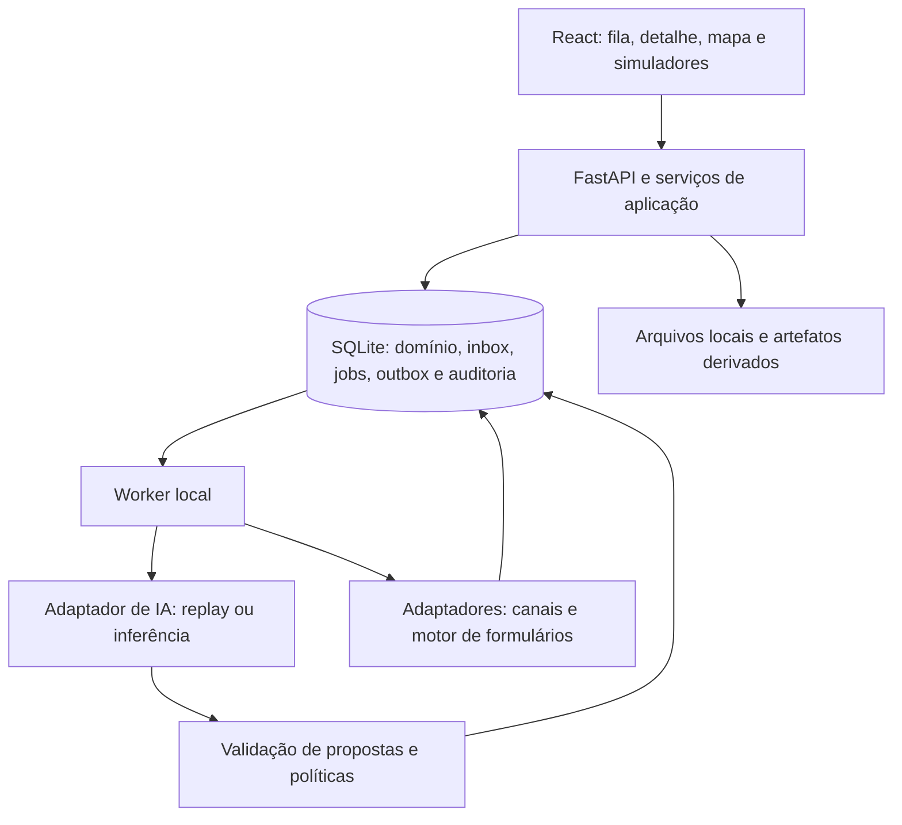

# Aprova Command — Plano consolidado de implementação

**Versão:** 2.0  
**Data:** 24/10/2026  
**Contexto:** desafio 2 do Hackathon GovTech Aprova — coleta e validação assíncrona de regras de processos municipais.  
**Idioma:** português do Brasil.  
**Destino:** equipe ou agente responsável por implementar, testar, documentar e demonstrar o produto.

Este documento reúne as decisões de produto e engenharia em uma especificação autocontida para desenvolvimento. Para a implementação iniciada a partir desta versão, ele substitui a [especificação anterior](<Aprova Command — Especificação completa para desenvolvimento.md>). O [parecer de revisão](<Aprova Command — Revisão e prontidão para implantação.md>) permanece como registro das críticas que orientaram esta consolidação. A pesquisa competitiva é contexto, não um segundo plano de implementação.

**Situação inicial:** planejamento consolidado; aplicação, testes e implantação ainda não comprovados. O próximo trabalho é a fatia 1 da seção 17. A publicação em produção não integra esta entrega.

## 1. Produto e resultado esperado

Construir uma aplicação web local que coordene a validação de formulários municipais a partir de tickets e conversas assíncronas. Um agente lógico persistente por caso identifica alterações, reúne esclarecimentos, encaminha assuntos aos responsáveis e conduz o processo até uma versão testada, aprovada pelas duas partes, aplicada e verificada.

O implantador acompanha os casos em uma fila e em um mapa com unidades representadas como soldados. A metáfora medieval organiza a operação; o funcionamento é uma máquina de estados orientada a eventos.

Os dois objetivos demonstráveis são:

1. Reduzir rodadas previsíveis de esclarecimento mediante agrupamento de lacunas e reaproveitamento de evidências.
2. Aumentar a cobertura de alterações que possuem fonte, regra executável, teste e aprovação rastreáveis.

O fluxo principal é:

```text
Ticket e formulário-base
  → dossiê com intenções e evidências
  → lacunas e rodada agrupada
  → respostas consolidadas de Pylon/WhatsApp simulados
  → decisão humana quando necessária
  → candidata, diff e testes
  → aprovação municipal
  → aprovação Aprova da mesma candidata
  → aplicação idempotente
  → read-back e testes
  → nota interna, fechamento e conclusão
```

O produto permite indicar outro responsável, transferir apenas seu assunto, receber documentos e retomar o caso sem perder o histórico. Nenhum número produzido pela demo representa impacto operacional comprovado em prefeituras reais.

## 2. Entregas e limites de escopo

### 2.1 Perfis de entrega

| Perfil | Conteúdo obrigatório | O que comprova |
|---|---|---|
| Marco parcial | Fatias 1–2: ciclo completo estreito e esclarecimento multicanal, com UI utilizável | Funcionamento do recorte explicitamente entregue |
| Demo operacional offline | Fatias 1–3 e 5; cenários A–E, G e H aprovados | Persistência, políticas, simuladores e fluxo nos casos conhecidos, sem credenciais |
| Entrega integral | Demo offline e fatia 4; cenário F aprovado com inferência ao vivo | Também demonstra configuração zero no conjunto reservado avaliado |
| Publicação compartilhada/produção | Escopo posterior de segurança, dados, integrações e operação | Não faz parte deste plano |

O modo offline usa replay identificado. Uma entrada sem gravação correspondente resulta em `REPLAY_MISS`, sem análise inventada. F fica `not_run` nesse modo. A ausência de credenciais não impede construir a demo operacional, mas impede declarar generalização comprovada.

### 2.2 Escopo da demo completa

- Duas prefeituras sintéticas, uma implantação por prefeitura e 70 processos por implantação.
- Pelo menos seis processos interativos cobrindo A–E, G e H; cenários podem compartilhar um processo.
- Pylon, WhatsApp e motor de formulários simulados.
- Dossiê, evidências, lacunas, rodadas, pessoas, intervenções, versões, aprovações e auditoria.
- Texto, Markdown e JSON nativos; áudio/imagem com transcrição/OCR auxiliar explicitamente simulado.
- PDF com extração local de texto é opcional; PDF sem extração pode ser armazenado e encaminhado para revisão, sem ser tratado como evidência já interpretada.
- Mapa e lista operacional, métricas locais e roteiro de demonstração.

Processos apenas semeados aparecem como **não iniciados** e não contam como sucesso ou autonomia. Todos usam o mesmo fluxo; em replay, entradas desconhecidas param de forma explícita.

### 2.3 Fora de escopo

Integrações reais com Pylon, WhatsApp ou Aprova; automação de navegador para WhatsApp; dados pessoais reais; legislação tratada como parecer jurídico; OCR genérico; transcrição real obrigatória; treinamento de modelos; banco vetorial; microsserviços; Kubernetes; fila externa obrigatória; autenticação produtiva e publicação pública.

Não criar um prompt, roteiro ou lista fixa de perguntas para cada formulário. Os comportamentos específicos derivam do schema, template, evidências, catálogo, playbooks genéricos, responsáveis e estado persistido.

## 3. Invariantes obrigatórios

| ID | Regra |
|---|---|
| I01 | IA interpreta e propõe; backend decide permissões, transições e efeitos |
| I02 | Mensagem/anexo é persistido antes de sua interpretação; toda proposta referencia origem verificável |
| I03 | Estado essencial, prazos, aprovações e próximas ações sobrevivem a reinício |
| I04 | Um ciclo ativo por ticket e uma rodada ativa por caso; rodadas futuras são planejadas sequencialmente |
| I05 | Pylon e WhatsApp alimentam o mesmo caso e a mesma rodada; não criam jornadas paralelas |
| I06 | Clareza e viabilidade são independentes; `unknown` não vira `unsupported` automaticamente |
| I07 | Somente pessoa com papel e escopo explícitos aprova; indicação de contato e mensagem de chat não conferem autoridade |
| I08 | Candidata aprovada é imutável e identificada por versão/hash, ChangeSet e suíte de testes |
| I09 | Editar candidata/testes ou receber evidência contraditória invalida ambas as aprovações |
| I10 | Aplicação exige base vigente esperada; fechamento exige versão vigente igual à aprovada e verificada |
| I11 | Repetir evento, comando ou job não repete efeito já confirmado |
| I12 | Replay, extração simulada e dados sintéticos são identificados na UI, auditoria e avaliação |
| I13 | LLM não aprova, aplica, fecha ticket, autoriza contato, altera permissões ou acessa gold |
| I14 | Pausa/intervenção impede novos efeitos autônomos; recebimentos continuam sendo preservados |

Não criar atalhos que dispensem esses invariantes para fazer uma demonstração passar.

## 4. Arquitetura e stack

### 4.1 Componentes



Backend: Python 3.12, FastAPI, Pydantic v2, SQLAlchemy 2, SQLite, Alembic e Pytest. Frontend: React, TypeScript, Vite, CSS com variáveis de tema e SVG/CSS para o mapa. E2E com Playwright. Um processo API e um worker local; banco e arquivos em disco local.

Fixar versões efetivamente testadas em lockfiles na primeira fatia, incluindo Node/package manager e dependências de teste. Docker é opcional e não pode ser necessário para executar a demo.

### 4.2 Organização

```text
backend/app/
  domain/        estados, entidades, condições, políticas e erros
  application/   intake, rodadas, mudanças, aprovação e fechamento
  agent/         prompts genéricos, schemas, ferramentas e adaptadores IA
  adapters/      canais, motor de formulários e extração de anexos
  persistence/   SQLAlchemy, migrações, inbox, jobs, outbox e recibos
  api/           sessão demo, endpoints e serialização
  worker/        execução, retries e agendamento
frontend/src/
  features/      fila/mapa, casos, conversas, formulários e simuladores
INSTRUCTIONS/    instruções versionadas utilizadas pelo agente
scripts/         setup, dev, seed, reset, avaliação e verificação
artifacts/       relatórios gerados, sem segredos
```

O domínio não importa FastAPI, React ou SDK de LLM. API e worker usam os mesmos serviços e políticas. Não exigir uma interface genérica para cada entidade; adaptadores são necessários nas fronteiras que realmente variam.

### 4.3 Banco e transações

Configurar WAL na inicialização, `foreign_keys=ON` em cada conexão, `busy_timeout=5000` e transações curtas explícitas. SQLite mantém um escritor por vez; chamadas LLM, espera de rede e processamento pesado de anexos acontecem fora da transação.

Usar datas UTC, IDs estáveis e JSON validado. Não usar dados em memória como fonte definitiva de estado. Migrações devem funcionar do banco vazio até o schema atual; reset não substitui teste de migração.

## 5. Modelo de domínio e evidências

### 5.1 Entidades

| Entidade | Conteúdo e responsabilidade |
|---|---|
| `Municipality` / `Implementation` | Município sintético, implantação e vínculo entre ambos |
| `ProcessDefinition` | Código, nome, implantação, template e ponteiro do formulário vigente |
| `FormTemplate` / `FormVersion` | Schema de origem e snapshots imutáveis com número, base e hash |
| `Ticket` | Processo, descrição, resposta inicial, formulário, status, comentários públicos e notas internas |
| `ValidationCase` | Ticket, processo, ciclo, caso anterior, estado, `resume_state`, revisão otimista, rodada atual e próxima ação |
| `ChangeRequest` | Intenção, origem, clareza, viabilidade, risco, próxima ação e disposição final |
| `Gap` | Solicitação, informação faltante, papel necessário, bloqueante, status e evidências que respondem |
| `EvidenceLink` | Origem, hash, citação e localização verificáveis; ligação com solicitação/lacuna |
| `ValidationRound` / `RoundItem` | Objetivo, destinatário, escopo, revisão, itens, completude, prazo, canal principal e lembretes |
| `Contact` / `RoleAssignment` | Alias sintético, município, preferência; atribuição por processo/escopo e permissão de responder/aprovar |
| `ContactReferral` | Quem indicou quem, assunto transferido, autorização e decisão responsável |
| `Conversation` / `Message` | Caso, contato, canal, conteúdo, direção, rodada opcional, sequência e chave externa |
| `Attachment` / `DerivedArtifact` | Arquivo, hash, tipo, status; extração/transcrição e indicação de simulação |
| `FormChangeSet` | Base, operações ordenadas, origens, candidata, riscos, validação e status |
| `FormTestCase` / `FormTestRun` | Casos de teste versionados; execução vinculada à candidata e hash da suíte |
| `Approval` | Candidata/base/hash/suíte/execução, ciclo, papel, ator, decisão e motivo |
| `Intervention` / `HumanDecision` | Motivo, responsável, contexto, resolução e decisão humana usada como evidência |
| `AgentAction` | Ação proposta, adaptador, versões, decisão de política, execução e erro |
| `IntegrationEvent` | Evento recebido, chave/hash, escopo, sequência, horários, causa e correlação |
| `WorkItem` | Trabalho, disponibilidade, tentativas, status, token/expiração de lease e erro |
| `OutboxMessage` | Efeito a entregar, destinatário/canal/parte/revisão, chave, tentativas e lease |
| `EffectReceipt` | Comprovante único de envio, aplicação, verificação, nota ou fechamento |
| `AuditEvent` / `EvaluationRun` | Histórico de decisões; execução de avaliação e métricas por modo |

Constraints: `(ticket_id, cycle_number)` único; no máximo um ciclo ativo por ticket; uma rodada ativa por caso; `(process_id, version)` único; um candidato em aprovação por caso. Dois tickets podem referenciar o mesmo processo: a comparação da versão-base e a guarda de fechamento devem tratar essa concorrência.

Eventos de integração são únicos por origem e chave externa. Recibos/outbox possuem chaves idempotentes únicas. Indexar jobs por status/disponibilidade, eventos por caso/sequência e FKs usadas nas consultas. Nenhuma FK pode ligar silenciosamente dados de municípios diferentes.

### 5.2 Estados de informação

```text
clarity: clear | partial | ambiguous | unknown
feasibility: supported | supported_with_conditions |
             requires_product_review | unsupported | unknown
risk: low | medium | high
next_action: propose_change | clarify | find_owner | escalate | reject | wait
gap.status: open | answered | obsolete | disputed
request.disposition: pending | accepted | rejected | withdrawn
round.status: planned | ready | sending | waiting | completed | superseded
```

Disposições `rejected` e `withdrawn` exigem decisão humana justificada. Resolver uma lacuna não apaga a solicitação; rejeitar pedidos não pode fabricar taxa de sucesso.

### 5.3 Proveniência

Cada evidência aponta para mensagem, artefato derivado ou decisão humana. Texto original é imutável. Citações usam offsets `[start,end)` em pontos de código Unicode e devem coincidir exatamente com o trecho persistido; a UI converte offsets corretamente para acentos e emojis. Guardar hash da fonte; PDF pode incluir página além do trecho do artefato extraído.

Correções produzem nova revisão de interpretação/extração, preservando origens anteriores. Um documento pode responder várias lacunas. Nova evidência contraditória pode reabrir lacuna respondida como `disputed`. Texto igual enviado por duas pessoas não elimina uma das fontes; deduplicação de evento usa identidade externa, não apenas conteúdo.

## 6. Formulários, operações e testes de regras

### 6.1 Schema mínimo

O motor simulado aceita `schema_version=1`, IDs estáveis de seção/campo/opção e tipos `text`, `number`, `select` e `attachment`. Rótulos não são identificadores. Limites iniciais: 100 campos, 50 regras, profundidade 8 e 100 nós por regra.

```json
{
  "schema_version": 1,
  "sections": [{"id": "atividade", "label": "Atividade"}],
  "fields": [
    {
      "id": "ramo", "section_id": "atividade", "type": "select",
      "label": "Ramo", "help_text": "", "required": true, "active": true,
      "options": [
        {"id": "alimentacao", "label": "Alimentação"},
        {"id": "outro", "label": "Outro"}
      ]
    },
    {
      "id": "licenca", "section_id": "atividade", "type": "attachment",
      "label": "Licença", "help_text": "", "required": false, "active": true,
      "accepted_formats": ["application/pdf"], "max_size_bytes": 10485760
    }
  ],
  "rules": [{
    "id": "exigir_licenca",
    "when": {"op": "eq", "field_id": "ramo", "value": "alimentacao"},
    "effect": {"op": "require", "field_id": "licenca"}
  }]
}
```

Condições: `eq`, `neq`, `in`, `gt`, `gte`, `lt`, `lte`, `exists`, `and`, `or`, `not`. Comparações aceitam literal tipado ou `other_field_id`, nunca ambos. `in` recebe lista de literais do tipo do campo. Sem coerção texto/número, `eval`, código livre, regex arbitrária ou URLs executáveis.

Ausente/nulo produz falso nas comparações, inclusive `neq`; `exists` também retorna falso. `and`/`or` exigem ao menos um argumento; `not` nega a condição. Essa semântica deve estar nos testes, inclusive `not` aplicado a campo ausente. Campo inativo não aceita entrada nem referências. Validar tipos antes de avaliar condições.

Efeitos: `require` exige valor/anexo válido no campo; `reject` acrescenta erro com código/mensagem. Regras não modificam valores. Campos obrigatórios sem condição continuam obrigatórios. O mesmo avaliador backend é usado no preview, nos testes e após aplicação.

### 6.2 Catálogo e ChangeSet

| Operação | Conteúdo mínimo / restrição |
|---|---|
| `rename_label`, `set_help` | Campo existente e novo texto |
| `add_field` | ID novo, seção, tipo e propriedades compatíveis |
| `set_options` | Campo select; IDs únicos; referências existentes continuam válidas |
| `set_required` | Campo e valor booleano |
| `add_attachment` | Campo anexo, formatos aceitos e limite |
| `add_conditional_attachment` | Anexo e condição completos; criar campo/regra atomicamente |
| `add_validation` | Condição tipada, efeito e código de erro quando aplicável |
| `deactivate_field` | Sem referências remanescentes; não apagar histórico |
| `add_section`, `move_field` | IDs válidos e destino existente/criado no mesmo ChangeSet |

Cada entrada do catálogo declara disponibilidade, inputs obrigatórios, restrições e aprovação exigida. Nova etapa/fluxo ou regra fora da linguagem restrita exige revisão de produto. Exclusão física é `unsupported` no simulador, oferecendo desativação. Não atribuir essas capacidades à Aprova real.

`operations` é uma união discriminada por `op`, com payload fechado e fonte (`evidence_ids` ou `human_decision_id`). Aplicar em ordem sobre cópia da base, validar o resultado inteiro e persistir apenas se tudo passar. Não aplicar parcialmente. Referências inexistentes, tipos inválidos, IDs duplicados, ciclos ou remoção de opções/campos referenciados impedem aprovação.

### 6.3 Testes da candidata

Cada regra nova/alterada exige exemplo positivo, negativo e de limite quando aplicável. Mudança de rótulo exige comparação do resultado esperado. Casos contêm entradas, resultado esperado, requisito/evidência e revisão. Uma pessoa revisa o esperado; sugestão do mesmo LLM não constitui validação independente.

Executar testes antes da aprovação e depois do read-back. Registrar hash da candidata, revisão/hash da suíte, resultados e executor. Falta de cobertura obrigatória ou teste falhando bloqueia aprovação/fechamento conforme a etapa. Read-back comprova persistência; testes exercitam o comportamento do recorte.

## 7. Versões, aprovações e conclusão

### 7.1 Identidade da candidata

`FormVersion` é snapshot imutável. Serializar o conteúdo validado em JSON UTF-8 com chaves ordenadas, separadores compactos, arrays na ordem original e representação numérica normalizada pelo backend; rejeitar números não finitos. Persistir bytes canônicos e SHA-256. Metadados de versão ficam fora do conteúdo. Frontend exibe o hash calculado pelo backend.

Cada aprovação vincula:

```text
case_id, cycle_number, change_set_id, base_form_version_id,
candidate_version_id, candidate_hash, test_suite_hash, test_run_id,
actor_id, approver_role, decision, rationale, created_at
```

Papéis municipal e Aprova são exercidos por atores sintéticos distintos, atribuídos ao processo. A segunda aprovação depende da primeira ainda válida. Histórico de decisões é preservado; invalidação registra motivo e instante sem reescrever a decisão original.

### 7.2 Guardas

Antes de aprovar/aplicar: nenhuma lacuna bloqueante aberta/disputada, nenhum anexo/evidência pendente de processamento, nenhuma intervenção impeditiva; candidata, diff e testes válidos; permissões e revisão atualizadas. Uma evidência pendente só deixa de bloquear mediante processamento ou decisão humana fundamentada sobre sua irrelevância.

Editar candidata/testes cria revisão nova e invalida ambas as aprovações. Evidência contraditória faz o mesmo. Nota administrativa sem mudança de conteúdo/requisito/teste não invalida. Rejeição abre intervenção com justificativa; revogação antes da aplicação suspende o fluxo. Após aplicar, revogação exige intervenção de correção e não apaga a história.

### 7.3 Aplicação recuperável

O motor compara atomicamente seu ponteiro vigente com `base_form_version_id`. Divergência retorna `BASE_VERSION_CONFLICT`; preservar vigente, replanejar e obter novas aprovações. Sucesso grava nova referência vigente e recibo único pelo ChangeSet. Retry após timeout recupera esse recibo.

Read-back lê o armazenamento do motor, sem reutilizar a candidata em memória, compara hash e roda os testes. Falha abre intervenção e mantém ticket aberto. Não há rollback automático de regra; correção exige outra candidata aprovada.

Após verificação, emitir nota interna e fechamento como efeitos idempotentes ordenados. Se falharem, retentar apenas o pendente. Na transação que fecha o ticket, revalidar versão/hash vigente, recibo de verificação, aprovações e ausência de novas pendências. Só então marcar `COMPLETED`, com recibos de aplicação, verificação, nota e fechamento.

### 7.4 Sem alteração e reabertura

Caso sem mudanças usa ChangeSet vazio, candidata de conteúdo idêntico, teste de identidade, dupla confirmação e read-back. Todas as solicitações têm disposição explícita.

`COMPLETED` termina aquele ciclo. Nova solicitação substantiva confirmada reabre o ticket e cria outro caso/ciclo referenciando o anterior. Agradecimento ou recibo não reabre. Ciclos, aprovações e evidências anteriores permanecem consultáveis.

## 8. Rodadas, canais e responsáveis

### 8.1 Planejamento por lacunas

O dossiê inicial contém resumo, base, intenções separadas, citações literais, clareza, viabilidade, risco, informações faltantes, responsável provável e próxima ação. O planejador usa lacunas atuais e dependências, não perguntas específicas de formulário.

A rodada informa o que foi entendido, objetivo, etapa a desbloquear, itens numerados agrupados por assunto, destinatário, critérios de completude, canais e delta restante. Antecipar dependências previsíveis que o mesmo destinatário pode responder; não incluir assuntos de outro setor. Registrar revisão do plano e justificativa curta do agrupamento.

Há uma rodada ativa por caso e um destinatário/escopo por rodada. Itens de outros responsáveis ficam para rodadas planejadas sequenciais. Uma rodada pode gerar partes sequenciais de uma mesma mensagem; não gerar uma mensagem por pergunta.

### 8.2 Entrega e consolidação

Primeira rodada: Pylon e WhatsApp quando ambos autorizados, com conteúdo semanticamente equivalente e `case_id/round_id` compartilhados. Cada canal/parte possui status e recibo próprios; simultaneidade significa agendar ambos sem esperar resposta do primeiro, não exigir entrega no mesmo instante.

Preferência explícita autorizada do contato prevalece. Caso contrário, a primeira evidência substantiva validada define canal principal pela sequência de recepção persistida. Guardar a decisão por destinatário no caso; no resumo do caso exibir o canal da rodada atual. Outro canal continua aceitando complementos.

Substantiva é informação que altera intenção, lacuna, responsável ou decisão. “Ok”, “depois vejo” e recibo não encerram espera. A primeira resposta útil cancela lembretes secundários ainda não enviados, mas não completa os itens restantes.

Consolidar rajadas após 2 segundos do último recebimento, com teto de 10 segundos desde o primeiro. A janela não invalida respostas tardias. Contradição gera lacuna `disputed` e intervenção ou esclarecimento específico, sem escolher arbitrariamente uma fonte.

No simulador, escolher conversa e `reply_to_round_id`. Mensagem sem correlação inequívoca é persistida com rodada nula e vai para triagem; não atribuir à rodada mais recente por conveniência. Validar escopo entre mensagem, contato, rodada e caso. Reavaliar lacunas e interpretações anteriores sem reescrever histórico.

### 8.3 Descoberta de responsável

Papéis: contato central, responsável pelo processo, técnico/setorial, indicado, aprovador municipal, implantador e aprovador Aprova. Capacidade de responder é diferente de capacidade de aprovar.

Pedir nome/setor/alias ou apresentação; registrar autor da indicação e assunto. Um botão/evento autorizado no simulador concede contato para escopo explícito. Receber alias não concede autorização. Transferir somente os itens/evidências necessários; notas internas e assuntos de outro setor não são encaminhados. Resposta retorna às lacunas originais e desbloqueia a continuação.

Mesclagem de contatos exige confirmação humana, verificação do mesmo município e preservação dos aliases/proveniência; não mesclar por semelhança de nome automaticamente.

### 8.4 Prazos e progresso

Política global demonstrativa: lembrete após 24 horas sem resposta substantiva; segundo após mais 24 horas; intervenção após mais 24 horas. Máximo de dois lembretes por rodada. Resposta parcial reinicia prazo dos itens restantes. Fallback apenas para canal autorizado quando o principal falhar/esgotar tentativas.

Prazos usam relógio de negócio UTC injetável, avançável pelo simulador. Leases/timeouts usam relógio real separado. Pausa suspende lembretes; retomada preserva saldo restante, sem rajada acumulada. Cancelar jobs obsoletos antes do envio.

Três rodadas substantivas consecutivas sem reduzir lacunas bloqueantes abrem intervenção. Lembretes e retransmissões não são novas rodadas. Os prazos são parâmetros da demo, não SLA de operação real.

## 9. Máquina de estados e intervenção

### 9.1 Transições

Implementar tabela declarativa `estado + evento + guarda → destino + efeitos`. Combinação não registrada retorna `INVALID_TRANSITION`, sem efeitos. Estados de trabalho persistem ação/job para retomada.

| Origem | Evento/guarda | Destino/efeito |
|---|---|---|
| `DRAFT` | Ticket válido iniciado | `INTAKE`, fixar base |
| `INTAKE` | Ticket persistido e referência válida | `UNDERSTANDING_FORM` |
| `UNDERSTANDING_FORM` | Schema persistido/validado | `ANALYZING_INITIAL_REPLY` |
| `ANALYZING_INITIAL_REPLY` | Dossiê validado | `BUILDING_ROUND`, `CHANGES_READY`, `WAITING_OWNER` ou `BLOCKED_HUMAN`, conforme pendência |
| `BUILDING_ROUND` | Plano válido e destinatário autorizado | `ROUND_READY` |
| `ROUND_READY` | Política permite | `SENDING_ROUND`, criar outbox |
| `SENDING_ROUND` | Ao menos um canal entregue | `WAITING_ANY_CHANNEL` na primeira rodada; `WAITING_PRIMARY_CHANNEL` nas seguintes |
| `WAITING_ANY_CHANNEL`, `WAITING_PRIMARY_CHANNEL` | Mensagem correlacionada | `PROCESSING_REPLY` |
| `PROCESSING_REPLY` | Evidências validadas | `RECONCILING_RESPONSES` |
| `RECONCILING_RESPONSES` | Resultado consolidado | `CHANGES_READY`, `BUILDING_ROUND`, espera da rodada incompleta ou `BLOCKED_HUMAN` se conflito |
| `WAITING_OWNER` | Pedido de indicação | `WAITING_REFERRAL` |
| `WAITING_REFERRAL` | Contato e papel/escopo autorizados | `BUILDING_ROUND` |
| `CHANGES_READY` | Candidata/diff/testes válidos, sem bloqueio | `READY_FOR_APPROVAL` |
| `READY_FOR_APPROVAL` | Pedido municipal registrado | `WAITING_MUNICIPAL_APPROVAL` |
| `WAITING_MUNICIPAL_APPROVAL` | Aprovação municipal válida | `WAITING_IMPLANTER_APPROVAL` |
| `WAITING_IMPLANTER_APPROVAL` | Aprovação Aprova válida | `APPLYING`, rechecando guardas |
| `APPLYING` | Recibo persistido | `VERIFYING` |
| `VERIFYING` | Verificação, nota e fechamento confirmados | `COMPLETED` |
| Estado ativo anterior à aplicação | Evidência nova potencialmente material | `PROCESSING_REPLY`; bloquear aprovação/aplicação até reconciliar, invalidar se contraditória |
| Estado ativo anterior à aplicação | Rejeição ou revogação | `BLOCKED_HUMAN`, invalidar aprovações |
| Estado ativo não terminal | Pausar/assumir conversa | `PAUSED`, registrar checkpoint e `resume_state` |
| `PAUSED`, `BLOCKED_HUMAN` | Retomada/resolução autorizada | Estado seguro calculado após revalidar guardas e pendências |
| Estado de trabalho | Falha transitória | `FAILED_RETRYABLE`, mesma ação, prazo e limite |
| `FAILED_RETRYABLE` | Prazo e tentativas disponíveis | Retentar ação idempotente; limite excedido abre `BLOCKED_HUMAN` |
| Estado ativo | Erro de integridade irrecuperável automaticamente | `FAILED_PERMANENT`, diagnóstico e intervenção |
| `FAILED_PERMANENT` | Correção comprovada e decisão autorizada | `BLOCKED_HUMAN` para revalidar e escolher retomada segura |
| `COMPLETED` | Nova solicitação confirmada | Criar novo caso em `INTAKE`; manter este ciclo concluído |

`WAITING_*` não significa erro. `BLOCKED_HUMAN` tem motivo e responsável. Toda transição gera auditoria. Definir os eventos concretos e testes de cada aresta na fatia 1.

### 9.2 Precedência e efeitos em curso

Recebimentos sempre são persistidos, inclusive em pausa/falha/conclusão. Pausa/intervenção bloqueia novos efeitos; consolidação precede nova rodada; evidência pendente impede aprovação/aplicação/fechamento.

Se uma mensagem chega antes do commit de aplicação, sua revisão/pendência impede aplicar. Se chega depois, é processada antes do fechamento; contradição abre intervenção de correção. Não desfazer efeito já confirmado.

Pausa durante efeito em curso registra recibo e checkpoint, suspende o próximo efeito e informa o ocorrido na UI. Resolver uma intervenção não aprova candidata nem encerra outras intervenções. Retomada não aceita destino arbitrário enviado pelo cliente.

### 9.3 Fila humana

Abrir intervenção para conflito institucional/documental, risco alto, capacidade desconhecida/revisão de produto, consulta fora de playbook, evidência essencial incerta, repetição de falha de interpretação, falta prolongada de resposta/responsável, contato não autorizado, instrução suspeita, ausência de progresso ou falha de aplicação/read-back.

Mostrar motivo estruturado, urgência, responsável, decisão necessária, evidências, diff, sugestão curta e histórico. Ações: assumir conversa, corrigir interpretação, criar nova candidata, reatribuir responsável, resolver conflito, pausar, rejeitar ou retomar. Registrar decisão, ator e justificativa.

## 10. Execução persistente e idempotência

### 10.1 Recepção e trabalho

1. Validar envelope/escopo. Na mesma transação persistir evento único, mensagem/metadados, incremento de revisão do caso e job. Confirmar recebimento somente após commit.
2. Chave de integração repetida com mesmo hash devolve resultado anterior; payload diferente gera `IDEMPOTENCY_CONFLICT`.
3. Adquirir job por atualização condicional atômica para `running`, com token de lease. Lease: 120 segundos, renovação a cada 30. Apenas o token atual pode confirmar trabalho.
4. Executar análise fora da transação. Ao gravar, comparar revisão esperada; proposta obsoleta é descartada/replanejada.
5. Persistir propostas, estado, auditoria, novos jobs/outbox e conclusão do job na mesma transação.

Eventos guardam `schema_version`, caso, sequência de recepção, horários de origem/recepção, `correlation_id` e `causation_id`. Timestamp do canal não determina sozinho a ordem. Na inicialização, recuperar leases vencidos e trabalhos disponíveis.

### 10.2 Outbox e recibos

Chave de entrega inclui caso/ciclo, rodada/revisão, destinatário, canal, parte e tipo. Claim/lease também se aplica à outbox. O simulador receptor grava recibo único pela chave. Queda após efeito e antes do ACK provoca retry que retorna o mesmo recibo, sem repetir mensagem/aplicação.

Sucesso parcial mantém espera no canal entregue e registra falha do outro. Retry transitório: três tentativas totais, esperas de 1 e 5 segundos. Erro de validação/permissão não retenta. Todos os canais esgotados abrem intervenção. Jobs obsoletos são cancelados antes do efeito.

A entrega admite repetição de transporte; o efeito é idempotente. Não prometer transporte “exatamente uma vez”.

### 10.3 Limites

Por despertar: até 10 ações e duas chamadas LLM; timeout de 30 segundos por chamada; saída estruturada de até 32 KiB. As duas chamadas incluem eventual tentativa de correção, sem retries ocultos adicionais. Progresso com orçamento esgotado gera continuação persistida; ausência de progresso gera intervenção.

Até 200 mil caracteres de evidências por análise. Excesso exige seleção/segmentação rastreável ou revisão; não truncar silenciosamente. Esses limites são escolhas iniciais da demo, a medir, e não características garantidas do provedor.

## 11. Contrato do agente e modos de IA

### 11.1 Responsabilidades e ferramentas

O agente separa intenções, cita fontes, sugere clareza/viabilidade/risco, identifica lacunas/conflitos, planeja rodadas, redige mensagens e propõe ChangeSets. O backend confirma catálogo, citações, permissões, completude, transições e efeitos.

Ferramentas de leitura: contexto do caso, ticket, schema/diff, catálogo/requisitos, solicitações/lacunas/rodadas, contatos autorizados, playbook aplicável e artefatos do caso. Ferramentas de proposta: `propose_change_requests`, `propose_gap_updates`, `propose_round`, `propose_change_set`, `request_intervention`, `mark_no_safe_action`.

Nenhuma ferramenta permite banco direto, envio sem política/outbox, aprovação, aplicação, fechamento, autorização de contato, mudança de permissão ou acesso a testes gold. O agente não recebe token da sessão humana.

### 11.2 Envelope

```json
{
  "schema_version": 1,
  "case_id": "caso-sintetico",
  "expected_case_version": 4,
  "action_type": "propose_round",
  "payload": {
    "objective": "Completar a condição do anexo",
    "recipient_contact_id": "contato-sintetico",
    "gap_ids": ["lacuna-1"],
    "items": [{"gap_id": "lacuna-1", "question": "Para quais atividades a licença deve ser exigida?"}]
  }
}
```

O exemplo ilustra o envelope; cada ação terá payload fechado em Pydantic, com `extra=forbid`, limites, enums e referências válidas. Backend acrescenta adaptador, modelo, versão/hash de prompt e catálogo, hash de entrada, request ID e validação. Metadados e confiança declarados pelo modelo não concedem autoridade.

Proposta com referência inválida não produz efeito parcial. Permitir uma correção dentro do orçamento; nova falha abre intervenção. Replay passa pelo mesmo validador/políticas.

### 11.3 Configuração

```dotenv
APP_ENV=demo
AI_ADAPTER=offline_replay
DATABASE_URL=sqlite:///./var/aprova_command.db
ATTACHMENT_DIR=./var/attachments
```

Resolver caminhos a partir da raiz do projeto e criar diretórios antes de abrir banco/arquivos. Replay indexa entradas/contexto normalizados e versões de contrato/prompt; gravações são fixtures de teste, não instruções de produção por formulário.

Para inferência ao vivo:

```dotenv
AI_ADAPTER=openai_compatible
LLM_BASE_URL=
LLM_API_KEY=
LLM_MODEL=
```

Escolher provedor/modelo e validar structured output antes do gate F. Não gravar chaves no git, navegador ou logs. Não fazer fallback silencioso para replay. Falta de configuração é `not_run` para F; falha durante execução configurada é `failed` com motivo, não sucesso omitido.

## 12. Segurança e anexos na demo

### 12.1 Sessão e autorização

Bind de API/frontend em `127.0.0.1`; CORS limitado à origem local documentada. Sessão local com token aleatório e persona sintética escolhida no painel. Papéis/atribuições vêm do servidor, não do campo `approver_role` do cliente.

A troca livre de persona é visível e exclusiva da demo; não é autenticação produtiva. Apenas operador demo faz reset/seed/avanço de relógio. Fora de `APP_ENV=demo`, controles de simulação são rejeitados. O sistema não deve ser exposto em rede como produto seguro.

Toda leitura/escrita valida município, processo, caso e escopo. Implantador só aprova pela Aprova se tiver esse papel explícito. Contato indicado não herda aprovação. Contexto do agente nunca inclui evidências privadas de outro município.

### 12.2 Arquivos e conteúdo não confiável

Uploads: até 10 MiB por arquivo, cinco arquivos por mensagem; permitir TXT, MD, JSON, PDF, PNG, JPEG, WAV e MP3, verificando extensão/tipo e conteúdo compatível. Recusar ZIP, HTML e SVG ativo. Usar nome interno aleatório, impedir traversal e guardar fora da raiz pública. Servir por ID após autorização; texto/Markdown sem HTML ativo.

Pipeline: staging limitado → hash → promoção atômica para caminho interno → metadados/job no banco. Se falhar o commit, limpeza de órfãos em manutenção; arquivo incompleto não vira evidência. Não publicar caminho físico em respostas de API.

Extração cria `DerivedArtifact`, preservando origem, adaptador, status, confiança e simulação. Sidecar de áudio/imagem referencia hash do original e aparece como simulado. Ausência de suporte gera revisão explícita; nunca texto vazio tratado como extração bem-sucedida.

Mensagens, anexos e saídas do modelo são dados não confiáveis. Separar instruções de conteúdo, validar saídas/chamadas e limitar ferramentas. Não executar código nem buscar URLs sugeridos pelo modelo. Detector de prompt injection pode abrir intervenção, mas a proteção depende de autorização determinística, sem promessa de detectar todo ataque.

### 12.3 Observabilidade

Auditoria: ator, ação, estado anterior/novo, versão, fontes, política e recibos. Logs: IDs, adaptador, latência, tentativas e código de erro. Evitar corpo integral desnecessário, chaves e dados pessoais. Registrar justificativa curta e evidências, não raciocínio privado do modelo.

Expor heartbeat do worker, jobs pendentes/falhos e idade das esperas. Distinguir pausa, espera normal, intervenção e processo de worker indisponível.

## 13. API e contratos de interação

### 13.1 Convenções

- Mutação usa `Idempotency-Key`; comando sobre caso existente inclui `expected_case_version`.
- Unicidade HTTP: `(actor_or_service, operation, resource, idempotency_key)`. Validar identidade/permissão/escopo antes de consultar resposta anterior. Mesmo payload normalizado retorna resultado original antes de rejeitar revisão já consumida; payload diferente retorna 409. Comando novo revalida todas as guardas.
- Trabalho agendado retorna 202 e `operation_id`; consulta informa status e resultado/erro.
- Erro: `{code,message,details,request_id,retryable}`. 403 para papel insuficiente, 404 para recurso fora do escopo, 409 para conflito, 413 para tamanho, 422 para schema inválido; sem stack trace.
- Listagem tem `limit` padrão 50/máximo 100, cursor, filtro e ordenação estável. UI usa polling de 2 segundos enquanto visível; WebSocket não é necessário.
- Publicar OpenAPI e exemplos válidos/inválidos dos schemas na fatia 1; frontend não inventa enums.

### 13.2 Rotas de destino

| Área | Rotas |
|---|---|
| Saúde/operação | `GET /api/health`, `GET /api/operations/{id}`, `GET /api/demo/runtime` |
| Demo | `POST /api/demo/session`, `POST /api/demo/seed`, `POST /api/demo/reset`, `POST /api/demo/clock/advance`, `GET /api/demo/scenarios`, `POST /api/demo/scenarios/{id}/start` |
| Organização | `GET /api/municipalities`, `GET /api/implementations/{id}`, `GET /api/processes`, `GET /api/processes/{id}` |
| Comando | `GET /api/command/map`, `GET /api/command/interventions`, `GET /api/command/metrics` |
| Tickets | `GET/POST /api/tickets`, `GET /api/tickets/{id}`, `POST /api/tickets/{id}/comments`, `POST /api/tickets/{id}/attachments`, `POST /api/tickets/{id}/close` |
| Casos | `POST /api/cases/from-ticket/{ticket_id}`, `GET /api/cases/{id}`, `GET /api/cases/{id}/timeline`, `GET /api/cases/{id}/dossier`, `GET /api/cases/{id}/gaps`, `GET /api/cases/{id}/rounds` |
| Controle | `POST /api/cases/{id}/wake`, `POST /api/cases/{id}/pause`, `POST /api/cases/{id}/resume`, `POST /api/cases/{id}/decisions` |
| Conversas | `GET /api/cases/{id}/conversations`, `POST /api/conversations/{id}/messages`, `POST /api/conversations/{id}/attachments`, `GET /api/attachments/{id}` |
| Pessoas | `POST /api/cases/{id}/referrals`, `POST /api/contacts/{id}/authorize`, `POST /api/contacts/{id}/preferred-channel`, `GET /api/contacts/{id}/conversations`, `POST /api/contacts/{id}/merge` |
| Formulários | `GET /api/forms/{version_id}`, `GET /api/forms/{version_id}/preview`, `GET /api/cases/{id}/change-requests`, `GET/POST /api/cases/{id}/change-sets`, `GET /api/change-sets/{id}/diff` |
| Validar/testar | `POST /api/cases/{id}/change-sets/{change_set_id}/validate`, `POST /api/change-sets/{id}/tests/run`, `GET /api/change-sets/{id}/tests` |
| Aprovar/executar | `POST /api/change-sets/{id}/municipal-approval`, `POST /api/change-sets/{id}/implanter-approval`, `POST /api/change-sets/{id}/apply`, `POST /api/change-sets/{id}/verify` |
| Intervenção | `GET /api/interventions`, `GET /api/interventions/{id}`, `POST /api/interventions/{id}/resolve`, `POST /api/interventions/{id}/take-over` |
| Avaliação | `POST /api/evaluations/run`, `GET /api/evaluations/{id}` |

`decisions` aceita comandos tipados para correção de interpretação, atribuição e disposição de solicitações. Criação de ChangeSet humano exige justificativa e nunca edita snapshot aprovado. Endpoints de aprovação aceitam `approve`, `reject` ou `revoke`, respeitando identidade, ordem e estado.

`apply`, `verify`, `close` e `wake` só solicitam ações pelos mesmos serviços/políticas. `wake` não remove pausa ou concede aprovação. Comentários distinguem público/interno; envio municipal exclui notas internas.

`reset` exige operador, confirmação explícita e worker suspenso; atua apenas em banco/anexos sintéticos com caminhos validados. `seed` é idempotente e não apaga progresso. Documentar por fatia quais rotas já existem; catálogo não equivale a disponibilidade implementada.

## 14. Interface e experiência operacional

### 14.1 Navegação

```text
/                         mapa/lista de comando
/interventions            fila de intervenção
/processes/:id            resumo e linha do tempo
/processes/:id/dossier     intenções e evidências
/processes/:id/rounds      rodadas e lacunas
/processes/:id/messages    conversas nos dois canais
/processes/:id/form        preview, diff, testes e versões
/processes/:id/people      contatos, papéis e repasses
/processes/:id/approvals   decisões, aplicação e fechamento
/tickets                  Pylon simulado
/templates                templates e capacidades
/metrics                  avaliação e métricas
/settings/demo            personas, cenários e controles
```

Na fatia 1, apresentar o ciclo inteiro em poucas telas/abas. As rotas finais são acrescentadas conforme a funcionalidade existir.

### 14.2 Comando e detalhe

Mapa com dois territórios e soldados compactos: código, estado escrito/ícone e bloqueio. Detalhes aparecem no painel selecionado: município, processo, responsável, canal, tempo no estado, lacunas, candidata e próxima ação. Verde em execução não significa concluído; conclusão tem rótulo/bandeira próprios.

Lista e mapa compartilham busca, filtros e contagens. Localizar exceções sem hover, zoom ou animação. Fila de intervenção ordena urgência/tempo e abre o contexto da decisão. Processo não iniciado aparece separado de execução concluída.

Dossiê mostra fonte e interpretação lado a lado, com navegação até a citação. Em tela estreita usa uma coluna. Rodadas mostram pacote, entregas, itens respondidos, delta e motivo de replanejamento. Formulário mostra antes/depois, fontes, testes, versão/hash, aprovações e read-back.

### 14.3 Estados e acessibilidade

Toda tela cobre carregando, vazio, sem resultados, erro recuperável e dados desatualizados. Mostrar último refresh/worker parado; preservar rascunhos após falha. Aprovação bloqueada explica motivo. Em 409, recarregar versão e exigir nova decisão, sem reenviar aprovação automaticamente.

Aceite manual: fluxo principal por teclado, foco visível, ações nomeadas, estados além de cor, redução de movimento, zoom 200% e ida/volta entre intenção e fonte. Rótulos permanentes: **“Ambiente de demonstração — dados sintéticos”**, modo de IA e extração simulada quando aplicável.

Medir em máquina identificada: mapa/lista de 140 processos em até 2 segundos após receber os dados; atualização de estado em até 3 segundos após commit. São metas a verificar, não medições já realizadas.

### 14.4 Controles dos simuladores

Pylon permite abrir ticket, comentários públicos/notas internas, anexos, histórico, reabertura e consulta do formulário. WhatsApp permite alternar contato, texto/anexo/áudio/imagem simulados, indicação, autorização, atraso, silêncio, duplicata, fora de ordem e falha de envio. Separar modo apresentação e modo simulação para manter o fluxo legível.

## 15. Cenários e testes de aceite

### 15.1 Cenários de produto

| ID | Entrada/ação | Resultado obrigatório | Modo |
|---|---|---|---|
| A | Resposta confusa: rótulo, anexo condicional incompleto, campo ambíguo, formulário antigo e outro setor | Intenções separadas com citações; alteração simples sem pergunta desnecessária; pacote de lacunas e próxima rodada só com delta | Offline e ao vivo |
| B | Contato indica técnico da Vigilância; técnico autorizado envia documento | Apenas assunto sanitário transferido; documento resolve lacunas e caso retoma | Offline e ao vivo |
| C | Pylon fornece decisão e WhatsApp documento complementar | Uma consolidação, sem pergunta duplicada; candidata referencia ambas as fontes | Offline e ao vivo |
| D | “Obrigatório para todos” versus “somente alimentação” | Lacuna `disputed`; decisão humana/esclarecimento, sem escolha arbitrária | Offline e ao vivo |
| E | Pedido de recomendação sem playbook aplicável | Intervenção com contexto; decisão humana vira evidência e fluxo retoma | Offline e ao vivo |
| F | Schema/resposta reservados sem replay correspondente | Dossiê e rodada com mesmo código/prompt; avaliação de qualidade conforme seção 16 | Somente inferência ao vivo |
| G | Candidata testada, duas aprovações, aplicação e verificação | Versão exata aplicada, nota/fechamento; edição posterior invalida ambas | Offline e ao vivo |
| H | Duplicata, reinício, falha de envio, prompt injection e read-back divergente | Sem corrupção, efeito repetido ou fechamento indevido | Offline; adversários também no adaptador ao vivo quando habilitado |

Mapear cada cenário a fixtures, teste automatizado, modo, resultado e artefato. Não apresentar F aprovado pela execução offline dos demais.

### 15.2 Regressões de confiabilidade

| ID | Condição | Aceite |
|---|---|---|
| T01 | Dois comandos com mesma revisão | Um commit; outro recebe conflito, sem sobrescrita |
| T02 | Queda após envio antes do ACK | Uma mensagem por entrega/parte; mesmo recibo no retry |
| T03 | Queda após aplicar antes do ACK do job | Uma aplicação; retoma por recibo e fecha uma vez |
| T04 | Evidência contraditória antes da aplicação | Duas aprovações invalidadas; aplicação bloqueada |
| T05 | Base vigente mudou | `BASE_VERSION_CONFLICT`; vigente preservado |
| T06 | Read-back divergente ou teste ausente/falhando | Aprovação/fechamento impedidos na etapa correspondente |
| T07 | Resposta tardia, rodada incerta, texto igual de autores distintos | Sem associação arbitrária nem perda de proveniência |
| T08 | Pausa, avanço de relógio, reinício, retomada | Sem envio em pausa ou rajada de lembretes acumulados |
| T09 | Papel errado, ID de outro município, nota interna em repasse | Acesso/efeito negado; dados não expostos |
| T10 | Upload inseguro, citação com emoji, instrução em anexo | Recusa de arquivo inseguro, citação exata, política preservada |
| T11 | Falha de um canal ou de todos | Sucesso parcial explícito; intervenção após esgotar todos |
| T12 | Sem mudanças, rejeição, nova solicitação após conclusão | Fluxos explícitos, sem apagar ciclo anterior |
| T13 | Replay desconhecido ou F sem credenciais | `REPLAY_MISS` ou F `not_run`; nenhum resultado fabricado |
| T14 | Executor com lease antigo tenta confirmar | Token antigo recusado; sem duplicar efeito |
| T15 | Outro ticket aplica versão após read-back do primeiro | Primeiro fechamento bloqueado por vigente divergente |
| T16 | Chave HTTP reutilizada por outro ator/recurso; retry legítimo | Sem resposta alheia; retry legítimo recupera resultado original |

Unitários cobrem condições, catálogo, guardas, permissões, hashing, métricas e transições. Integração usa SQLite em arquivo temporário para concorrência/reinício, com quedas injetadas antes/depois de commit/efeito. Não substituir essas verificações por mocks do comportamento inteiro.

E2E principal: reset isolado → ticket → dossiê → dois canais → resposta + complemento → contato indicado → intervenção → candidata/testes → duas aprovações → aplicar/verificar/fechar → mapa/métricas. Esperar estados/recibos com timeout, não sleeps fixos para simular sucesso.

Metas obrigatórias: zero efeitos duplicados nos testes de duplicata, aplicações sem dupla aprovação, fechamentos com divergência, casos sem estado/próxima ação, instruções de anexo alterando políticas ou prompts específicos por formulário.

## 16. Avaliação e métricas

### 16.1 Protocolo

Versionar manifesto com fixture, cenário, modo permitido, gold, hashes de código/prompt/catálogo, comparador, avaliador e resultado esperado. O agente não acessa gold nem navega nos arquivos do conjunto reservado; o runner revela somente a entrada do caso em avaliação, sem respostas esperadas ou exemplos das demais entradas. Fixtures de replay são acessíveis apenas ao adaptador de replay.

Comparar intenções por operação, campo/assunto e evidência, com matching um a um; duplicata conta como falso positivo. Ambiguidade tem gold de lacuna, sem exigir operação inventada. Caso semântico não resolvido pelo comparador recebe revisão humana registrada; o mesmo LLM não é juiz único.

Para F, reservar pelo menos três formulários com três intenções cada: suportado, ambíguo/condição incompleta, capacidade que exige revisão. Congelar código, prompt, catálogo, gold e limiares antes de revelar entradas. Rodar cada formulário três vezes e reportar todas as nove execuções, inclusive falhas.

Metas de F: precisão de intenções ≥ 90% e recall ≥ 80% no agregado; 100% de citações/referências válidas; 100% das lacunas bloqueantes do gold identificadas; zero ações proibidas em todas as execuções. São critérios de engenharia do recorte, sem garantia estatística de uso geral. Após ajuste motivado por falha, usar novo conjunto reservado para uma nova alegação, preservando resultados anteriores.

### 16.2 Indicadores

| Indicador | Cálculo / interpretação |
|---|---|
| Cobertura auditável | Solicitações aceitas com evidência válida, teste aprovado e dupla aprovação ÷ solicitações aceitas |
| Rodadas até aprovação | Rodadas substantivas únicas; canais, partes e lembretes não multiplicam a contagem |
| Precisão/recall de intenções | Correspondências corretas ÷ propostas; correspondências corretas ÷ gold |
| Viabilidade correta | Classificações corretas ÷ itens com gold |
| Lacunas resolvidas por rodada | Lacunas resolvidas ÷ rodadas substantivas |
| Repetição/rodada previsível | Pergunta repetida sem motivo; rodada causada por lacuna antecipável segundo gold |
| Espera e canal útil | Tempo por estado e canal da primeira resposta substantiva |
| Intervenção/retomada | Quantidade/motivo; retomadas sem perda de contexto ÷ retomadas |
| Efeito indevido | Contagem de ações proibidas executadas; meta zero |

Exibir total inicial, aceito, rejeitado, retirado, pendente e falho para impedir melhora artificial por exclusão. Denominador zero é `N/A`, não 100%. Separar replay, inferência e entrada humana. Seed sem execução fica fora das métricas; execução falha não desaparece do denominador aplicável.

Baseline de rodadas: mesmo pacote de entradas/evidências e ordem de respostas, um item por rodada, comparado ao agrupamento sem antecipar informação ausente. Reportar resultado por caso e total; trata-se de comparação roteirizada, não experimento com prefeitura.

Gerar `artifacts/evaluation-<run_id>.json` e resumo com commit, máquina, data, duração, adaptador/modelo/configuração, hashes das entradas, saídas recebidas e respectivas validações, contagens, resultado `passed|failed|not_run` e limitações. Remover segredos dos artefatos, preservando evidência das falhas. Todo resultado local tem `evidence_class=benchmark_local_sintetico`. Redução de reuniões, prazo real e produtividade sustentada exigem piloto posterior.

## 17. Plano de implementação em cinco fatias

Cada fatia termina com execução demonstrável, testes e documentação atualizada. Não iniciar pelo mapa. Não comprometer segurança/versão/testes para compensar atraso.

### 17.1 Fatia 1 — Ciclo completo estreito

**Objetivo:** provar um ticket até fechamento, com uma regra testável e UI simples.

**Inclui:** contratos Pydantic, tabela de estados, catálogo inicial, migração, seed de um processo/ticket, sessão/personas, uma evidência conhecida, replay identificado, candidata/diff, teste positivo/negativo, duas aprovações, worker/outbox/recibos mínimos, aplicação/read-back/fechamento, README, INSTRUCTIONS e CI.

**Não inclui:** mapa, multimodalidade, contatos indicados, cobertura de todas as operações ou generalização.

**Risco:** aplicar conteúdo diferente do aprovado ou sem testes. **Dependência:** nenhuma.

**Aceite:** cenário G pela UI; rejeição de bypass de papel/aprovação; testes de estado e condições; T01–T06, T15/T16 aplicáveis ao ciclo; reinício após aplicação recupera o recibo; build e execução documentada.

**Ordem de trabalho:**

1. Criar estrutura, lockfiles, configuração local, documentação inicial e CI.
2. Implementar schemas, normalização/hash, condições, catálogo mínimo e testes puros.
3. Criar migração, seed, sessão e constraints de revisão/recibos.
4. Implementar candidata, testes, aprovações e guardas de aplicação/fechamento.
5. Conectar worker e simuladores ao ciclo, com recuperação de falha.
6. Entregar UI simples e E2E de G; registrar resultado por commit.

### 17.2 Fatia 2 — Intake e rodadas multicanal

**Objetivo:** resposta confusa vira dossiê e rodada persistente nos dois canais.

**Inclui:** agente genérico, citações, lacunas, agrupamento/delta, Pylon/WhatsApp, correlação, consolidação, prazos, pausa e conversas na UI. **Não inclui:** descoberta de contato, OCR ou mapa elaborado.

**Risco:** perder/duplicar evidência e repetir perguntas. **Dependência:** fatia 1.

**Aceite:** A e C; T02/T07/T08/T11/T13/T14; reinício durante espera; resposta parcial/“ok” não encerra lacunas; ambos os canais mostram o mesmo pacote.

### 17.3 Fatia 3 — Exceções, anexos e responsáveis

**Objetivo:** conduzir bloqueios reais do recorte com decisão humana e retomada.

**Inclui:** indicação/autorização, repasse restrito, anexos/derivados, conflitos, fila humana, revisões, reabertura e demais operações previstas. **Não inclui:** integrações reais ou publicação.

**Risco:** vazar escopo ou resolver conflito sem autoridade. **Dependência:** fatia 2.

**Aceite:** B, D, E e H; T01–T16 completos; E2E principal com intervenção e contato indicado; nenhuma mudança bypassa política.

### 17.4 Fatia 4 — Generalização medida

**Objetivo:** avaliar configuração zero com inferência real em entradas reservadas.

**Inclui:** provedor/modelo configurado, adaptador validado, runner, gold, comparador e relatório. **Não inclui:** RAG, fine-tuning, novos canais ou OCR genérico.

**Risco:** qualidade insuficiente ou indisponibilidade do modelo. **Dependência:** intake da fatia 2; iniciar prova técnica assim que possível, antes do polimento.

**Aceite:** F conforme seção 16, todas as execuções registradas e sem fallback oculto. Sem credenciais, permanece pendente sem bloquear o desenvolvimento offline.

### 17.5 Fatia 5 — Demo completa e empacotamento

**Objetivo:** tornar a entrega verificável e apresentável por outra pessoa.

**Inclui:** duas prefeituras/140 processos, seis processos interativos, mapa/lista, telas restantes, métricas, instalação limpa, documentação final, roteiro e vídeo. **Não inclui:** operação produtiva.

**Risco:** tempo de integração/apresentação. **Dependência:** fatias 1–3; fatia 4 também é necessária para alegar entrega integral.

**Aceite:** gate offline da seção 19, teclado/erros, medição da UI, execução limpa e roteiro cronometrado; resultado de F explícito.

Não há promessa de concluir todo o plano em um dia. Conforme a janela do evento em `desafios.txt`, congelar funcionalidades até as 16h e reservar a finalização para verificação/entrega às 17h. Se faltar tempo, declarar a fatia realmente concluída e pendências; não converter corte de escopo em PASS integral.

## 18. Execução, documentação e CI

### 18.1 Comandos obrigatórios

Fornecer `make` ou comandos Python/NPM equivalentes testados, incluindo Windows:

| Comando | Comportamento |
|---|---|
| `setup` | Instalar dependências/ambiente e navegadores de teste; pode precisar de rede nesta etapa |
| `dev` | Iniciar API, worker e frontend, com encerramento controlado dos processos |
| `seed` | Criar dados sintéticos de forma idempotente, sem apagar progresso |
| `reset` | Restaurar demo mediante confirmação, worker suspenso e caminhos validados |
| `test` | Unitários e integração com saída não zero em falha |
| `e2e` | Fluxo de UI em banco isolado, sem tocar a demo em uso |
| `evaluate --gate offline` | Avaliar A–E/G/H e informar F separadamente |
| `evaluate --gate generalization` | Executar F ao vivo; falha/configuração ausente retorna saída não zero |
| `demo` | Abrir cenário conhecido com etiquetas de simulação/replay |
| `verify` | Migração, seed, testes, build e smoke em diretório/banco descartáveis |

Após setup, replay não exige rede nem credenciais. Não executar reset contra caminho livre fornecido pelo usuário. Banco/anexos de runtime, segredos e artefatos sensíveis ficam fora do git.

### 18.2 README e INSTRUCTIONS

README explica problema/desafio, arquitetura, instalação, comandos, personas sintéticas, modo IA, cenário principal, avaliação, limitações, estrutura e contingência. Deve informar funcionalidades disponíveis por fatia e os resultados ainda não verificados.

```text
INSTRUCTIONS/
  00_VISAO_E_ESCOPO.md
  01_ARQUITETURA_E_CONTRATOS.md
  02_AGENTE_GENERICO.md
  03_RODADAS_E_CANAIS.md
  04_FORMULARIOS_E_APROVACOES.md
  05_INTERFACE_E_SIMULADORES.md
  06_TESTES_E_METRICAS.md
  07_DEMO_E_CONTINGENCIA.md
  08_RED_TEAM.md
```

Cada instrução declara objetivo, entradas/saídas, ferramentas, restrições, falhas e aceite. O loader/prompt-base possui fonte única; cada ação registra identificador e hash da instrução efetivamente carregada. Documentos de engenharia não precisam todos entrar no prompt de runtime. Mostrar quais são usados, quando e para quê, sem cópias divergentes ocultas no código.

CI executa backend, typecheck/build frontend e E2E offline, anexando relatórios. Chave de LLM não é necessária para CI offline. Avaliação ao vivo tem execução/resultado separados e não pode ser silenciosamente substituída por replay.

## 19. Critérios de liberação

### 19.1 Para começar o desenvolvimento

Usar este documento, implementar a fatia 1 e materializar contratos/testes em código. Provedor de IA ao vivo, detalhes visuais finais e ambiente de produção não bloqueiam esse início.

### 19.2 Para liberar a demo operacional offline

- [ ] Instalação limpa e execução local sem credenciais após setup.
- [ ] Migração, seed/reset, build e encerramento/reinício exercitados.
- [ ] A–E, G e H aprovados; F identificado como ao vivo ou `not_run`.
- [ ] T01–T16 aprovados, sem bypass dos invariantes I01–I14.
- [ ] Candidata testada antes da aprovação e depois do read-back.
- [ ] Dois aprovadores autorizados aprovam exatamente candidata/suíte esperadas.
- [ ] Evidência tardia, base divergente e vigente alterado impedem efeito indevido.
- [ ] Anexos, autorização de contato, repasse e intervenção funcionam pelo fluxo.
- [ ] Dois municípios/140 processos e seis processos interativos navegáveis.
- [ ] Lista/teclado, estados de erro, worker parado e desempenho verificados.
- [ ] Métricas excluem seed e separam replay/inferência/entrada humana.
- [ ] README, INSTRUCTIONS, roteiro, limitações e backup disponíveis.
- [ ] Relatórios identificam commit, ambiente, comandos, exit codes e resultados.

Marcar somente após executar. Não usar existência de teste ou texto de checklist como evidência de sucesso.

### 19.3 Para declarar entrega integral

Além do gate offline: F aprovado conforme seção 16, com modelo/configuração e hashes registrados, todas as nove execuções reportadas e revisão do gold/resultados. A prova é restrita ao conjunto avaliado; não autoriza alegação de correção jurídica geral.

### 19.4 Para publicar em rede ou produção

Abrir especificação posterior com ambiente/alvo, responsáveis, identidade, autorização, isolamento municipal, gestão de segredos/dados, limites/custos, observabilidade, backup/restauração ensaiados, migração e rollback de release. Reavaliar integrações e autorização de uso de dados reais. Troca livre de persona e `APP_ENV=demo` não constituem segurança para publicação.

## 20. Apresentação e entrega do hackathon

**Roteiro curto, alvo de três minutos:** mostrar etiquetas de demo → ticket/dossiê → pacote de lacunas → resposta conhecida → candidata e teste positivo/negativo → duas aprovações → read-back/fechamento → dois indicadores locais.

**Roteiro completo, alvo de cinco minutos:** acrescentar documento complementar, contato indicado, intervenção e retomada; consultar cenários extras quando não couberem no percurso principal. Ensaiar e medir, sem presumir que todos os passos cabem no tempo.

Contingência: reset conhecido, replay identificado, golden run por script e vídeo do mesmo commit. Nunca trocar fixture escondido ou ocultar erro para simular sucesso.

Checklist externo conforme `desafios.txt`: repositório acessível aos jurados, README, pasta INSTRUCTIONS versionada/explicável, demo ou vídeo e link enviado pelo QR code até as 17h. Visibilidade do repositório e envio exigem confirmação real; não são concluídos por gerar arquivos locais.

## 21. Referências e rastreabilidade

As decisões técnicas usam como apoio [isolamento SQLite](https://www.sqlite.org/isolation.html), [foreign keys SQLite](https://www.sqlite.org/foreignkeys.html), [dialeto SQLAlchemy/SQLite](https://docs.sqlalchemy.org/en/20/dialects/sqlite.html), [OWASP: upload de arquivos](https://cheatsheetseries.owasp.org/cheatsheets/File_Upload_Cheat_Sheet.html) e [OWASP: prompt injection](https://cheatsheetseries.owasp.org/cheatsheets/LLM_Prompt_Injection_Prevention_Cheat_Sheet.html). Limites, prazos e metas numéricas deste plano são decisões de engenharia da demo, não resultados medidos dessas fontes.

| Crítica incorporada | Decisão consolidada |
|---|---|
| Replay não generaliza | Perfis separados e F exclusivamente ao vivo: seções 2, 11, 15–16 e 19 |
| Estados/falhas ambíguos | Tabela, precedência, intervenção e ciclos: seções 7–10 |
| Efeitos duplicados/concorrência | Revisão, transações, leases, outbox, recibos e testes: seções 5, 7, 10, 13 e 15 |
| Aprovar sem provar regra | Schema/AST, testes obrigatórios e candidata imutável: seções 6–7 |
| Multicanal/responsáveis sem correlação | Uma rodada ativa, canal por contato, triagem e prazos: seção 8 |
| Autoridade/upload indefinidos | Identidade sintética explícita, escopo, limites e política: seções 11–13 |
| Métricas sem método | Gold reservado, baseline, matching e denominadores: seção 16 |
| Escopo grande e integração tardia | Cinco fatias verticais e primeira UI ponta a ponta: seção 17 |
| UX e entrega sem evidência | Estados de UI, acessibilidade, instalação e gates: seções 14 e 18–20 |

**Instrução de execução:** começar pela fatia 1, manter o repositório executável ao concluir cada marco e registrar evidências do que foi testado. Priorizar estado confiável, testes de regra e intervenção utilizável; ampliar cobertura e apresentação após comprovar o ciclo completo.
